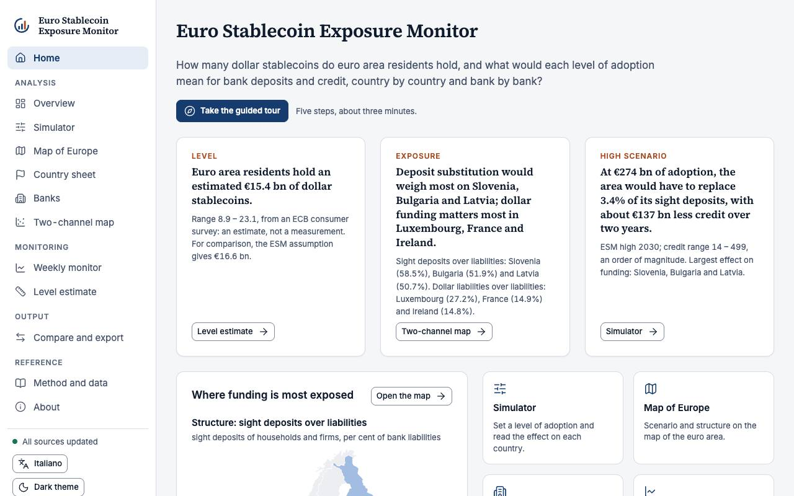
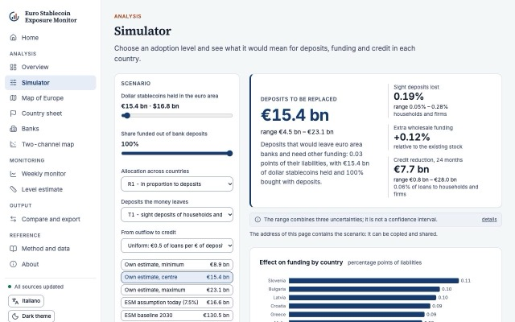
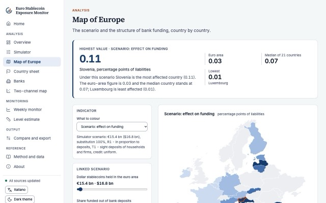
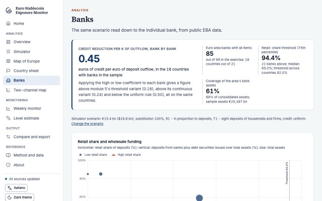

# Euro Stablecoin Exposure Monitor

[](https://github.com/lorenzo-bianchi-lab/euro-stablecoin-exposure/actions/workflows/ci.yml)
[](https://github.com/lorenzo-bianchi-lab/euro-stablecoin-exposure/actions/workflows/weekly-update.yml)
[](https://github.com/lorenzo-bianchi-lab/euro-stablecoin-exposure/releases/latest)
[](LICENSE)

[](https://lorenzo-bianchi-lab.github.io/euro-stablecoin-exposure/)

How many dollar stablecoins (USDT, USDC) do euro area residents hold, and what would each
level of adoption mean for bank deposits, wholesale funding and credit, country by
country and bank by bank? This web application estimates the first and computes the
second, with a weekly monitor of stablecoin trading against the euro.

An independent university project (ESCP Business School) by Lorenzo Bianchi.

- **Application**: https://lorenzo-bianchi-lab.github.io/euro-stablecoin-exposure/
- **Methodological note** (PDF, two pages): https://lorenzo-bianchi-lab.github.io/euro-stablecoin-exposure/methodological-note.pdf
- **Specification and decision log**: [SPEC.md](SPEC.md)
- **Reports**, one per test and module: [reports/](reports/)
- **Summary of the latest results**, generated by the code: [SUMMARY.md](SUMMARY.md)
- **Data sources and terms of use**: [DATA_SOURCES.md](DATA_SOURCES.md)
- **Changes by version**: [CHANGELOG.md](CHANGELOG.md) · **How to cite**: [CITATION.cff](CITATION.cff)

<table>
<tr>
<td width="33%"><a href="https://lorenzo-bianchi-lab.github.io/euro-stablecoin-exposure/#/simulator"></a><br><b>Simulator</b>: set a level of adoption and read deposits, funding and credit by country.</td>
<td width="33%"><a href="https://lorenzo-bianchi-lab.github.io/euro-stablecoin-exposure/#/map"></a><br><b>Map of Europe</b>: the scenario and the structure of bank funding, country by country.</td>
<td width="33%"><a href="https://lorenzo-bianchi-lab.github.io/euro-stablecoin-exposure/#/banks"></a><br><b>Banks</b>: the same scenario applied to 85 euro area banks from public EBA data.</td>
</tr>
</table>

## Key findings

At the data of 27 November 2026 (bank balance sheets of October 2026). The application and
[SUMMARY.md](SUMMARY.md) always show the latest figures.

1. **Level.** Euro area residents hold an estimated **EUR 15.4 billion** of dollar
   stablecoins, in a range of EUR 8.9 to 23.1 billion. The estimate comes from the ECB
   consumer survey with stated assumptions: it is not a measurement. For comparison, the
   ESM assumption (7.5% of USDT and USDC in circulation) gives EUR 16.6 billion.
2. **Exposure.** Deposit substitution would weigh most on Slovenia, Bulgaria and Latvia,
   where sight deposits of households and firms are 51-59% of bank liabilities; dollar
   funding matters most in Luxembourg, France and Ireland (15-27% of liabilities). The
   two channels rarely coincide (rank correlation -0.67).
3. **Central scenario.** At the central level, euro area banks would have to replace
   0.19% of their sight deposits, with about EUR 7.7 billion less credit over two years
   (range 2.7 to 18.6): small for the area as a whole.
4. **High scenario.** At the ESM high assumption for 2030 (about EUR 274 billion), the
   area would replace about 3.4% of its sight deposits, with about EUR 137 billion less
   credit over two years: an order of magnitude, not a forecast.
5. **Banks.** Applied bank by bank to 85 banks (61% of the assets of resident banks), the
   coefficients of ECB Working Paper 3199 give EUR 0.45 of credit per euro of outflow,
   close to the paper's uniform rule of 0.50 and well above the country-level variant
   (0.18).
6. **Trading against the euro.** The euro accounts for 10.2% of USDT and 54.3% of USDC
   trading against fiat currencies on 24 exchanges (week of 16 November 2026). A
   pre-registered test found no predictive content of this index for deposits: it
   describes trading, it is not an early warning.

## What it does

1. **Level.** Estimates a range for the dollar stablecoins held in the euro area from an
   ECB consumer survey, with every assumption adjustable, and compares it with the ESM
   assumption.
2. **Exposure.** Ranks the 21 national banking systems by how exposed their funding is to
   a substitution of deposits, and places each on two channels: sight deposits and
   dollar funding.
3. **Scenarios.** For any amount held, computes by country the deposits to be replaced,
   the extra wholesale funding and the reduction in credit, with a range. All scenario
   calculations run in the browser.
4. **Banks.** Applies the same scenario to 85 euro area banks from the public EBA
   transparency exercise.
5. **Monitor.** Tracks the weekly share of stablecoin trading against the euro on 24
   exchanges, with a rule that flags unusual weeks.
6. **Export.** Compares two scenarios, downloads every table as CSV and prints a
   two-page report.

The reference is ECB Working Paper No 3199, "Stablecoins and monetary policy
transmission" (March 2026). Scenarios are assumptions, not forecasts.

## Open it

Open the link above. No account, no installation; it works from a phone (390 px) up.

- English by default; **Italiano** in the side bar. The choice is kept in the address
  (`?lang=it`), like the scenario, so any page can be shared as a link.
- Light and dark theme follow the system; the side bar has a switch.
- **Guided tour**: "Take the guided tour" on the home page. Five steps, also usable as a
  script for a demo:
  1. *Home*: the three results at the latest data.
  2. *Simulator*: pick the preset "ESM high 2030" and read deposits and credit.
  3. *Map of Europe*: the same scenario by country; the top country is already selected.
  4. *Banks*: the scenario down to the single bank; open a bank's sheet.
  5. *Weekly monitor*: the index of trading against the euro and its flags.

## Run it locally

Tested with Python 3.14, Node.js 24 and Google Chrome (Chrome is needed only for the
browser tests, the screenshots and the PDF note).

```bash
git clone https://github.com/lorenzo-bianchi-lab/euro-stablecoin-exposure.git
cd euro-stablecoin-exposure
python3 -m venv .venv
.venv/bin/pip install -r requirements.txt -r requirements-dev.txt   # pinned versions
cd web
npm ci
npm run dev                                   # the application at http://localhost:5173
```

The repository already contains the data and the built application (`docs/`), so the
application also opens from any static server without building:
`python3 -m http.server -d docs 8000`, then http://localhost:8000.

## Update the data

```bash
.venv/bin/python src/run_all.py               # all modules from the sources, about 5 minutes, no API keys
.venv/bin/python src/run_all.py --offline     # recompute from the data already downloaded
cd web
npm run note                                  # methodological note with the new figures
npm run build                                 # application into ../docs
```

`run_all.py` runs the modules in order, then writes [SUMMARY.md](SUMMARY.md) and the
JSON files the application reads (`web/public/data/`). If a source does not respond, the
module that uses it fails, its previous results are kept, the others go on, and the
application flags the source in the side bar and in "Method and data".

**Automatic update.** A GitHub Action ([weekly-update.yml](.github/workflows/weekly-update.yml))
does all of the above every Monday at 06:00 UTC, runs every test and publishes. If a test
fails nothing is published and the site stays as it was.

**How to check that the scheduled run started by itself.** Scheduled runs can start
late, and GitHub disables schedules after 60 days without repository activity.

- On GitHub: *Actions* → *Weekly update*; a scheduled run shows the event `schedule`
  (manual ones show `workflow_dispatch`).
- From a terminal: `gh run list --workflow weekly-update.yml --event schedule --limit 5`
- In the repository: a commit by `github-actions[bot]` titled
  "Automatic data update (date, complete)" on that Monday.
- In the application: "Data updated on ..." in the side bar shows that Monday.

To start a run by hand: `gh workflow run weekly-update.yml`, or *Run workflow* on the
same page.

## Tests and checks

```bash
.venv/bin/python -m unittest discover -s tests -v   # balance sheets, scenarios, data layer, banks, reproducibility
.venv/bin/ruff format --check src tests             # Python formatting
.venv/bin/ruff check src tests                      # Python static checks
cd web
npm run format:check && npm run lint && npm run typecheck   # TypeScript formatting and static checks
npm test            # the application's calculations against the Python modules; translations; colour contrast
npm run build
npm run e2e         # every page in the browser: both languages, both themes, 1280 and 390 px
npm run shots       # screenshots of every page (optional)
```

The browser test checks, among other things, that no page logs an error, that every
chart is completely drawn after three seconds (also with the tab in the background),
that text meets AA contrast, that every page works from the keyboard and that the
printable report is two pages. The same checks run on GitHub on every push and pull
request ([ci.yml](.github/workflows/ci.yml)).

## Repository structure

| Path | Content |
|---|---|
| `src/` | Python modules: `module1_level.py` to `module6_banks.py`, `level_own.py`, `run_all.py`, `summary.py`, `export_app_data.py`; scripts of the preliminary tests |
| `data/raw/` | Data as downloaded from the sources (for the EBA exercise, the rows used) |
| `data/processed/` | Tables and summaries produced by the modules |
| `data/archive/` | Data of the methods tried and discarded at the start, with a README |
| `web/` | The application: React, Vite, TypeScript, ECharts |
| `web/src/styles/tokens.css` | The design system: colours, type, spacing, chart palette, both themes |
| `web/src/i18n/` | Interface texts in English and Italian, one file per section |
| `web/public/data/` | The data layer: JSON files read by the application, described in its README |
| `web/tests/` | Tests of the application, screenshots, methodological note |
| `docs/` | The built application, published with GitHub Pages |
| `reports/` | One report per test and module; `reports/figures/` holds charts and screenshots |
| `tests/` | Python tests |
| `.github/workflows/` | Continuous checks and the weekly automatic update |

No API keys are needed: every source is public and free. If keys are ever added they go
in `.env` (excluded from git; see `.env.example`).

## Limits

- **No measurement of residence.** Holdings by euro area residents are not observed.
  The level is a survey-based estimate from 11 countries extended to 21, and two other
  routes attempted did not confirm it.
- **No country-level adoption.** The allocation rules distribute a total; they do not
  measure national holdings.
- **No causal estimate.** Credit effects apply coefficients published in ECB Working
  Paper 3199, estimated on individual banks, to national aggregates and to consolidated
  banks: orders of magnitude, not forecasts.
- **No early warning.** The flagging rule marks unusual weeks; a pre-registered test
  found no predictive content for deposits.
- **Rankings describe funding structure**, not the probability of outflows nor the
  soundness of any banking system or bank.
- **Bank data** are public data on consolidated groups dated June 2025, with no currency
  breakdown; three countries have no bank in the sample.
- **Not covered**: over-the-counter and peer-to-peer trading, decentralised finance,
  stablecoins other than USDT and USDC, future adoption.

The full list, with the methods tried and discarded, is in [SPEC.md](SPEC.md) and in
"Method and data" in the application.

## Author and licence

Lorenzo Bianchi, ESCP Business School.

The code is released under the [MIT License](LICENSE). The data remain under the terms
of their providers, listed with the required attributions in
[DATA_SOURCES.md](DATA_SOURCES.md). Typefaces: Source Serif 4 and Inter (SIL Open Font
License 1.1); icons: Lucide (ISC); charts: Apache ECharts (Apache 2.0). Country
boundaries: Eurostat GISCO, © EuroGeographics for the administrative boundaries.
