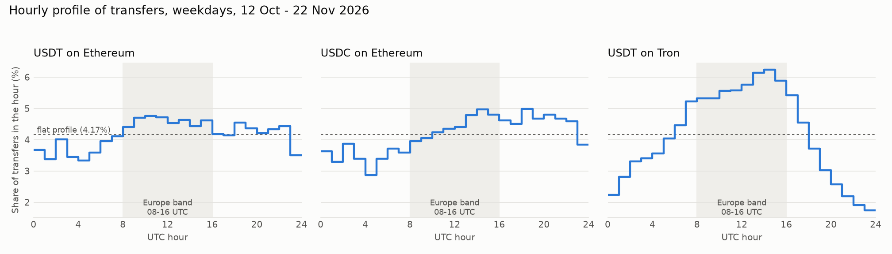

# 00 - Feasibility test of hypothesis H1

> **H1**: independent public indicators give mutually consistent estimates of the share
> of dollar stablecoin assets (USDT, USDC) attributable to the euro area.

This document is written in two stages. Sections 1 and 2 (criterion and method) were
committed **before** any volume or hourly profile was downloaded: the git history shows
this. The following sections report the results.

## 1. Decision criterion (set before the results)

Let R be the ratio between the higher and the lower of the two proxies' central estimates.

| R | Verdict |
|---|---|
| R ≤ 2 | GO |
| 2 < R ≤ 4 | GO WITH RESERVATIONS (wide range, to be declared) |
| R > 4 | NO-GO |

The verdict is calculated on the two **central estimates** defined below. The ranges
serve to describe the uncertainty and do not change the verdict.

## 2. Pre-registered method

Window common to both proxies: six complete weeks, from Monday 2026-10-12 00:00 UTC
to Monday 2026-11-23 00:00 UTC (42 days).

### 2.1 Proxy 1 - Exchanges

- **Quantity**: share of USDT and USDC spot volumes traded against EUR in total volumes
  traded against fiat currencies.
- **Universe**: all spot stablecoin/fiat pairs (in both directions, for example
  USDT/EUR and EUR/USDT) on the exchanges that expose daily candles through a free
  public API without a key and that are reachable. The list is closed on the basis of
  reachability, not of observed volumes.
- **Unit**: volume expressed in stablecoin units (roughly dollars). If the stablecoin
  is the base currency, the base volume is used; if it is the quote currency, the quote
  volume is used or, if that is missing, base volume times closing price.
- **Central estimate P1**: sum of volumes against EUR divided by the sum of volumes
  against all fiat currencies, USDT and USDC together, over the whole window.
- **Range P1**: minimum and maximum among (a) the six weekly shares, (b) the share
  calculated on USDT only and on USDC only, (c) the share derived from a 24-hour
  snapshot of CoinGecko tickers, which covers more exchanges but a single day
  (excluding tickers flagged as anomalous or stale).
- **Robustness** (reported, outside the range): exclusion of one exchange at a time;
  EUR share of total non-dollar fiat currencies.

### 2.2 Proxy 2 - On-chain hours

- **Quantity**: share of on-chain transfers consistent with European working hours.
- **Series**: USDT on Ethereum, USDC on Ethereum, USDT on Tron (USDC on Tron is no
  longer supported by the issuer and is excluded).
- **Data**: `Transfer` events of the contracts, read from public RPCs. A full census
  is not feasible for free (around one million events per day on Ethereum and several
  million on Tron), so a **systematic block sample** is used: one block in every 50 on
  Ethereum and one in every 200 on Tron, i.e. about six blocks per hour on each
  network. The sampling is uniform over time and does not alter the hourly profile.
  These are real sampled data, not simulated.
- **Main metric**: number of transfers (excluding minting and burning, i.e. from or to
  the zero address). Sensitivity metrics: "retail"-size transfers (between 1 and 10,000
  dollars) and value transferred.
- **Hourly profile**: average transfers per sampled block in each of the 24 UTC hours.
  Main version on weekdays only (Monday-Friday UTC); sensitivity version on all days.
- **Method A (main), decomposition into three bands**: the profile is modelled as a
  flat component (automated activity 24 hours a day, not attributed) plus three
  non-negative regional components. Each regional component equals 1 in local working
  hours 09:00-18:00 and 0 elsewhere, with reference time zones Asia/Shanghai,
  Europe/Berlin and America/New_York and actual daylight saving time day by day. The
  weights are estimated with non-negative least squares. Europe share = Europe weight
  divided by the sum of the three regional weights.
- **Method B (sensitivity), simple partition**: share of activity falling in the
  08:00-16:00 UTC band, with Asia 00:00-08:00 and the Americas 16:00-24:00. With a flat
  profile this method returns 33.3% by construction.
- **Central estimate P2**: simple average of the method A Europe share over the three
  series, main metric, weekdays.
- **Range P2**: minimum and maximum over all combinations of series, metric, method
  and set of days.

### 2.3 Limitations known at the outset

- European hours include the United Kingdom, Switzerland and Africa and do not
  distinguish the euro area from the rest of the time zone.
- Exchange volumes measure trading, not holdings.
- The two proxies do not measure the same quantity: the first is a currency share
  (EUR in fiat), the second a time-zone share. The consistency between the two is
  exactly what H1 puts to the test.

## 3. Results

Run on 2026-11-23. All figures are reproducible with the scripts in `src/` starting
from the files in `data/raw/`.

### 3.1 Verdict

| | Central estimate | Range |
|---|---|---|
| Proxy 1 - EUR share of stablecoin/fiat volumes | **24.3%** | 11.9% - 50.4% |
| Proxy 2 - on-chain "European hours" share | **52.4%** | 27.3% - 85.0% |

**R = 52.4 / 24.3 = 2.16 → GO WITH RESERVATIONS.**

The verdict is the one the pre-registered criterion produces, and it has not been
adjusted. It should, however, be read with three caveats, developed in section 4:

- R is close to the threshold between GO and GO WITH RESERVATIONS. The sampling
  uncertainty of proxy 2 alone (resampling of days, 95%: 45.4% - 61.0%) moves R between
  1.87 and 2.51.
- The ranges of the two proxies overlap, but they are very wide: combining the
  extremes, R goes from 1 to 7.1.
- Both estimates are well above the published benchmarks for the euro area (7.5% - 15%).
  The consistency found concerns two measures of "activity in euro or in European
  hours", not the share held by euro area residents.

### 3.2 Sources used and period

Period: 2026-10-12 - 2026-11-22 (42 days, six complete weeks) for both proxies.

| Data | Source | API key | Coverage |
|---|---|---|---|
| Daily stablecoin/fiat volumes | Public APIs of 25 exchanges: Binance, Binance.US, Kraken, Coinbase, Bitstamp, OKX, Bybit, Upbit, Bithumb, Coinone, Korbit, BtcTurk, Bitvavo, Bitfinex, Gemini, Crypto.com, KuCoin, Gate, Bitget, MEXC, WhiteBIT, Indodax, CoinDCX, BTC Markets, Bitso | no | 142 pairs with data, USD 53.7 billion traded |
| 24-hour ticker snapshot | CoinGecko, public API | no | 142 valid tickers on 48 exchanges, USD 1.03 billion, taken on 2026-11-23 between 07:16 and 09:38 UTC |
| USDT and USDC transfers on Ethereum | Public RPCs dRPC and MEV Blocker (`eth_getLogs`) | no | 6,029 sampled blocks (one in every 50), 1,082,677 transfers |
| USDT transfers on Tron | Public RPCs PublicNode, TronGrid for the headers | no | 6,046 sampled blocks (one in every 200), 489,934 transfers |

No source required an API key. No sampled block was lost.

### 3.3 Proxy 1 - Exchanges

EUR share of total volumes against fiat, USDT and USDC together: **24.3%**.

| Currency | Share of volume | of which USDT (USD bn) | of which USDC (USD bn) |
|---|---|---|---|
| USD | 41.2% | 16.6 | 5.5 |
| EUR | 24.3% | 4.3 | 8.7 |
| KRW | 17.0% | 8.1 | 1.0 |
| BRL | 7.5% | 3.3 | 0.8 |
| TRY | 3.5% | 1.7 | 0.2 |
| GBP | 2.2% | 0.6 | 0.6 |
| other 19 currencies | 4.2% | | |

Components of the range:

| Variant | EUR share |
|---|---|
| Week by week (six values) | from 22.4% to 25.2% |
| USDT only | 11.9% |
| USDC only | 50.4% |
| CoinGecko snapshot, 48 exchanges, 24 hours | 24.3% |

Robustness, outside the range:

- Removing one exchange at a time, the share stays between 20.7% and 26.7%. The panel
  is, however, concentrated: Kraken accounts for 39.7% of volume, Binance for 15.2%,
  Coinbase for 9.3%.
- EUR share of non-dollar fiat currencies only: 41.3%.
- CoinGecko flags the USDT/KRW tickers of Upbit, Bithumb and Coinone as "anomalous".
  If they are included, the snapshot share falls to 20.5%. The pre-registered rule
  excludes them; in the six-week panel those same exchanges are included.

Reading: stability over time is high (less than three points from one week to the
next), stability across tokens is low. USDC is traded against the euro four times more
than USDT, and this gap generates almost all of the width of the range.

### 3.4 Proxy 2 - On-chain hours



Weekdays, number of transfers (main metric):

| Series | Method A: Europe share | Flat component | Method B: 08-16 UTC band |
|---|---|---|---|
| USDT on Ethereum | 63.6% | 90% | 36.8% |
| USDC on Ethereum | 32.3% | 86% | 35.6% |
| USDT on Tron | 61.3% | 58% | 45.8% |
| **Average (central estimate)** | **52.4%** | | 39.4% |

With a perfectly flat profile, method B would give 33.3%.

The range 27.3% - 85.0% covers the 36 combinations of series, metric, method and set
of days (full table in `data/processed/proxy2_decomposition.csv`). Restricting to the
main metric, the range is 27.3% - 63.6%. The upper extreme comes from the value
transferred on Tron, which is dominated by a few very large transfers.

Reading, in order of importance:

- On Ethereum the profile is almost flat: each hour accounts for between 2.9% and 5.0%
  of the total and the flat component absorbs 86% - 90% of activity. The method A
  Europe share is therefore calculated on about one tenth of transfers.
- Method A assigns zero weight to Asia on Ethereum. This is not a credible result: the
  flat component absorbs the minimum level of the day, which falls in Asian hours, and
  the share of the other two bands is inflated.
- On Tron the daily cycle is clear (from 1.7% to 6.2% per hour) but it does not have
  the shape of European office hours: it rises from 00 UTC and peaks at 13-15 UTC. It
  is consistent with waking hours in Asia combined with the working day of the Middle
  East, Turkey, Russia and Africa, which share the European time band.

### 3.5 External benchmark

Update of 2026-11-24: all the figures in this table have been checked again against
the original documents. The value, period, sample and page of each are in
[02_benchmarks_and_module3_data.md](02_benchmarks_and_module3_data.md), part A. No source publishes a
**measured** euro area share of dollar stablecoins.

| Source | Figure | What it measures | Where |
|---|---|---|---|
| [ESM Working Paper 79](https://www.esm.europa.eu/system/files/document/2026-10/WP%2079.pdf), 2026 | 7.5% (high scenario 15%) | Euro area share of global circulation of dollar stablecoins. It is a calibration assumption, not an estimate | Section 5.1, pp. 47-48 |
| [ESMA, "Crypto assets: Market structures and EU relevance"](https://www.esma.europa.eu/sites/default/files/2024-04/ESMA50-524821-3153_risk_article_crypto_assets_market_structures_and_eu_relevance.pdf), 2024 | about 10% | EUR share of fiat-crypto volumes, all crypto-assets, Kaiko data from Dec 2020 to Dec 2023 | p. 7, chart 5 |
| [Kaiko, "The State of the European Crypto Market 2025-2026"](https://resources.kaiko.com/hubfs/Research/The%20State%20of%20the%20European%20Crypto%20Market%20-%202025%20-%202026%20Trends%20in%20Trading%20Activity.pdf), May 2026 | 9.0% | EUR share of global crypto-fiat volume, first quarter of 2026 | Part 1, p. 2 |
| [Chainalysis](https://www.chainalysis.com/blog/western-europe-crypto-adoption-2026/), Nov 2026 | 11.8% | Euro trading as a share of crypto volume against 33 fiat currencies, end of the period July 2025 - June 2026 | Article text |
| [Chainalysis](https://www.chainalysis.com/blog/2024-western-europe-crypto-adoption/), Oct 2024 | 24% | EUR share of stablecoin purchases against fiat currencies. The only stablecoin-specific figure; period and sample not declared | Article text |
| [IMF WP/25/141](https://www.elibrary.imf.org/view/journals/001/2025/141/article-A001-en.xml), Reuter, 2025 | 21.4% | "Europe" in the broad sense as a share of 2024 USDT and USDC flows (own calculation: 334 out of 1,561 billion). Also uses hourly profiles | Table 6 |
| [Bruegel Policy Brief 09/2026](https://www.bruegel.org/policy-brief/new-strategy-contain-stablecoin-risks-european-union), 2026 | 38% | Stablecoin transactions attributed to Europe by time zone, fourth quarter of 2025, Artemis data | Figure 3b |
| [Chainalysis](https://www.chainalysis.com/blog/western-europe-crypto-adoption-2026/), Nov 2026 | 5.1% | Western Europe share of global stablecoin balances, July 2025 - June 2026 | Article text |
| [ECB, Economic Bulletin 7/2026](https://www.ecb.europa.eu/press/economic-bulletin/focus/2026/html/ecb.ebbox202607_08~f4ddf0117c.en.html) | 5% | Euro area consumers who report owning stablecoins, August 2025, CES survey in 11 countries. It is a prevalence, not a share of supply | Chart B, panel a |

The project's reference document, [ECB Working Paper 3199](https://www.ecb.europa.eu/pub/pdf/scpwps/ecb.wp3199~ad552b59ec.en.pdf)
("Stablecoins and monetary policy transmission", March 2026), studies deposit
substitution with granular data on euro area banks. A search of the text finds no euro
area share of stablecoins.

Comparison:

- Proxy 1 (24.3%) matches the only published stablecoin-specific figure (Chainalysis
  2024: 24%) and is about twice the EUR share of overall crypto trading (9% - 12%).
- Proxy 2, method B (36% - 46%), is of the same order of magnitude as the other
  time-zone estimate (Bruegel/Artemis: 38%). Method A (52.4%) is above every benchmark.
- Both are well above the supply shares referring to the euro area or to Western
  Europe (5.1% - 15%).

## 4. Limitations

The three main ones:

1. **Proxy 2 does not identify the euro area, and barely identifies Europe.** On
   Ethereum 86% - 90% of activity has no daily cycle (bots, arbitrage, protocols) and
   the share is estimated on the residual. The European band overlaps with the Asian
   evening and the American morning and includes the United Kingdom, Switzerland,
   Africa, the Middle East, Turkey and Russia. The zero weight for Asia on Ethereum
   shows that the chosen decomposition does not separate the three bands well.
2. **Proxy 1 measures trading in euro, not holdings or residence.** It covers only
   centralised order books with public candles: OTC, P2P, direct issuance and
   redemption, and purchases of stablecoins against other crypto-assets are left out.
   A euro pair can be used by non-residents and by market makers. The result depends
   heavily on composition: a single exchange accounts for 40% of volume and the share
   goes from 12% (USDT) to 50% (USDC).
3. **The consistency found is weak and partly nominal.** The two proxies measure
   different quantities and neither is close to the euro area benchmarks. R lies
   between 1.6 and 2.5 depending on specification choices that are all reasonable (for
   example R = 1.62 using method B instead of method A), so the verdict is not robust
   with respect to the threshold of 2.

Other limitations:

- The on-chain data are a sample (2% of Ethereum blocks, 0.5% of Tron blocks). The
  sampling error on counts is small; on value transferred it is large.
- Only Ethereum and Tron are covered. Solana, BNB Chain and layer-2 networks, through
  which a significant part of USDC and USDT passes, are missing.
- The window contains the clock change in Europe (25 October) and in the United States
  (1 November). The regional profiles take this into account day by day.
- Six weeks say nothing about long-term stability.
- Volumes reported by exchanges may include fictitious trades. No filter was applied,
  so as not to introduce subjective choices after seeing the data.

## 5. What could not be done

- **Full census of transfers**: with free RPCs it would require tens of gigabytes and
  many hours. A systematic sample was used.
- **Dune, Etherscan, BigQuery**: they require a key or an account and were not used.
  A free Dune key would allow a full census and address-level analysis; it was not
  needed for this test.
- **TronGrid without a key** is limited to 3 requests per second: replaced with
  PublicNode.
- **Exchanges not reached or without free history**: Mercado Bitcoin (HTTP 403),
  Bitkub (HTTP 502), HTX (invalid fiat symbols), Luno (candles only with
  authentication), Paribu, Independent Reserve, Coins.ph, Bit2Me. Some appear only in
  the CoinGecko snapshot. bitFlyer does not list stablecoins. One Bitget pair
  (RON/USDT) returned an error and 12 Binance pairs have no data in the window.
- **CoinGecko history**: the free API gives only the last 24 hours. The snapshot is
  from Monday morning and largely covers Sunday.
- **USDC on Tron**: excluded, as the issuer no longer supports it.
- **Distinction between the euro area and the rest of Europe**: neither proxy allows it.
- **Independent check of the benchmarks**: the "second-hand" figures and those read
  only on the web page were not checked again against the original documents. The
  Kaiko PDF and the Bloomberg and Bitvavo pages were not accessible.

## 6. Pointers for the next step

- Keep proxy 1 as the main indicator, always separating USDT and USDC.
- Replace proxy 2 with a measure that identifies residence: deposit addresses of
  European exchanges, or the IMF method (regional labels plus hourly profiles by
  address). Both require address-level data, hence a Dune key.
- Add a third independent proxy (for example web traffic or app downloads by country)
  before allocating the share among national banking systems.

## 7. Reproducibility

```bash
python3 -m venv .venv && .venv/bin/pip install -r requirements.txt
.venv/bin/python src/exchange_fetch.py      # daily volumes, about 1 minute
.venv/bin/python src/coingecko_snapshot.py  # 24-hour snapshot, about 15 minutes
.venv/bin/python src/onchain_fetch.py       # block sample, about 30 minutes
.venv/bin/python src/proxy1_exchange.py
.venv/bin/python src/proxy2_onchain.py
.venv/bin/python src/h1_decision.py
```

Rerunning the collection scripts on another day changes the CoinGecko snapshot; the
data for the window 12 October - 22 November remain the same.

---

**What this adds to the final programme**: the EUR share of stablecoin/fiat volumes
(24.3%, stable between 22.4% and 25.2% over the six weeks), which becomes the module 2
index with data collection already working on 25 exchanges, and the evidence that the
on-chain hourly profile does not distinguish Europe and should not be used.
