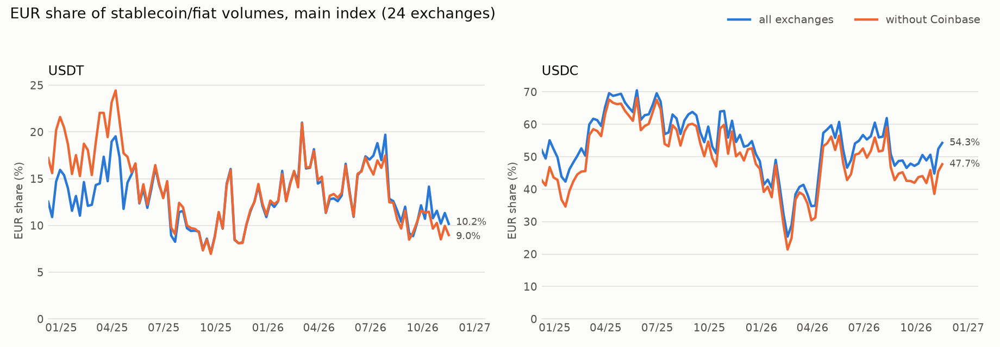
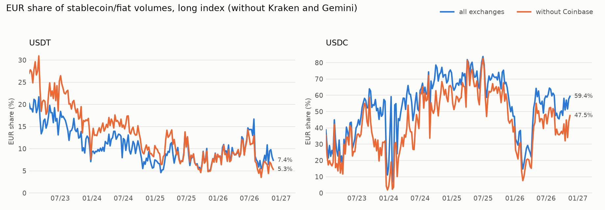

# 03 - Module 2: weekly index of the EUR share

Module 2 of [SPEC.md](../SPEC.md) asks for a weekly index of the EUR share of
stablecoin/fiat spot volumes, separately for USDT and USDC, with and without Coinbase.

Sections 1 and 2 (depth of history and method) were committed **before** the series
were calculated. Only the values for the last six weeks were already known, from test 00.

## 1. Depth of history by exchange

Measured on 2026-11-24 by requesting daily candles from 2023-01-02 from each API.

| History available | Exchange | Cause of the limit |
|---|---|---|
| From at least 2023-01-02 | Binance, Binance.US, Coinbase, Bitstamp, OKX, Bybit, Korbit, BtcTurk, Bitvavo, Bitfinex, Crypto.com, KuCoin, Gate, Bitget, WhiteBIT, Indodax, BTC Markets, Bitso | None within the requested window |
| From 2023-11-29 | Coinone | Listing date of the pairs |
| From 2023-12-07 | Bithumb | Listing date of the pairs |
| From 2024-02 / 2024-03 | CoinDCX | The API returns at most 1,000 candles |
| From 2024-06-07 | Upbit | Listing date of the pairs |
| From 2024-11 / 2025-02 | MEXC | Listing date of the pairs |
| **From 2024-12-04** | **Kraken** | **The API returns only the last 720 candles** |
| From 2025-11-25 | Gemini | The API returns a fixed window of about one year |

Kraken is the constraint that matters: in test 00 it accounted for 40% of the panel's
volumes. Its limit is rolling (720 days back from today), so the history has to be
accumulated: downloaded volumes are saved in an archive that grows with each run and no
longer depends on what the API returns in future.

## 2. Method (set before the calculation)

### 2.1 Definition

For each week from Monday to Sunday (UTC), for each stablecoin and for a given set of
exchanges:

    index = volume traded against EUR / volume traded against all fiat currencies

with volumes expressed in units of stablecoin, as in proxy 1 of test 00. Only complete
weeks are calculated.

### 2.2 The series

Four main series, as required by SPEC:

| Series | Stablecoin | Exchanges |
|---|---|---|
| `usdt` | USDT | all |
| `usdt_senza_coinbase` | USDT | all except Coinbase |
| `usdc` | USDC | all |
| `usdc_senza_coinbase` | USDC | all except Coinbase |

In addition, for reference only, the `total` series (USDT and USDC together), which
corresponds to proxy 1 of test 00.

### 2.3 Two windows

- **Main index**: full panel of the 25 exchanges, from the week of 2024-12-09 (the first
  full week covered by Kraken) to the last closed week.
- **Long index**: the same four series from 2023-01-02, calculated **without Kraken and
  without Gemini** in all weeks, because their history does not go back that far. It
  serves to show the trend over four years; its level is not comparable with that of the
  main index. The two series overlap from 2024-12-09, and the difference between them
  over that stretch is reported.

### 2.4 Panel and log

- The panel is the list of pairs in `src/exchange_fetch.py`, fixed on 2026-11-23.
  No exchanges are added or removed on the basis of the results.
- For each week and each exchange, the days with data and the volume are recorded. An
  exchange "enters" in the first week in which it has data and "exits" in the last;
  entries and exits are listed with their dates.
- Gemini enters the main index from the week of 2025-12-01. It is the only entry due to
  an API limit rather than to a market event.
- Robustness check: the same series on a **constant panel**, that is, only the exchanges
  present in every week of the window.

### 2.5 What the analyst receives

For each series: the value for the latest week, the change on the previous week in
percentage points, the average of the last 4 weeks, the mean and standard deviation of
the last 52 weeks, and the standardised deviation of the latest week from those 52.

### 2.6 Reproducibility

- Daily volumes are saved in a cumulative archive
  (`data/raw/m2_daily_volumes.csv`). A day already archived is not overwritten.
- At each run the newly downloaded values are compared with those in the archive and
  the differences are recorded.
- The check required by SPEC consists of two consecutive runs: the second must give the
  same values for all closed weeks. The report also gives how much the index would
  change if only the re-downloaded data were used.

### 2.7 Limits known at the outset

- The index measures euro trading on centralised order books, not holdings or residence.
- Bithumb and Korbit close the day at 00:00 Korean time and Bitso at 06:00 UTC:
  the weekly boundary for these exchanges is shifted by a few hours.
- The volumes reported by the exchanges are not filtered.

## 3. Results

Calculated on 2026-11-24. Last closed week: 16-22 November 2026.

### 3.1 The number for the week

Main index, 25 exchanges, 102 weeks from 9 December 2024.

| Series | Latest week | Change on previous week | 4-week average | 52-week average | 52-week std. dev. | Standardised deviation |
|---|---|---|---|---|---|---|
| USDT | **11.9%** | 0.0 points | 11.5% | 14.2% | 2.9 | -0.79 |
| USDT without Coinbase | **10.9%** | +0.3 points | 10.2% | 13.9% | 2.8 | -1.08 |
| USDC | **54.9%** | +2.1 points | 50.9% | 48.9% | 8.4 | +0.71 |
| USDC without Coinbase | **48.5%** | +2.6 points | 44.9% | 45.0% | 8.2 | +0.43 |
| Total (reference) | 24.7% | -0.4 points | 24.4% | 24.3% | 3.1 | +0.16 |

Reading: none of the four series is outside its usual range. USDT against the euro is
about one standard deviation below its average over the past year; USDC is slightly
above.



### 3.2 What happened in two years

| Series | Average of first 13 weeks | Average of last 13 weeks | Minimum | Maximum |
|---|---|---|---|---|
| USDT | 13.4% | 11.5% | 7.1% (22 Sep 2025) | 21.2% (2 Mar 2026) |
| USDT without Coinbase | 18.1% | 10.8% | 7.0% (22 Sep 2025) | 24.7% (7 Apr 2025) |
| USDC | 50.3% | 49.1% | 25.4% (16 Feb 2026) | 70.5% (26 May 2025) |
| USDC without Coinbase | 43.5% | 43.9% | 21.4% (16 Feb 2026) | 68.2% (26 May 2025) |
| Total | 16.4% | 22.0% | 13.5% (16 Dec 2024) | 31.1% (27 Jul 2026) |

Three facts the index shows:

- **The euro is losing ground on USDT and holding it on USDC.** Outside Coinbase the EUR
  share of USDT fell from 18% to 11%. That of USDC stayed at around 44%.
- **The total share rises because of composition, not because the euro is gaining.** As
  a weekly average, between the first and the last six months USDT volumes against fiat
  fell from USD 10.0 billion to USD 5.8 billion and USDC volumes rose from 1.4 to 2.2.
  Because USDC is traded against the euro much more than USDT, the total rises (from 16%
  to 22% between the first and the last 13 weeks). This is why
  the two stablecoins have to be read separately.
- **In absolute terms**: weekly USDT volumes against the euro went from 1.4 to
  0.8 billion; USDC volumes against the euro from 0.8 to 1.1 billion. More USDC than
  USDT is now traded against the euro.

The weight of Coinbase: 14.3% of the panel's USDT volumes and 12.6% of its USDC volumes.
Removing it lowers the USDC index by 1-9 points depending on the week (median 4),
without changing its trend.

### 3.3 A warning that the index itself revealed

The USDC low in February 2026 (25%) is not a fall in the euro. In those weeks USDC
volumes against the euro stayed between 1.0 and 1.4 billion, while USDC volumes against
the Korean won rose from 0.8 to 2.2 billion a week. The index is a share: it also moves
when the other currencies move.

For this reason the index file also contains the volumes against the euro in absolute
terms (`volume_eur_usdt_bn`, `volume_eur_usdc_bn`). Before interpreting a change in
the index, it is advisable to look at those two columns.

### 3.4 Long index (from 2023, without Kraken and Gemini)



Annual averages, 203 weeks from 2 January 2023:

| Year | USDT | USDT without Coinbase | USDC | USDC without Coinbase |
|---|---|---|---|---|
| 2023 | 15.8% | 21.7% | 40.2% | 30.0% |
| 2024 | 10.3% | 14.0% | 59.3% | 46.7% |
| 2025 | 8.0% | 8.9% | 68.8% | 61.3% |
| 2026 | 10.5% | 9.6% | 47.0% | 36.7% |

Over the stretch it shares with the main index (from December 2024) the long index is on
average 4.4 points lower on USDT and 5.2 points higher on USDC, with correlations
between 0.71 and 0.87. It should be used for direction, not for level: it confirms the
long-term decline of the euro on USDT and the growth of USDC against the euro up to 2025.

### 3.5 Panel and log

- **153 pairs with data**, of which 24 against the euro. Only one pair returns an error (RON/USDT on Bitget).
- **Active exchanges per week** in the main index: 24 until November 2025, then 25.
- **Entries**, all documented in `data/processed/m2_panel_changes.csv`:

| Exchange | First week with data | Cause |
|---|---|---|
| MEXC | 2023-02-06 | Listing |
| Coinone | 2023-11-27 | Listing |
| Bithumb | 2023-12-04 | Listing |
| CoinDCX | 2024-01-29 | API limit (1,000 candles) |
| Upbit | 2024-06-03 | Listing |
| Kraken | 2024-12-02 | API limit (720 candles) |
| Gemini | 2025-11-24 | API limit (about one year) |

- **Exits**: none. No exchange with more than 1% of volume has incomplete weeks.
- **Constant panel** (24 exchanges, all except Gemini): maximum difference from the
  main index 0.3 points on USDT and 1.1 points on USDC.
- **Concentration**: Kraken 33% of volume, Binance 14%, Coinbase 14%, Bithumb 10%, Upbit 8%.

The detail by exchange and week (days with data, volume, volume against the euro) is in
`data/processed/m2_exchange_participation.csv`.

### 3.6 Reproducibility

| Run | What it did | Outcome |
|---|---|---|
| 1 | Full download from 2023-01-02: 127,529 daily observations | Archive created |
| 2 | Second full download, compared with the archive | 127,529 identical observations; index identical in all 102 weeks |
| 3 | Ordinary update: re-downloads the last five weeks | 4,730 observations compared, 1 revised by the source; index identical |

The only revision is from Korbit (USDT/won for 17 November 2026, -0.9%). The archive is
not overwritten: the difference is recorded in `data/processed/m2_revisions.csv`.

### 3.7 SPEC completion criteria

| Criterion | Status |
|---|---|
| (a) Four weekly series for the whole available history, with the period stated | Done: 102 weeks (main), 203 (long) |
| (b) Contributing exchanges recorded for each week | Done |
| (c) Fixed panel, or entries and exits documented | Done: panel fixed on 2026-11-23, seven entries documented |
| (d) A second run reproduces the closed weeks | Done: three runs, zero difference |
| (e) Stated that it measures euro trading, not holdings or residence | Done, section 4 |

## 4. Limits

- **It measures trading, not holdings or residence.** A high EUR share says that a lot
  is traded against the euro on those order books, not that euro area residents hold more.
- **The panel contains only the pairs listed on 23 November 2026.** Pairs removed
  before that date are also missing from the history. I tried to recover one
  (USDT/EUR on Bitvavo): the API no longer returns it. The EUR share of USDT in
  2023-2024 is therefore probably underestimated, and part of its decline could be
  larger than the index shows.
- **It is a share, so it depends on the denominator** (section 3.3).
- **Concentration**: a third of volume comes from Kraken. A change in its pairs would
  move the index.
- **Unfiltered volumes**: fictitious trades, if there are any, enter the calculation.
- **Weekly boundary** shifted by a few hours for Bithumb, Korbit and Bitso.
- **The standardised deviation** compares the latest week with the previous 52: it is a
  descriptive measure, not a test, and it is not an early-warning signal.

## 5. What could not be done

- **Kraken history before December 2024**: the API returns only 720 candles. There are
  two alternatives, not yet tried because they are very heavy: rebuilding the candles
  from the public list of trades (about an hour of requests per pair), and the
  downloadable historical archive that Kraken publishes separately. From now on the
  problem does not recur, because the local archive accumulates the data.
- **Recovering delisted pairs**: the APIs no longer serve them.
- **Gemini and CoinDCX history beyond the limits of their APIs**: together they account
  for less than 0.5% of volume.
- **One pair** (RON/USDT on Bitget) returns an error.

## 6. How to use it

```bash
.venv/bin/python src/module2_index.py            # weekly update
.venv/bin/python src/module2_index.py --full     # re-downloads everything and compares with the archive
.venv/bin/python src/module2_index.py --offline  # recalculates from the archive, without the network
```

| File | Contents |
|---|---|
| `data/processed/m2_weekly_index.csv` | Main index: four series, total, volumes |
| `data/processed/m2_weekly_index_long.csv` | Long index from 2023 |
| `data/processed/m2_summary.json` | Latest value, change, averages and standardised deviation for each series |
| `data/processed/m2_exchange_participation.csv` | Exchanges per week |
| `data/raw/m2_daily_volumes.csv` | Cumulative archive of daily volumes |

---

**What this adds to the final programme**: the first complete module. Four weekly
series of the EUR share (USDT and USDC, with and without Coinbase) over 102 weeks, plus
203 weeks of long history, updatable with one command and with an archive that no longer
depends on API limits; and a result that can be read straight away: the euro is
retreating on USDT (from 18% to 11% outside Coinbase) and holding on USDC (44%).
