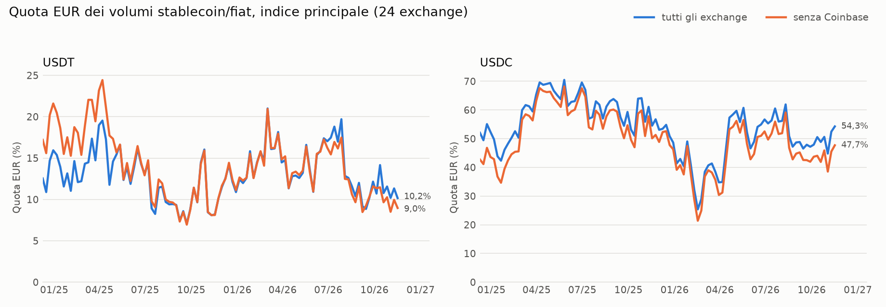
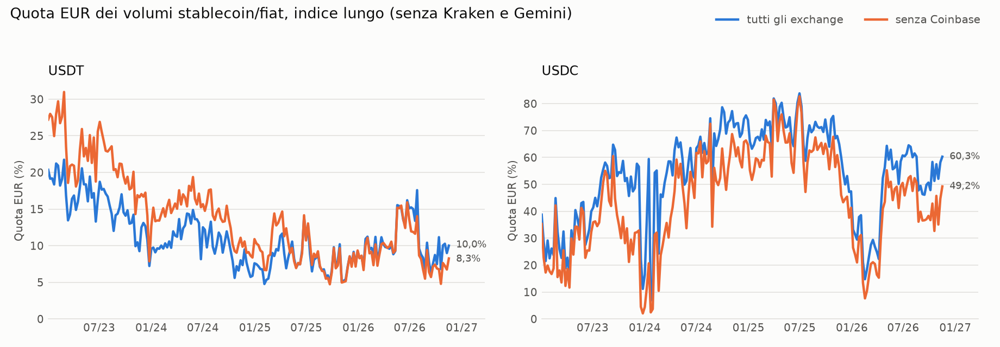

# 03 - Modulo 2: indice settimanale della quota EUR

Il modulo 2 di [SPEC.md](../SPEC.md) chiede un indice settimanale della quota EUR dei
volumi spot stablecoin/fiat, separato per USDT e USDC, con e senza Coinbase.

Le sezioni 1 e 2 (profondità dello storico e metodo) sono state committate **prima** di
calcolare le serie. Erano già noti solo i valori delle ultime sei settimane, dal test 00.

## 1. Profondità dello storico per exchange

Misurata il 2026-11-24 chiedendo a ogni API le candele giornaliere dal 2023-01-02.

| Storico disponibile | Exchange | Causa del limite |
|---|---|---|
| Almeno dal 2023-01-02 | Binance, Binance.US, Coinbase, Bitstamp, OKX, Bybit, Korbit, BtcTurk, Bitvavo, Bitfinex, Crypto.com, KuCoin, Gate, Bitget, WhiteBIT, Indodax, BTC Markets, Bitso | Nessuno entro la finestra richiesta |
| Dal 2023-11-29 | Coinone | Data di quotazione delle coppie |
| Dal 2023-12-07 | Bithumb | Data di quotazione delle coppie |
| Dal 2024-02 / 2024-03 | CoinDCX | L'API restituisce al massimo 1.000 candele |
| Dal 2024-06-07 | Upbit | Data di quotazione delle coppie |
| Dal 2024-11 / 2025-02 | MEXC | Data di quotazione delle coppie |
| **Dal 2024-12-04** | **Kraken** | **L'API restituisce solo le ultime 720 candele** |
| Dal 2025-11-25 | Gemini | L'API restituisce una finestra fissa di circa un anno |

Kraken è il vincolo che conta: nel test 00 valeva il 40% dei volumi del pannello. Il suo
limite è mobile (720 giorni da oggi), quindi lo storico va accumulato: i volumi
scaricati vengono salvati in un archivio che cresce a ogni esecuzione e non dipende più
da quanto l'API restituisce in futuro.

## 2. Metodo (fissato prima del calcolo)

### 2.1 Definizione

Per ogni settimana da lunedì a domenica (UTC), per ogni stablecoin e per un dato insieme
di exchange:

    indice = volume scambiato contro EUR / volume scambiato contro tutte le valute fiat

con i volumi espressi in unità di stablecoin, come nella proxy 1 del test 00. Si
calcolano solo le settimane complete.

### 2.2 Le serie

Quattro serie principali, come da SPEC:

| Serie | Stablecoin | Exchange |
|---|---|---|
| `usdt` | USDT | tutti |
| `usdt_senza_coinbase` | USDT | tutti tranne Coinbase |
| `usdc` | USDC | tutti |
| `usdc_senza_coinbase` | USDC | tutti tranne Coinbase |

In più, a solo titolo di riferimento, la serie `totale` (USDT e USDC insieme), che
corrisponde alla proxy 1 del test 00.

### 2.3 Due finestre

- **Indice principale**: pannello completo dei 25 exchange, dalla settimana del
  2024-12-09 (prima settimana intera coperta da Kraken) all'ultima settimana chiusa.
- **Indice lungo**: stesse quattro serie dal 2023-01-02, calcolate **senza Kraken e
  senza Gemini** in tutte le settimane, perché il loro storico non arriva così indietro.
  Serve a vedere l'andamento su quattro anni; il suo livello non è confrontabile con
  quello dell'indice principale. Le due serie si sovrappongono dal 2024-12-09, e la
  differenza tra le due in quel tratto viene riportata.

### 2.4 Pannello e registro

- Il pannello è l'elenco di coppie di `src/exchange_fetch.py`, fissato il 2026-11-23.
  Non si aggiungono né si tolgono exchange in base ai risultati.
- Per ogni settimana e ogni exchange si registrano i giorni con dati e il volume. Un
  exchange "entra" nella prima settimana in cui ha dati e "esce" nell'ultima; ingressi
  e uscite vengono elencati con la data.
- Gemini entra nell'indice principale dalla settimana del 2025-12-01. È l'unico
  ingresso dovuto a un limite dell'API e non a un evento di mercato.
- Controllo di robustezza: le stesse serie su un **pannello costante**, cioè i soli
  exchange presenti in tutte le settimane della finestra.

### 2.5 Cosa riceve l'analista

Per ciascuna serie: valore dell'ultima settimana, variazione sulla settimana precedente
in punti percentuali, media delle ultime 4 settimane, media e deviazione standard delle
ultime 52 settimane, scarto standardizzato dell'ultima settimana rispetto alle 52.

### 2.6 Riproducibilità

- I volumi giornalieri vengono salvati in un archivio cumulativo
  (`data/raw/m2_daily_volumes.csv`). Un giorno già archiviato non viene sovrascritto.
- A ogni esecuzione i valori appena scaricati vengono confrontati con quelli in archivio
  e le differenze sono registrate.
- Il controllo richiesto da SPEC consiste in due esecuzioni consecutive: la seconda deve
  dare gli stessi valori per tutte le settimane chiuse. Si riporta anche di quanto
  cambierebbe l'indice usando i soli dati riscaricati.

### 2.7 Limiti noti in partenza

- L'indice misura trading in euro sui book centralizzati, non detenzioni né residenza.
- Bithumb e Korbit chiudono il giorno alle 00:00 ora coreana e Bitso alle 06:00 UTC:
  il confine settimanale di questi exchange è spostato di alcune ore.
- I volumi dichiarati dagli exchange non sono filtrati.

## 3. Risultati

Calcolato il 2026-11-24. Ultima settimana chiusa: 16-22 novembre 2026.

### 3.1 Il numero della settimana

Indice principale, 25 exchange, 102 settimane dal 9 dicembre 2024.

| Serie | Ultima settimana | Variazione sulla precedente | Media 4 settimane | Media 52 settimane | Dev. std. 52 sett. | Scarto standardizzato |
|---|---|---|---|---|---|---|
| USDT | **11,9%** | 0,0 punti | 11,5% | 14,2% | 2,9 | -0,79 |
| USDT senza Coinbase | **10,9%** | +0,3 punti | 10,2% | 13,9% | 2,8 | -1,08 |
| USDC | **54,9%** | +2,1 punti | 50,9% | 48,9% | 8,4 | +0,71 |
| USDC senza Coinbase | **48,5%** | +2,6 punti | 44,9% | 45,0% | 8,2 | +0,43 |
| Totale (riferimento) | 24,7% | -0,4 punti | 24,4% | 24,3% | 3,1 | +0,16 |

Lettura: nessuna delle quattro serie è fuori dal proprio intervallo abituale. USDT
contro euro è circa una deviazione standard sotto la media dell'ultimo anno; USDC è
leggermente sopra.



### 3.2 Cosa è successo in due anni

| Serie | Media prime 13 settimane | Media ultime 13 settimane | Minimo | Massimo |
|---|---|---|---|---|
| USDT | 13,4% | 11,5% | 7,1% (22 set 2025) | 21,2% (2 mar 2026) |
| USDT senza Coinbase | 18,1% | 10,8% | 7,0% (22 set 2025) | 24,7% (7 apr 2025) |
| USDC | 50,3% | 49,1% | 25,4% (16 feb 2026) | 70,5% (26 mag 2025) |
| USDC senza Coinbase | 43,5% | 43,9% | 21,4% (16 feb 2026) | 68,2% (26 mag 2025) |
| Totale | 16,4% | 22,0% | 13,5% (16 dic 2024) | 31,1% (27 lug 2026) |

Tre fatti che l'indice mostra:

- **L'euro perde terreno su USDT e lo tiene su USDC.** Fuori da Coinbase la quota EUR
  di USDT è scesa da 18% a 11%. Quella di USDC è rimasta intorno al 44%.
- **La quota totale sale per composizione, non perché l'euro guadagni.** In media
  settimanale, tra i primi e gli ultimi sei mesi i volumi USDT contro fiat sono scesi da
  10,0 a 5,8 miliardi di dollari e quelli USDC sono saliti da 1,4 a 2,2. Poiché USDC è
  scambiata contro euro molto più di USDT, il totale sale (da 16% a 22% tra le prime e
  le ultime 13 settimane). È il motivo per
  cui le due stablecoin vanno lette separatamente.
- **In valore assoluto**: i volumi settimanali USDT contro euro sono passati da 1,4 a
  0,8 miliardi; quelli USDC contro euro da 0,8 a 1,1 miliardi. Contro euro oggi si
  scambia più USDC che USDT.

Il peso di Coinbase: 14,3% dei volumi USDT e 12,6% dei volumi USDC del pannello.
Toglierla abbassa l'indice USDC di 1-9 punti a seconda della settimana (mediana 4),
senza cambiarne l'andamento.

### 3.3 Un avvertimento che l'indice stesso ha rivelato

Il minimo di USDC a febbraio 2026 (25%) non è un calo dell'euro. In quelle settimane i
volumi USDC contro euro sono rimasti tra 1,0 e 1,4 miliardi, mentre quelli USDC contro
won coreano sono saliti da 0,8 a 2,2 miliardi a settimana. L'indice è una quota: si
muove anche quando si muovono le altre valute.

Per questo il file dell'indice contiene anche i volumi contro euro in valore assoluto
(`volume_eur_usdt_mld`, `volume_eur_usdc_mld`). Prima di interpretare una variazione
dell'indice conviene guardare quelle due colonne.

### 3.4 Indice lungo (dal 2023, senza Kraken e Gemini)



Medie annue, 203 settimane dal 2 gennaio 2023:

| Anno | USDT | USDT senza Coinbase | USDC | USDC senza Coinbase |
|---|---|---|---|---|
| 2023 | 15,8% | 21,7% | 40,2% | 30,0% |
| 2024 | 10,3% | 14,0% | 59,3% | 46,7% |
| 2025 | 8,0% | 8,9% | 68,8% | 61,3% |
| 2026 | 10,5% | 9,6% | 47,0% | 36,7% |

Nel tratto in comune con l'indice principale (dal dicembre 2024) l'indice lungo è in
media più basso di 4,4 punti su USDT e più alto di 5,2 punti su USDC, con correlazioni
tra 0,71 e 0,87. Va usato per la direzione, non per il livello: conferma il calo di
lungo periodo dell'euro su USDT e la crescita di USDC contro euro fino al 2025.

### 3.5 Pannello e registro

- **153 coppie con dati**, di cui 24 contro euro. Una sola coppia in errore (RON/USDT su Bitget).
- **Exchange attivi per settimana** nell'indice principale: 24 fino a novembre 2025, poi 25.
- **Ingressi**, tutti documentati in `data/processed/m2_panel_changes.csv`:

| Exchange | Prima settimana con dati | Causa |
|---|---|---|
| MEXC | 2023-02-06 | Quotazione |
| Coinone | 2023-11-27 | Quotazione |
| Bithumb | 2023-12-04 | Quotazione |
| CoinDCX | 2024-01-29 | Limite dell'API (1.000 candele) |
| Upbit | 2024-06-03 | Quotazione |
| Kraken | 2024-12-02 | Limite dell'API (720 candele) |
| Gemini | 2025-11-24 | Limite dell'API (circa un anno) |

- **Uscite**: nessuna. Nessun exchange con più dell'1% del volume ha settimane incomplete.
- **Pannello costante** (24 exchange, tutti tranne Gemini): differenza massima rispetto
  all'indice principale 0,3 punti su USDT e 1,1 punti su USDC.
- **Concentrazione**: Kraken 33% del volume, Binance 14%, Coinbase 14%, Bithumb 10%, Upbit 8%.

Il dettaglio per exchange e settimana (giorni con dati, volume, volume contro euro) è in
`data/processed/m2_exchange_participation.csv`.

### 3.6 Riproducibilità

| Esecuzione | Cosa ha fatto | Esito |
|---|---|---|
| 1 | Scarico completo dal 2023-01-02: 127.529 osservazioni giornaliere | Archivio creato |
| 2 | Secondo scarico completo, confrontato con l'archivio | 127.529 osservazioni identiche; indice identico in tutte le 102 settimane |
| 3 | Aggiornamento ordinario: riscarica le ultime cinque settimane | 4.730 osservazioni confrontate, 1 rivista dalla fonte; indice identico |

L'unica revisione è di Korbit (USDT/won del 17 novembre 2026, -0,9%). L'archivio non
viene sovrascritto: la differenza è registrata in `data/processed/m2_revisions.csv`.

### 3.7 Criteri di completamento di SPEC

| Criterio | Stato |
|---|---|
| (a) Quattro serie settimanali per tutto lo storico disponibile, con periodo dichiarato | Fatto: 102 settimane (principale), 203 (lungo) |
| (b) Exchange che contribuiscono registrati per ogni settimana | Fatto |
| (c) Pannello fisso oppure ingressi e uscite documentati | Fatto: pannello fissato il 2026-11-23, sette ingressi documentati |
| (d) Una seconda esecuzione riproduce le settimane chiuse | Fatto: tre esecuzioni, differenza zero |
| (e) Dichiarato che misura trading in euro, non detenzioni né residenza | Fatto, sezione 4 |

## 4. Limiti

- **Misura trading, non detenzioni né residenza.** Una quota EUR alta dice che su quei
  book si scambia molto contro euro, non che i residenti dell'area euro detengono di più.
- **Il pannello contiene solo le coppie quotate il 23 novembre 2026.** Le coppie tolte
  prima di quella data mancano anche dallo storico. Ho provato a recuperarne una
  (USDT/EUR su Bitvavo): l'API non la restituisce più. La quota EUR di USDT negli anni
  2023-2024 è quindi probabilmente sottostimata, e una parte del suo calo potrebbe
  essere più ampia di quanto l'indice mostri.
- **È una quota, quindi dipende dal denominatore** (sezione 3.3).
- **Concentrazione**: un terzo del volume viene da Kraken. Un cambiamento nelle sue
  coppie sposterebbe l'indice.
- **Volumi non filtrati**: gli scambi fittizi, se ci sono, entrano nel calcolo.
- **Confine settimanale** spostato di alcune ore per Bithumb, Korbit e Bitso.
- **Lo scarto standardizzato** confronta l'ultima settimana con le 52 precedenti: è una
  misura descrittiva, non un test, e non è un segnale anticipatore.

## 5. Cosa non è stato possibile fare

- **Storico di Kraken prima di dicembre 2024**: l'API restituisce solo 720 candele.
  Esistono due alternative, non ancora provate perché molto pesanti: ricostruire le
  candele dall'elenco pubblico degli scambi (circa un'ora di richieste per coppia) e
  l'archivio storico scaricabile che Kraken pubblica a parte. Da ora in poi il problema
  non si ripresenta, perché l'archivio locale accumula i dati.
- **Recuperare le coppie eliminate**: le API non le servono più.
- **Storico di Gemini e CoinDCX oltre i limiti delle rispettive API**: insieme valgono
  meno dello 0,5% del volume.
- **Una coppia** (RON/USDT su Bitget) restituisce errore.

## 6. Come si usa

```bash
.venv/bin/python src/module2_index.py            # aggiornamento settimanale
.venv/bin/python src/module2_index.py --full     # riscarica tutto e confronta con l'archivio
.venv/bin/python src/module2_index.py --offline  # ricalcola dall'archivio, senza rete
```

| File | Contenuto |
|---|---|
| `data/processed/m2_weekly_index.csv` | Indice principale: quattro serie, totale, volumi |
| `data/processed/m2_weekly_index_long.csv` | Indice lungo dal 2023 |
| `data/processed/m2_summary.json` | Ultimo valore, variazione, medie e scarto per ogni serie |
| `data/processed/m2_exchange_participation.csv` | Exchange per settimana |
| `data/raw/m2_daily_volumes.csv` | Archivio cumulativo dei volumi giornalieri |

---

**Cosa aggiunge questo al programma finale**: il primo modulo completo. Quattro serie
settimanali della quota EUR (USDT e USDC, con e senza Coinbase) su 102 settimane, più
203 settimane di storico lungo, aggiornabili con un comando e con un archivio che non
dipende più dai limiti delle API; e un risultato leggibile subito: l'euro arretra su
USDT (da 18% a 11% fuori da Coinbase) e tiene su USDC (44%).
