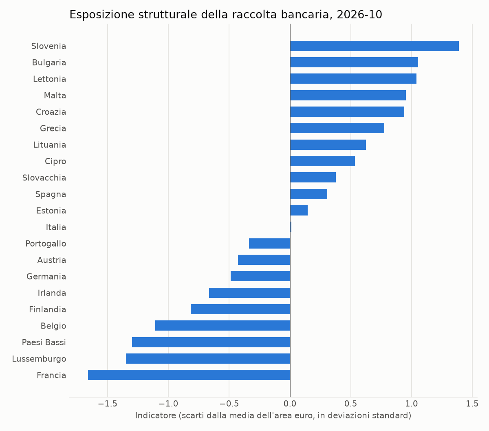
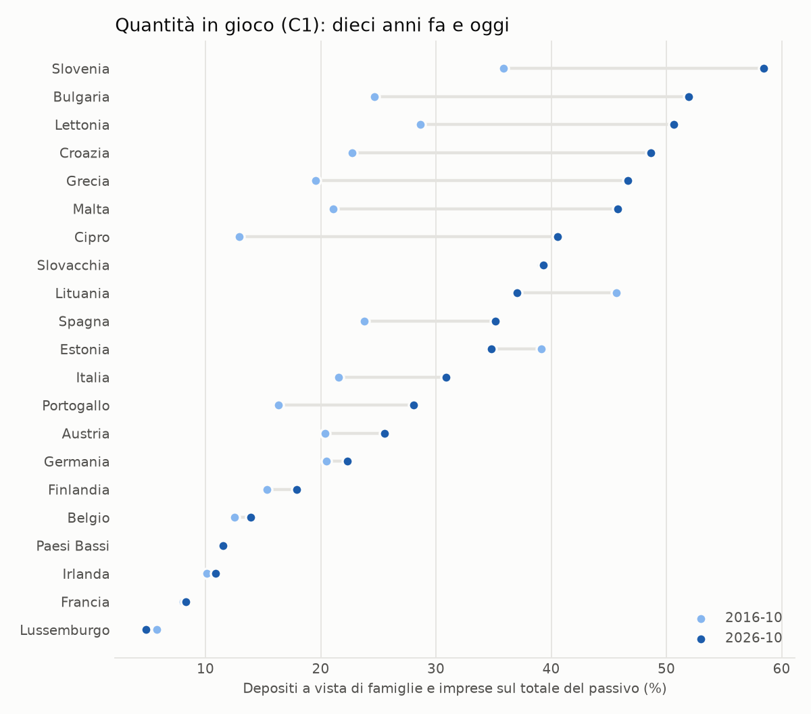

# 04 - Modulo 3: classifica dei paesi per struttura della raccolta bancaria

Il modulo 3 di [SPEC.md](../SPEC.md) chiede una classifica dei 21 paesi dell'area euro
per esposizione strutturale della raccolta bancaria a una sostituzione dei depositi con
stablecoin, con le componenti che spiegano la posizione di ciascuno.

Le sezioni 1 e 2 sono state committate **prima** di calcolare qualsiasi quota o
classifica. A quel punto conoscevo solo: i valori assoluti di tre paesi nell'ultimo mese
(dalla verifica del report 02) e la quota di passività in dollari dei 13 paesi BRI, che
qui entra solo in una variante.

## 1. Tabella di composizione (criteri a e b di SPEC)

Fonte: ECB Data Portal, dataset BSI, consistenze di fine mese in milioni di euro,
istituzioni finanziarie monetarie escluso il Sistema europeo di banche centrali.

Il passivo aggregato si scompone in sei voci:

    totale passivo = depositi di residenti dell'area euro + quote di fondi monetari
                   + titoli di debito emessi + capitale e riserve
                   + passività verso non residenti dell'area euro + altre passività

I depositi di residenti dell'area euro si scompongono a loro volta per controparte. Le
quote della tabella, tutte in rapporto al totale del passivo, sono:

| Voce | Formula con i codici BSI |
|---|---|
| Depositi a vista, famiglie | `L21` settore 2250 |
| Altri depositi, famiglie | `L20` settore 2250 meno `L21` settore 2250 |
| Depositi a vista, imprese | `L21` settore 2240 |
| Altri depositi, imprese | `L20` settore 2240 meno `L21` settore 2240 |
| Altri depositi di non-IFM | `L20` settore 2300 meno famiglie meno imprese |
| Depositi del governo centrale | `L20` settore 0000 meno settore 2300 meno settore 1000 |
| Depositi da IFM (interbancario, banca centrale inclusa) | `L20` settore 1000 |
| Quote di fondi monetari | `L30` |
| Titoli di debito emessi | `L40` |
| Capitale e riserve | `L60` |
| Passività verso l'estero | `LXG` |
| Altre passività | `L70` |
| Scarto | totale `T00` meno la somma delle voci |

Tolleranza dichiarata: lo scarto deve restare entro lo 0,5% del totale del passivo in
valore assoluto. Dove non ci resta, il report lo spiega paese per paese.

## 2. Indicatore e classifica (criterio c di SPEC), fissati prima dei dati

### 2.1 Cosa deve misurare

Il meccanismo di riferimento è quello del Working Paper BCE 3199: i fondi si spostano
dai depositi al dettaglio verso le stablecoin, la banca deve sostituirli con raccolta
all'ingrosso e la sua capacità di intermediazione ne risente. Un sistema bancario è
strutturalmente più esposto quanto più la sua raccolta è fatta del tipo di depositi che
può migrare, quanto meno quei depositi sono vincolati, e quanto più la raccolta dipende
da essi rispetto ai canali all'ingrosso.

### 2.2 Tre componenti

| Componente | Formula | Perché | Verso |
|---|---|---|---|
| C1 - Quantità in gioco | (depositi a vista di famiglie + depositi a vista di imprese) / totale passivo | È la raccolta che può spostarsi senza preavviso e senza penali verso uno strumento di pagamento | più alto = più esposto |
| C2 - Mobilità | depositi a vista di famiglie e imprese / depositi totali di famiglie e imprese | A parità di depositi, quelli a vista sono meno stabili di quelli vincolati | più alto = più esposto |
| C3 - Dipendenza | depositi totali di famiglie e imprese / (depositi totali di famiglie e imprese + titoli di debito emessi + depositi da IFM) | Chi si finanzia quasi solo con depositi della clientela ha meno canali all'ingrosso già attivi per sostituirli | più alto = più esposto |

### 2.3 Indicatore principale

Ogni mese, ciascuna componente viene standardizzata tra i paesi con dati in quel mese
(valore meno media, diviso deviazione standard). L'indicatore è:

    I = 0,50 × z(C1) + 0,25 × z(C2) + 0,25 × z(C3)

C1 pesa la metà perché misura direttamente quanta raccolta è del tipo che può migrare;
C2 e C3 qualificano quanto quella perdita sarebbe rapida e quanto difficile da
compensare, e si dividono l'altra metà. La classifica ordina i paesi per I decrescente.
L'indicatore è relativo: dice chi è più esposto degli altri in quel mese, non di quanto
in assoluto. Per l'evoluzione nel tempo vanno lette le tre componenti, che sono quote.

### 2.4 Pesature alternative

| Variante | Definizione | Cosa verifica |
|---|---|---|
| A1 - Pesi uguali | un terzo ciascuna | Se il peso doppio di C1 decide l'ordine |
| A2 - Solo quantità | solo C1 | Quanto aggiungono C2 e C3 |
| A3 - Solo famiglie | C1 e C2 calcolate con i soli depositi delle famiglie, stessi pesi | Se le imprese cambiano l'ordine |
| A4 - Ranghi | media pesata dei ranghi invece che dei valori standardizzati, stessi pesi | Se pochi valori estremi decidono l'ordine |
| A5 - Con canale valutario | 0,40 C1 + 0,20 C2 + 0,20 C3 + 0,20 C4, dove C4 = passività in dollari / passività totali (BRI) | Se la raccolta in dollari, che il WP 3199 indica come canale distinto, cambia l'ordine. Solo 13 paesi, ultimo trimestre disponibile |

Misure di stabilità riportate per ogni variante: correlazione di rango di Spearman con
la classifica principale, numero di paesi che si spostano di più di tre posizioni,
paesi in comune tra i primi cinque.

### 2.5 Cosa la classifica non è

Ordina i paesi per struttura della raccolta. Non è una probabilità che i depositi
escano, non è un giudizio sulla solidità delle banche e non tiene conto di liquidità,
capitale in eccesso o accesso al rifinanziamento.

## 3. Risultati

Calcolato il 2026-11-24 sui dati di settembre 2026, ultimo mese pubblicato.

### 3.1 La classifica

| Pos. | Paese | Indicatore | C1 quantità (%) | C2 mobilità (%) | C3 dipendenza (%) | Depositi a vista (mld €) | Quota dell'area (%) | Posizione tra le varianti |
|---|---|---|---|---|---|---|---|---|
| 1 | Slovenia | +1,40 | 59,0 | 84,2 | 90,8 | 36 | 0,4 | 1-1 |
| 2 | Lettonia | +1,03 | 50,3 | 74,8 | 95,2 | 17 | 0,2 | 2-6 |
| 3 | Bulgaria | +1,02 | 51,5 | 76,0 | 89,5 | 65 | 0,8 | 2-5 |
| 4 | Malta | +0,94 | 45,6 | 82,3 | 89,9 | 22 | 0,3 | 2-6 |
| 5 | Croazia | +0,92 | 48,6 | 75,7 | 89,9 | 49 | 0,6 | 3-5 |
| 6 | Grecia | +0,83 | 47,8 | 77,1 | 82,4 | 174 | 2,1 | 4-6 |
| 7 | Lituania | +0,62 | 37,4 | 78,2 | 90,9 | 41 | 0,5 | 6-9 |
| 8 | Cipro | +0,53 | 40,6 | 66,4 | 90,7 | 31 | 0,4 | 7-10 |
| 9 | Slovacchia | +0,38 | 39,4 | 71,1 | 75,7 | 55 | 0,7 | 8-10 |
| 10 | Spagna | +0,35 | 36,2 | 82,8 | 67,0 | 1.255 | 15,3 | 9-10 |
| 11 | Estonia | +0,17 | 35,4 | 59,9 | 83,6 | 18 | 0,2 | 11-11 |
| 12 | Italia | 0,00 | 30,7 | 73,8 | 64,8 | 1.296 | 15,8 | 12-12 |
| 13 | Portogallo | -0,34 | 28,1 | 47,7 | 77,3 | 138 | 1,7 | 13-14 |
| 14 | Austria | -0,44 | 25,5 | 63,3 | 56,3 | 274 | 3,4 | 13-15 |
| 15 | Germania | -0,52 | 21,4 | 65,4 | 57,3 | 2.566 | 31,4 | 15-16 |
| 16 | Irlanda | -0,65 | 11,0 | 83,3 | 50,8 | 231 | 2,8 | 14-19 |
| 17 | Finlandia | -0,81 | 18,0 | 69,6 | 38,2 | 122 | 1,5 | 16-17 |
| 18 | Belgio | -1,11 | 14,1 | 33,6 | 70,0 | 210 | 2,6 | 17-18 |
| 19 | Paesi Bassi | -1,31 | 11,4 | 32,8 | 61,8 | 367 | 4,5 | 18-20 |
| 20 | Lussemburgo | -1,35 | 4,9 | 65,9 | 33,6 | 87 | 1,1 | 19-21 |
| 21 | Francia | -1,66 | 8,5 | 39,1 | 34,3 | 1.126 | 13,8 | 20-21 |

"Depositi a vista" sono quelli di famiglie e imprese insieme; "quota dell'area" è la
loro parte sugli 8.180 miliardi di euro dei 21 paesi. L'ultima colonna dà la posizione
migliore e peggiore del paese tra l'indicatore principale e le varianti A1-A4.



### 3.2 Come leggerla: tre gruppi

- **In testa, sistemi piccoli finanziati quasi solo da depositi a vista.** In Slovenia
  il 59% del passivo delle banche è fatto di depositi a vista di famiglie e imprese e
  il 91% della raccolta dalla clientela e dai mercati è depositi. Seguono Lettonia,
  Bulgaria, Malta, Croazia e Grecia, tutte con C1 tra il 46% e il 52%.
- **Al centro, Spagna e Italia.** Sono al decimo e dodicesimo posto, ma contano molto di
  più: da sole detengono il 31% dei depositi a vista dell'area.
- **In coda, i sistemi che si finanziano sui mercati e con l'estero.** In Francia,
  Lussemburgo, Paesi Bassi e Belgio i depositi a vista della clientela sono tra il 5% e
  il 14% del passivo.

**La classifica dice dove la struttura è più esposta, non dove sono i soldi.** I primi
nove paesi insieme detengono il 6% dei depositi a vista dell'area; Germania, Italia,
Spagna e Francia ne detengono il 76%. Un analista che guarda alla stabilità del singolo
sistema nazionale deve leggere la prima colonna; uno che guarda all'aggregato dell'area
deve leggere le ultime due.

### 3.3 Cosa c'è dietro ogni posizione

Composizione del passivo a settembre 2026, in percentuale del totale. Tabella completa
per tutti i mesi in `data/processed/m3_composition.csv`.

| Paese | Depositi a vista di famiglie e imprese | Altri depositi di famiglie e imprese | Altri depositi (finanziari, governo) | Depositi da banche | Titoli emessi | Passività estere | Capitale | Altro |
|---|---|---|---|---|---|---|---|---|
| Slovenia | 59,0 | 11,1 | 4,2 | 1,9 | 5,1 | 1,7 | 13,5 | 3,4 |
| Lettonia | 50,3 | 16,9 | 8,1 | 1,8 | 1,5 | 7,7 | 11,8 | 1,8 |
| Bulgaria | 51,5 | 16,3 | 3,9 | 6,1 | 1,8 | 3,2 | 14,0 | 3,2 |
| Malta | 45,6 | 9,8 | 10,4 | 3,3 | 2,9 | 15,2 | 10,9 | 2,0 |
| Croazia | 48,6 | 15,6 | 10,4 | 3,7 | 3,5 | 2,9 | 11,6 | 3,8 |
| Grecia | 47,8 | 14,2 | 6,2 | 5,7 | 7,6 | 4,4 | 10,5 | 3,7 |
| Lituania | 37,4 | 10,4 | 7,5 | 2,8 | 2,0 | 7,1 | 7,8 | 24,9 |
| Cipro | 40,6 | 20,6 | 11,7 | 4,8 | 1,5 | 7,5 | 10,6 | 2,8 |
| Slovacchia | 39,4 | 16,0 | 7,0 | 5,6 | 12,2 | 3,9 | 12,4 | 3,5 |
| Spagna | 36,2 | 7,5 | 13,3 | 12,1 | 9,4 | 5,9 | 8,3 | 7,2 |
| Estonia | 35,4 | 23,7 | 8,7 | 3,9 | 7,7 | 6,9 | 11,7 | 2,0 |
| Italia | 30,7 | 10,9 | 10,6 | 14,6 | 8,0 | 1,8 | 9,8 | 13,6 |
| Portogallo | 28,1 | 30,8 | 6,4 | 11,8 | 5,5 | 3,1 | 10,1 | 4,1 |
| Austria | 25,5 | 14,8 | 7,3 | 12,9 | 18,4 | 3,2 | 11,2 | 6,8 |
| Germania | 21,4 | 11,3 | 7,9 | 12,5 | 11,9 | 8,5 | 6,6 | 19,8 |
| Irlanda | 11,0 | 2,2 | 6,2 | 10,8 | 2,0 | 43,2 | 4,5 | 20,1 |
| Finlandia | 18,0 | 7,9 | 8,1 | 12,8 | 29,1 | 9,3 | 6,4 | 8,3 |
| Belgio | 14,1 | 27,9 | 7,2 | 10,2 | 7,8 | 22,2 | 6,2 | 4,5 |
| Paesi Bassi | 11,4 | 23,3 | 8,5 | 9,3 | 12,2 | 15,9 | 5,9 | 13,6 |
| Lussemburgo | 4,9 | 2,5 | 18,1 | 12,0 | 2,6 | 41,1 | 4,5 | 14,3 |
| Francia | 8,5 | 13,2 | 6,2 | 28,8 | 12,6 | 12,6 | 6,3 | 11,9 |

"Altro" somma le altre passività e le quote di fondi monetari detenute da residenti
dell'area. Alcuni esempi di lettura: il Portogallo è a metà classifica perché ha molti
depositi, ma più della metà è vincolata; la Finlandia è in basso perché il 29% del
passivo sono titoli emessi; l'Irlanda ha depositi quasi tutti a vista, ma pesano poco su
un passivo dominato dalle passività estere.

### 3.4 Quanto è stabile l'ordine

| Variante | Correlazione di rango con la principale | Paesi spostati di più di 3 posizioni | Spostamento massimo | Primi cinque in comune |
|---|---|---|---|---|
| A1 - Pesi uguali | 0,99 | 0 | 2 | 5 su 5 |
| A2 - Solo quantità | 0,98 | 0 | 3 | 4 su 5 |
| A3 - Solo famiglie | 0,97 | 1 | 4 | 4 su 5 |
| A4 - Ranghi | 0,99 | 0 | 2 | 5 su 5 |
| A5 - Con canale valutario (13 paesi) | 0,94 | 0 | 3 | 4 su 5 |

L'ordine non dipende dai pesi scelti. La Slovenia è prima in tutte le varianti; Italia
ed Estonia non cambiano mai posizione; lo spostamento più ampio è quello della Lettonia,
che scende dal secondo al sesto posto guardando solo alle famiglie, perché una parte
rilevante dei suoi depositi a vista è di imprese. Le tre componenti sono correlate tra
loro (C1 e C3: 0,88), il che spiega la stabilità: misurano aspetti dello stesso modello
di raccolta.

### 3.5 Evoluzione nel tempo



- **La quantità in gioco è cresciuta quasi ovunque.** Sommando i paesi, i depositi a
  vista di famiglie e imprese sono passati dal 15,6% al 18,2% del passivo tra settembre
  2016 e settembre 2026, e dal 54,5% al 59,3% dei depositi della clientela. L'aumento è
  molto più forte in testa alla classifica: Slovenia da 36% a 59%, Grecia da 19% a 48%,
  Cipro da 13% a 41%, Croazia da 23% a 49%.
- **L'ordine è stabile a un anno e cambia a dieci.** La correlazione di rango con la
  classifica di oggi è 1,00 a un anno, 0,92 a cinque anni e 0,75 a dieci.
- **Chi è salito e chi è sceso in dieci anni**: Cipro dal 16° all'8° posto, Grecia
  dall'11° al 6°, Slovenia dal 5° al 1°; Estonia dal 2° all'11°, Lituania dal 1° al 7°,
  Slovacchia dal 3° al 9°, Germania dal 10° al 15°.

La serie mensile di indicatore, componenti e posizione per ogni paese dal 2003 è in
`data/processed/m3_index.csv`.

### 3.6 Il secondo canale: la raccolta in dollari

Il Working Paper BCE 3199 indica un canale distinto per le stablecoin in valuta estera:
la dipendenza delle banche dalla raccolta all'ingrosso in valuta. Per i 13 paesi coperti
dalla BRI, al secondo trimestre 2026:

| Paese | Posizione senza canale valutario | Posizione con canale valutario (A5) | C4: passività in dollari (%) |
|---|---|---|---|
| Grecia | 1 | 1 | 5,4 |
| Cipro | 2 | 2 | 10,4 |
| Spagna | 3 | 3 | 9,4 |
| Italia | 4 | 4 | 2,8 |
| Germania | 7 | 5 | 9,4 |
| Portogallo | 5 | 6 | 2,0 |
| Irlanda | 8 | 7 | 14,8 |
| Austria | 6 | 8 | 4,2 |
| Lussemburgo | 12 | 9 | 27,2 |
| Finlandia | 9 | 10 | 9,3 |
| Belgio | 10 | 11 | 8,2 |
| Paesi Bassi | 11 | 12 | 14,3 |
| Francia | 13 | 13 | 14,9 |

**I due canali indicano paesi diversi.** Tra i 13 paesi la correlazione di rango tra la
quantità di depositi a vista (C1) e la quota di passività in dollari (C4) è -0,66: chi è
più esposto alla sostituzione dei depositi al dettaglio è meno dipendente dalla raccolta
in dollari, e viceversa. Lussemburgo, Francia, Irlanda e Paesi Bassi sono in fondo alla
classifica principale e in cima a quella della raccolta in dollari. Unire i due canali
in un solo numero li fa compensare; per questo A5 resta una variante e i due vanno
letti come due mappe distinte.

### 3.7 Quadratura della tabella di composizione

- 5.387 osservazioni paese-mese, dal 2003 (più tardi per i paesi entrati dopo) a
  settembre 2026.
- Lo scarto tra il totale del passivo e la somma delle voci è zero, a meno
  dell'arrotondamento numerico, in tutte le osservazioni. Nessuna è fuori dalla
  tolleranza dello 0,5%.
- Alla prima esecuzione lo scarto era del 35% per l'Irlanda e del 28% per il Lussemburgo.
  Causa: avevo preso le quote di fondi monetari detenute da tutti i sottoscrittori,
  mentre quelle detenute da non residenti sono già dentro le passività verso l'estero.
  Con le sole quote detenute da residenti dell'area euro la tabella quadra. La
  classifica non usa questa voce e non è cambiata.
- Per la Lituania la serie delle quote di fondi monetari non esiste ed è posta a zero;
  la quadratura torna comunque.

### 3.8 Criteri di completamento di SPEC

| Criterio | Stato |
|---|---|
| (a) Tabella paese per mese con le quote di composizione e formule scritte | Fatto: sezione 1 e `m3_composition.csv` |
| (b) Le quote sommano al totale entro la tolleranza, o lo scarto è spiegato | Fatto: scarto zero dopo la correzione descritta in 3.7 |
| (c) Indicatore con componenti e pesi fissati prima dei dati, e pesature alternative | Fatto: sezione 2 committata prima; cinque varianti in 3.4 |
| (d) Dichiarato che ordina la struttura, non la probabilità di deflusso | Fatto: sezioni 2.5 e 4 |

## 4. Limiti

- **Ordina la struttura della raccolta, non la probabilità che i depositi escano.** Non
  considera liquidità disponibile, capitale in eccesso, garanzia dei depositi, tassi
  offerti o accesso al rifinanziamento presso la banca centrale.
- **È relativo.** L'indicatore dice chi è più esposto degli altri in quel mese. Se tutti
  i paesi peggiorano insieme, non si muove: per questo vanno guardate anche le
  componenti, che sono quote.
- **La diffusione delle stablecoin per paese non è nota.** La classifica dice dove una
  data perdita di depositi peserebbe di più, non dove la perdita è più probabile.
- **Dati aggregati per paese.** Dentro ogni paese le banche sono diverse; una media
  nazionale può nascondere singoli istituti molto esposti o molto poco.
- **I depositi sono quelli di residenti dell'area euro presso banche del paese**, non
  dei soli residenti nazionali. Nei centri finanziari la differenza conta.
- **I depositi da IFM includono la banca centrale**, quindi il rifinanziamento presso
  l'Eurosystem entra in C3 come raccolta all'ingrosso.
- **Il canale valutario copre 13 paesi su 21** e ha frequenza trimestrale.
- **Il verso di C3 è una scelta.** Qui chi ha poca raccolta all'ingrosso è considerato
  più esposto perché ha meno canali già attivi; si può sostenere anche il contrario. La
  variante A2, che non usa C3, dà quasi lo stesso ordine.

## 5. Cosa non è stato possibile fare

- **Il canale valutario per gli otto paesi che non dichiarano alla BRI** (Bulgaria,
  Estonia, Croazia, Lituania, Lettonia, Malta, Slovenia, Slovacchia): tra loro ci sono
  sei dei primi sette della classifica. I dati bancari consolidati della BCE sono la
  prossima fonte da provare.
- **Distinguere i depositi garantiti da quelli non garantiti**: il dataset BSI non lo consente.
- **Scendere sotto il livello nazionale**: servirebbero dati di vigilanza per banca,
  non pubblici.

## 6. Come si usa

```bash
.venv/bin/python src/module3_ranking.py            # scarica le serie BCE e ricalcola
.venv/bin/python src/module3_ranking.py --offline  # ricalcola dai file già scaricati
```

| File | Contenuto |
|---|---|
| `data/processed/m3_ranking_latest.csv` | Classifica dell'ultimo mese con componenti, varianti e confronto a 1, 5 e 10 anni |
| `data/processed/m3_index.csv` | Indicatore, componenti e posizione per paese e mese dal 2003 |
| `data/processed/m3_composition.csv` | Composizione del passivo per paese e mese |
| `data/processed/m3_variant_usd_funding.csv` | Variante con la raccolta in dollari, 13 paesi |
| `data/processed/m3_summary.json` | Classifica, stabilità e controlli in un solo file |

---

**Cosa aggiunge questo al programma finale**: la classifica dei 21 paesi dell'area euro
per esposizione strutturale della raccolta, stabile a cinque pesature diverse, con le
serie mensili dal 2003; la base contabile del modulo 4 (8.180 miliardi di euro di
depositi a vista, ripartiti per paese); e un risultato non ovvio: il canale dei depositi
al dettaglio e quello della raccolta in dollari colpiscono paesi diversi.
