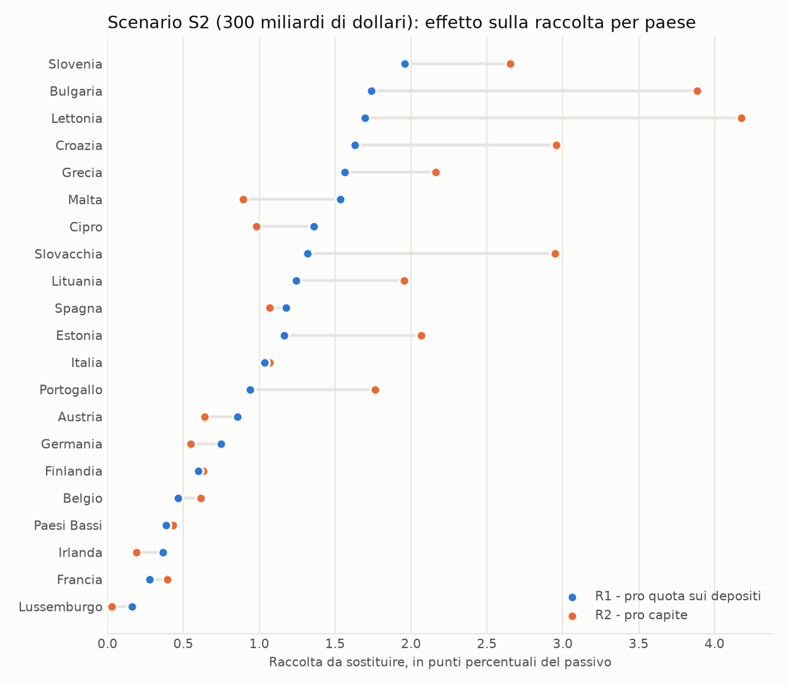

# 05 - Module 4: adoption scenarios and bank funding by country

Module 4 of [SPEC.md](../SPEC.md) asks, for each level of adoption of dollar
stablecoins, for the change in each country's funding in EUR billions and in percentage
points, and for how much wholesale funding would be needed to offset it.

Sections 1 and 2 were committed **before** the results were calculated. At that point I
knew the September 2026 balance sheets from module 3, so the aggregate orders of
magnitude were predictable; the country results were not.

## 1. What kind of calculation this is

It is an accounting exercise, not a forecast or a causal estimate. It answers a single
question: if euro area residents held a given amount of dollar stablecoins, and had
funded it by withdrawing bank deposits, by how much would the funding of each country's
banks fall, and how much wholesale funding would be needed to replace it?

It does not say whether, when or with what probability this will happen, and it does not
consider the reactions of banks, depositors and the central bank.

## 2. Parameters, set before the results

### 2.1 Starting balance sheets

Bank balance sheets for September 2026 for the 21 euro area countries, from module 3
(`data/raw/m3_bsi.csv`). The scenarios are applied to today's balance sheets, without
growing them: the amounts projected for 2030 are also compared with current funding.

### 2.2 Adoption levels

The amounts come from ESM Working Paper 79 (section 5, checked in
[report 02](02_benchmarks_and_module3_data.md)): dollar stablecoins held in the euro area.

| Scenario | Amount (USD bn) | How the ESM obtains it |
|---|---|---|
| S0 - Today | 19 | 7.5% of 248 billion in circulation in the third quarter of 2025 |
| S1 - Baseline 2030 | 143 | 7.5% of 1,900 billion |
| S2 - High 2030 | 300 | 7.5% of 4,000 billion |
| S3 - High 2030, double share | 600 | 15% of 4,000 billion |

These are ESM assumptions, not estimates. The script also accepts any amount, so the
calculation can be repeated with the level that module 1 will produce.

### 2.3 Conversion and substitution rate

- **Exchange rate**: ECB reference rate of 30 September 2026, i.e. the date of the
  balance sheets.
- **Substitution rate**: 100%. Each euro of stablecoins held corresponds to one euro of
  deposits leaving the area's banks. This is a ceiling: part could come from cash, funds
  or other assets, and part of the funds could return to the banks by other routes.
  Sensitivity at 50%.

### 2.4 Allocation across countries

There are no data on adoption by country. Two rules are used.

| Rule | Definition | What it assumes |
|---|---|---|
| **R1 - Pro rata to deposits (main)** | The outflow is distributed in proportion to each country's sight deposits of households and firms | Every euro deposited has the same probability of migrating. All countries lose the same percentage of sight deposits |
| **R2 - Per capita (alternative)** | The outflow is distributed in proportion to population (Eurostat, 1 January 2025) | Every resident adopts to the same extent. Countries with fewer deposits per inhabitant lose a larger percentage |

Under R2 the outflow assigned to a country cannot exceed its sight deposits; if this
happened, the excess would be flagged, not redistributed.

### 2.5 Allocation across deposit types

| Rule | Definition |
|---|---|
| **T1 (main)** | Only sight deposits leave, from households and firms in proportion to their respective stocks |
| T2 (alternative) | Only household sight deposits leave; the R1 allocation across countries is based on household sight deposits only |
| T3 (alternative) | Sight and term deposits of households and firms leave, in proportion to stocks; the R1 allocation across countries is based on total deposits |

### 2.6 Quantities calculated for each country and scenario

| Quantity | Formula |
|---|---|
| Outflow | amount assigned to the country, in EUR billions |
| Loss of sight deposits | outflow / sight deposits of households and firms |
| Loss of customer deposits | outflow / total deposits of households and firms |
| Effect on funding | outflow / total liabilities, in percentage points |
| Wholesale funding needed | equal to the outflow: one-for-one replacement is assumed |
| Increase in wholesale funding | outflow / (debt securities issued + deposits from MFIs) |

### 2.7 Thresholds

Inverse calculation: what amount of stablecoins held in the euro area corresponds to a
loss of 1%, 5% and 10% of the area's sight deposits, in EUR billions and USD billions,
and to what share of the circulation assumed by the ESM.

### 2.8 Sensitivity

The calculation is linear in the amount: doubling adoption, the substitution rate or the
euro area share doubles every result. The report nevertheless gives the substitution
rate at 50% and an exchange rate at ±10%, and above all the comparison between the two
allocation rules and between the three deposit types, which are not linear.

## 3. Results

Calculated on 2026-11-24. September 2026 balance sheets; ECB reference rate of 30
September 2026: USD 1.1355 per euro.

Starting quantities for the 21 countries: EUR 8,180 billion of sight deposits of
households and firms (5,526 households, 2,654 firms), 13,799 billion of customer
deposits, 12,441 billion of wholesale funding, 44,923 billion of liabilities.

### 3.1 Euro area

Main rule (R1 and T1), 100% substitution.

| Scenario | Stablecoins held (USD bn) | Outflow (EUR bn) | Sight deposits lost | Customer deposits lost | Effect on funding (points of liabilities) | Increase in wholesale funding |
|---|---|---|---|---|---|---|
| S0 - Today | 19 | 16.7 | 0.2% | 0.1% | 0.04 | 0.1% |
| S1 - Baseline 2030 | 143 | 125.9 | 1.5% | 0.9% | 0.28 | 1.0% |
| S2 - High 2030 | 300 | 264.2 | 3.2% | 1.9% | 0.59 | 2.1% |
| S3 - High 2030, double share | 600 | 528.4 | 6.5% | 3.8% | 1.18 | 4.2% |

For the area as a whole the effect is contained even in the highest scenario: EUR 528
billion of deposits to be replaced, equal to 6.5% of sight deposits and to a 4.2%
increase in existing wholesale funding. At today's level the effect is 0.2% of sight
deposits.

### 3.2 Thresholds: how much adoption must grow before it matters

| Loss of the area's sight deposits | Stablecoins held in the euro area | Multiple of today's level | Share of a circulation of USD 1,900 bn | Share of a circulation of USD 4,000 bn |
|---|---|---|---|---|
| 1% | EUR 82 bn = USD 93 bn | 4.9 times | 4.9% | 2.3% |
| 5% | EUR 409 bn = USD 464 bn | 24 times | 24.4% | 11.6% |
| 10% | EUR 818 bn = USD 929 bn | 49 times | 48.9% | 23.2% |

Reading: for the euro area to lose 5% of its sight deposits, its residents would have to
hold USD 464 billion of stablecoins. With the ESM assumption of a 7.5% share, this would
require a global circulation of about USD 6,200 billion, 25 times that of the third
quarter of 2025.

### 3.3 By country

Main rule (R1 and T1). Countries ordered by effect on funding. Scenario S0 is omitted
from the table: it is 13% of S1 in every cell.

| Country | Outflow S1 (EUR bn) | Outflow S2 | Outflow S3 | Effect S1 (points of liabilities) | Effect S2 | Effect S3 | Wholesale increase S1 | Wholesale increase S2 | Wholesale increase S3 |
|---|---|---|---|---|---|---|---|---|---|
| Slovenia | 0.6 | 1.2 | 2.3 | 0.91 | 1.91 | 3.81 | 12.8% | 26.9% | 53.9% |
| Bulgaria | 1.0 | 2.1 | 4.2 | 0.79 | 1.66 | 3.32 | 10.0% | 20.9% | 41.8% |
| Latvia | 0.3 | 0.5 | 1.1 | 0.77 | 1.63 | 3.25 | 23.0% | 48.2% | 96.4% |
| Croatia | 0.7 | 1.6 | 3.1 | 0.75 | 1.57 | 3.14 | 10.4% | 21.8% | 43.7% |
| Greece | 2.7 | 5.6 | 11.3 | 0.74 | 1.54 | 3.09 | 5.6% | 11.6% | 23.3% |
| Malta | 0.3 | 0.7 | 1.4 | 0.70 | 1.47 | 2.94 | 11.3% | 23.8% | 47.5% |
| Cyprus | 0.5 | 1.0 | 2.0 | 0.62 | 1.31 | 2.62 | 9.9% | 20.9% | 41.7% |
| Slovakia | 0.8 | 1.8 | 3.6 | 0.61 | 1.27 | 2.55 | 3.4% | 7.1% | 14.3% |
| Lithuania | 0.6 | 1.3 | 2.7 | 0.58 | 1.21 | 2.42 | 12.0% | 25.1% | 50.3% |
| Spain | 19.3 | 40.5 | 81.1 | 0.56 | 1.17 | 2.34 | 2.6% | 5.4% | 10.8% |
| Estonia | 0.3 | 0.6 | 1.1 | 0.55 | 1.14 | 2.29 | 4.7% | 9.9% | 19.8% |
| Italy | 20.0 | 41.9 | 83.7 | 0.47 | 0.99 | 1.98 | 2.1% | 4.4% | 8.8% |
| Portugal | 2.1 | 4.5 | 8.9 | 0.43 | 0.91 | 1.82 | 2.5% | 5.3% | 10.5% |
| Austria | 4.2 | 8.9 | 17.7 | 0.39 | 0.82 | 1.64 | 1.3% | 2.6% | 5.3% |
| Germany | 39.5 | 82.9 | 165.7 | 0.33 | 0.69 | 1.39 | 1.4% | 2.8% | 5.7% |
| Finland | 1.9 | 3.9 | 7.9 | 0.28 | 0.58 | 1.16 | 0.7% | 1.4% | 2.8% |
| Belgium | 3.2 | 6.8 | 13.6 | 0.22 | 0.46 | 0.91 | 1.2% | 2.5% | 5.1% |
| Netherlands | 5.6 | 11.8 | 23.7 | 0.18 | 0.37 | 0.74 | 0.8% | 1.7% | 3.4% |
| Ireland | 3.6 | 7.5 | 14.9 | 0.17 | 0.35 | 0.71 | 1.3% | 2.8% | 5.5% |
| France | 17.3 | 36.4 | 72.7 | 0.13 | 0.27 | 0.55 | 0.3% | 0.7% | 1.3% |
| Luxembourg | 1.3 | 2.8 | 5.6 | 0.07 | 0.16 | 0.31 | 0.5% | 1.1% | 2.2% |

Three readings:

- **The average effect hides twelvefold differences.** In scenario S2 the funding to be
  replaced ranges from 0.16% of liabilities in Luxembourg to 1.91% in Slovenia. Under
  rule R1 the order is by construction that of component C1 of module 3.
- **The real bottleneck is wholesale funding, not the amount.** In Latvia half a billion
  euro of outflows (scenario S2) is enough to require a 48% increase in wholesale
  funding, because the existing wholesale funding is very small. Slovenia, Lithuania,
  Malta, Croatia, Bulgaria and Cyprus would have to increase it by between 21% and 27%.
  Germany and France, which lose 83 and 36 billion, would have to increase it by 2.8%
  and 0.7%.
- **The billions are elsewhere.** Germany, Italy, Spain and France absorb 76% of the
  outflow in every scenario.

### 3.4 If adoption were the same per inhabitant

Scenario S2, rule R1 compared with R2.



| Country | Sight deposits per inhabitant (EUR thousands) | Effect R1 (points of liabilities) | Effect R2 | Sight deposits lost R1 | Sight deposits lost R2 | Wholesale increase R1 | Wholesale increase R2 |
|---|---|---|---|---|---|---|---|
| Latvia | 9.1 | 1.63 | 4.08 | 3.2% | 8.1% | 48.2% | 120.9% |
| Bulgaria | 10.1 | 1.66 | 3.74 | 3.2% | 7.3% | 20.9% | 46.9% |
| Slovakia | 10.2 | 1.27 | 2.85 | 3.2% | 7.2% | 7.1% | 16.0% |
| Croatia | 12.5 | 1.57 | 2.85 | 3.2% | 5.9% | 21.8% | 39.7% |
| Slovenia | 16.8 | 1.91 | 2.58 | 3.2% | 4.4% | 26.9% | 36.5% |
| Greece | 16.8 | 1.54 | 2.09 | 3.2% | 4.4% | 11.6% | 15.8% |
| Estonia | 13.0 | 1.14 | 2.01 | 3.2% | 5.7% | 9.9% | 17.4% |
| Lithuania | 14.2 | 1.21 | 1.94 | 3.2% | 5.2% | 25.1% | 40.3% |
| Portugal | 12.1 | 0.91 | 1.71 | 3.2% | 6.1% | 5.3% | 9.9% |
| Spain | 25.5 | 1.17 | 1.04 | 3.2% | 2.9% | 5.4% | 4.8% |
| Italy | 22.0 | 0.99 | 1.03 | 3.2% | 3.3% | 4.4% | 4.5% |
| Cyprus | 31.3 | 1.31 | 0.95 | 3.2% | 2.4% | 20.9% | 15.2% |
| Malta | 38.9 | 1.47 | 0.86 | 3.2% | 1.9% | 23.8% | 13.9% |
| Austria | 29.8 | 0.82 | 0.63 | 3.2% | 2.5% | 2.6% | 2.0% |
| Finland | 21.7 | 0.58 | 0.61 | 3.2% | 3.4% | 1.4% | 1.5% |
| Belgium | 17.7 | 0.46 | 0.59 | 3.2% | 4.2% | 2.5% | 3.3% |
| Germany | 30.7 | 0.69 | 0.51 | 3.2% | 2.4% | 2.8% | 2.1% |
| Netherlands | 20.3 | 0.37 | 0.41 | 3.2% | 3.6% | 1.7% | 1.9% |
| France | 16.3 | 0.27 | 0.38 | 3.2% | 4.5% | 0.7% | 0.9% |
| Ireland | 42.4 | 0.35 | 0.19 | 3.2% | 1.7% | 2.8% | 1.5% |
| Luxembourg | 127.7 | 0.16 | 0.03 | 3.2% | 0.6% | 1.1% | 0.2% |

With equal adoption per inhabitant, the countries with fewer deposits per head lose much
more: Latvia, Bulgaria and Slovakia would lose 7% - 8% of their sight deposits against
the average of 3.2%, and the effect on funding doubles or more. Malta, Cyprus, Ireland
and Luxembourg, where deposits per inhabitant are high, move down. For Italy, Spain and
Finland the two rules give almost the same result.

The order of countries remains similar (rank correlation 0.89) and the top five are the
same in four cases out of five: small deposit-funded systems are at the top in any case.
In no scenario does the assigned outflow exceed a country's sight deposits.

### 3.5 Which deposits the money comes from

Scenario S2, rule R1, euro area: the outflow is always EUR 264 billion; what changes is
where it falls.

| Rule | Category affected | Loss in the category |
|---|---|---|
| T1 (main) | Sight deposits of households and firms | 3.2% |
| T2 | Sight deposits of households only | 4.8% |
| T3 | All deposits of households and firms | 1.9% |

By country the order changes little: rank correlation of 0.96 between T1 and T2 and 0.93
between T1 and T3. The largest shift under T2 is Malta (from 1.47 to 1.78 points of
liabilities), where sight deposits are almost all held by households; under T3 it is
Slovenia (from 1.91 to 1.34), which has few term deposits over which to spread the
outflow.

### 3.6 Sensitivity

Scenario S2, euro area, main rule.

| Variant | Outflow (EUR bn) | Sight deposits lost | Increase in wholesale funding |
|---|---|---|---|
| Baseline | 264.2 | 3.2% | 2.1% |
| 50% substitution | 132.1 | 1.6% | 1.1% |
| Dollar 10% weaker | 240.2 | 2.9% | 1.9% |
| Dollar 10% stronger | 293.6 | 3.6% | 2.4% |

The calculation is linear: every result in sections 3.1 and 3.3 scales in proportion to
the amount, the substitution rate and the share attributed to the euro area. The choice
that matters most is none of these, but the rule for allocation across countries
(section 3.4), which is not observable.

### 3.7 SPEC completion criteria

| Criterion | Status |
|---|---|
| (a) Scenarios defined by parameters written before the results | Done: section 2, committed first |
| (b) Allocation rules stated, with an alternative | Done: R1 and R2 across countries; T1, T2 and T3 across deposit types |
| (c) Presented as a mechanical exercise, with sensitivity | Done: sections 1, 3.6 and 4 |
| (d) The code reproduces the tables | Done: a second run produces identical files |

## 4. Limits

- **It is an accounting calculation, not a forecast.** It does not say whether and when
  adoption will reach these levels. The amounts are ESM assumptions.
- **Full substitution is a ceiling.** Buyers of stablecoins may use cash, funds or other
  assets, and the seller may redeposit the funds in a bank in the area. The actual effect
  on deposits is at most the one calculated.
- **The allocation across countries is not observable.** R1 and R2 are two extreme but
  reasonable assumptions; actual adoption could follow age, income, remittances or the
  use of crypto-assets, for which there are no data by country.
- **Static balance sheets.** The 2030 scenarios are applied to the September 2026
  balance sheets. If deposits grow, the percentages fall.
- **No reaction.** Increases in deposit rates, recourse to the central bank, reductions
  in assets or sales of securities are not considered. The "wholesale funding
  requirement" is what would be needed if the bank replaced everything one for one.
- **Percentage increases in wholesale funding are very high where the base is
  small.** Latvia's 48% corresponds to half a billion euro. They indicate that the
  channel would have to be built, not that the amount is large.
- **Aggregate national data**, as in module 3.
- **No causal effect and no effect on interest rates**: for monetary policy transmission
  the reference remains ECB Working Paper 3199.

## 5. What could not be done

- **Using a starting level updated to today**: scenario S0 is the ESM figure for the
  third quarter of 2025. The current level will come from module 1; the script already
  accepts it with `--importo-usd`.
- **Allocating the outflow according to actual adoption by country**: there are no
  public data. The ECB box covers 11 countries but publishes only the aggregate figure.
- **Estimating the cost of substitution** (how much the new wholesale funding would
  cost): this would require issuance rates by country and an assumption on maturities,
  which is outside the scope of an accounting exercise.

## 6. How to use it

```bash
.venv/bin/python src/module4_scenarios.py                    # ESM scenarios, thresholds and sensitivity
.venv/bin/python src/module4_scenarios.py --importo-usd 250  # any level, in billions of dollars
.venv/bin/python src/module4_scenarios.py --offline          # without downloading the exchange rate and population
```

| File | Contents |
|---|---|
| `data/processed/m4_main_table.csv` | Results by country in the four scenarios, rules R1 and R2 |
| `data/processed/m4_scenarios_by_country.csv` | All combinations of scenario, country rule and deposit type |
| `data/processed/m4_euro_area.csv` | Euro area totals |
| `data/processed/m4_thresholds.csv` | Thresholds |
| `data/processed/m4_rule_comparison.csv` | Comparison between R1 and R2 in scenario S2 |
| `data/processed/m4_custom.csv` | Result of the last custom amount requested |

Update of 2026-11-24: now that module 1 is complete, the files also contain the
scenarios `M1_oggi_base` (USD 18.3 billion) and `M1_oggi_alto` (36.6), calculated on the
current circulation. See [06_module1_level.md](06_module1_level.md), section 3.6. The
tables in this report do not change.

---

**What this adds to the final programme**: the scenario tool. Given any amount of
stablecoins held in the euro area, it returns for each of the 21 countries the billions
of deposits to be replaced, the effect on funding and the increase in wholesale funding
needed; and three ready results: at today's level the effect is 0.2% of sight deposits,
USD 464 billion is needed to reach 5%, and the tightest constraint is the wholesale
funding of small systems, not the amount.
