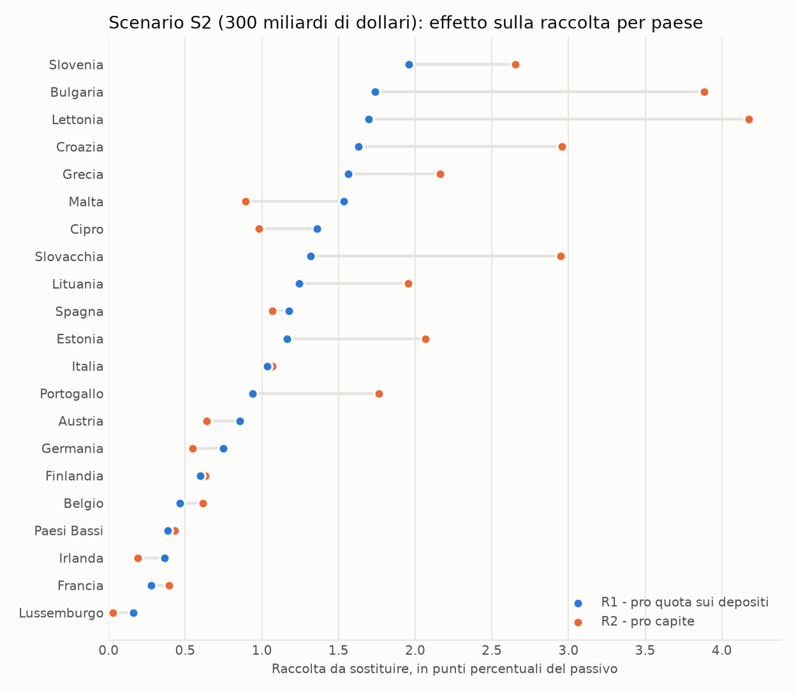

# 05 - Modulo 4: scenari di adozione e raccolta bancaria per paese

Il modulo 4 di [SPEC.md](../SPEC.md) chiede, per ogni livello di adozione delle
stablecoin in dollari, la variazione della raccolta di ciascun paese in miliardi di euro
e in punti percentuali, e quanta raccolta all'ingrosso servirebbe per compensarla.

Le sezioni 1 e 2 sono state committate **prima** di calcolare i risultati. A quel punto
conoscevo i bilanci di settembre 2026 dal modulo 3, quindi gli ordini di grandezza
aggregati erano prevedibili; i risultati per paese no.

## 1. Che tipo di calcolo è

È un esercizio contabile, non una previsione né una stima causale. Risponde a una sola
domanda: se i residenti dell'area euro detenessero un dato importo di stablecoin in
dollari, e lo avessero finanziato prelevando depositi bancari, di quanto si ridurrebbe
la raccolta delle banche di ciascun paese e quanta raccolta all'ingrosso servirebbe per
sostituirla?

Non dice se, quando o con quale probabilità questo accadrà, e non considera le reazioni
di banche, depositanti e banca centrale.

## 2. Parametri, fissati prima dei risultati

### 2.1 Bilanci di partenza

Bilanci bancari di settembre 2026 per i 21 paesi dell'area euro, dal modulo 3
(`data/raw/m3_bsi.csv`). Gli scenari sono applicati ai bilanci di oggi, senza farli
crescere: anche gli importi previsti per il 2030 sono confrontati con la raccolta attuale.

### 2.2 Livelli di adozione

Gli importi vengono dall'ESM Working Paper 79 (sezione 5, verificata nel
[report 02](02_benchmark_e_modulo3.md)): stablecoin in dollari detenute nell'area euro.

| Scenario | Importo (mld $) | Come lo ottiene l'ESM |
|---|---|---|
| S0 - Oggi | 19 | 7,5% di 248 miliardi in circolazione al terzo trimestre 2025 |
| S1 - Base 2030 | 143 | 7,5% di 1.900 miliardi |
| S2 - Alto 2030 | 300 | 7,5% di 4.000 miliardi |
| S3 - Alto 2030, quota doppia | 600 | 15% di 4.000 miliardi |

Sono ipotesi dell'ESM, non stime. Lo script accetta anche un importo qualsiasi, così il
calcolo si può ripetere con il livello che produrrà il modulo 1.

### 2.3 Conversione e tasso di sostituzione

- **Cambio**: tasso di riferimento BCE del 30 settembre 2026, cioè la data dei bilanci.
- **Tasso di sostituzione**: 100%. Ogni euro di stablecoin detenute corrisponde a un
  euro di depositi usciti dalle banche dell'area. È un tetto: una parte potrebbe venire
  da contante, fondi o altre attività, e una parte dei fondi potrebbe tornare alle
  banche per altre vie. Sensibilità al 50%.

### 2.4 Ripartizione tra paesi

Non esistono dati sull'adozione per paese. Si usano due regole.

| Regola | Definizione | Cosa assume |
|---|---|---|
| **R1 - Pro quota sui depositi (principale)** | Il deflusso si distribuisce in proporzione ai depositi a vista di famiglie e imprese di ciascun paese | Ogni euro depositato ha la stessa probabilità di migrare. Tutti i paesi perdono la stessa percentuale di depositi a vista |
| **R2 - Pro capite (alternativa)** | Il deflusso si distribuisce in proporzione alla popolazione (Eurostat, 1° gennaio 2025) | Ogni residente adotta nella stessa misura. I paesi con meno depositi per abitante perdono una percentuale maggiore |

Con R2 il deflusso assegnato a un paese non può superare i suoi depositi a vista; se
accadesse, l'eccedenza verrebbe segnalata, non redistribuita.

### 2.5 Ripartizione tra tipi di deposito

| Regola | Definizione |
|---|---|
| **T1 (principale)** | Escono solo depositi a vista, di famiglie e imprese in proporzione alle rispettive consistenze |
| T2 (alternativa) | Escono solo depositi a vista delle famiglie; la ripartizione tra paesi di R1 si fa sui soli depositi a vista delle famiglie |
| T3 (alternativa) | Escono depositi a vista e vincolati di famiglie e imprese, in proporzione alle consistenze; la ripartizione tra paesi di R1 si fa sui depositi totali |

### 2.6 Grandezze calcolate per ogni paese e scenario

| Grandezza | Formula |
|---|---|
| Deflusso | importo assegnato al paese, in miliardi di euro |
| Perdita di depositi a vista | deflusso / depositi a vista di famiglie e imprese |
| Perdita di depositi della clientela | deflusso / depositi totali di famiglie e imprese |
| Effetto sulla raccolta | deflusso / totale del passivo, in punti percentuali |
| Raccolta all'ingrosso necessaria | pari al deflusso: si assume sostituzione uno a uno |
| Aumento della raccolta all'ingrosso | deflusso / (titoli di debito emessi + depositi da IFM) |

### 2.7 Soglie

Calcolo inverso: quale importo di stablecoin detenute nell'area euro corrisponde a una
perdita dell'1%, del 5% e del 10% dei depositi a vista dell'area, in miliardi di euro e
di dollari, e a quale quota della circolazione ipotizzata dall'ESM.

### 2.8 Sensibilità

Il calcolo è lineare nell'importo: raddoppiare l'adozione, il tasso di sostituzione o la
quota dell'area euro raddoppia ogni risultato. Si riportano comunque il tasso di
sostituzione al 50% e un cambio a ±10%, e soprattutto il confronto tra le due regole di
ripartizione e tra i tre tipi di deposito, che non sono lineari.

## 3. Risultati

Calcolato il 2026-11-24. Bilanci di settembre 2026; cambio di riferimento BCE del 30
settembre 2026: 1,1355 dollari per euro.

Grandezze di partenza per i 21 paesi: 8.180 miliardi di euro di depositi a vista di
famiglie e imprese (5.526 famiglie, 2.654 imprese), 13.799 miliardi di depositi della
clientela, 12.441 miliardi di raccolta all'ingrosso, 44.923 miliardi di passivo.

### 3.1 Area euro

Regola principale (R1 e T1), sostituzione al 100%.

| Scenario | Stablecoin detenute (mld $) | Deflusso (mld €) | Depositi a vista persi | Depositi della clientela persi | Effetto sulla raccolta (punti del passivo) | Aumento della raccolta all'ingrosso |
|---|---|---|---|---|---|---|
| S0 - Oggi | 19 | 16,7 | 0,2% | 0,1% | 0,04 | 0,1% |
| S1 - Base 2030 | 143 | 125,9 | 1,5% | 0,9% | 0,28 | 1,0% |
| S2 - Alto 2030 | 300 | 264,2 | 3,2% | 1,9% | 0,59 | 2,1% |
| S3 - Alto 2030, quota doppia | 600 | 528,4 | 6,5% | 3,8% | 1,18 | 4,2% |

Per l'area nel suo insieme l'effetto è contenuto anche nello scenario più alto: 528
miliardi di euro di depositi da sostituire, pari al 6,5% dei depositi a vista e a un
aumento del 4,2% della raccolta all'ingrosso esistente. Al livello di oggi l'effetto è
dello 0,2% dei depositi a vista.

### 3.2 Le soglie: quanto deve crescere l'adozione perché conti

| Perdita di depositi a vista dell'area | Stablecoin detenute nell'area euro | Multiplo del livello di oggi | Quota di una circolazione di 1.900 mld $ | Quota di una circolazione di 4.000 mld $ |
|---|---|---|---|---|
| 1% | 82 mld € = 93 mld $ | 4,9 volte | 4,9% | 2,3% |
| 5% | 409 mld € = 464 mld $ | 24 volte | 24,4% | 11,6% |
| 10% | 818 mld € = 929 mld $ | 49 volte | 48,9% | 23,2% |

Lettura: perché l'area euro perda il 5% dei depositi a vista, i suoi residenti
dovrebbero detenere 464 miliardi di dollari di stablecoin. Con l'ipotesi ESM di una
quota del 7,5%, servirebbe una circolazione mondiale di circa 6.200 miliardi di
dollari, 25 volte quella del terzo trimestre 2025.

### 3.3 Per paese

Regola principale (R1 e T1). Paesi ordinati per effetto sulla raccolta. Lo scenario S0
è omesso dalla tabella: vale il 13% di S1 in ogni cella.

| Paese | Deflusso S1 (mld €) | Deflusso S2 | Deflusso S3 | Effetto S1 (punti del passivo) | Effetto S2 | Effetto S3 | Aumento ingrosso S1 | Aumento ingrosso S2 | Aumento ingrosso S3 |
|---|---|---|---|---|---|---|---|---|---|
| Slovenia | 0,6 | 1,2 | 2,3 | 0,91 | 1,91 | 3,81 | 12,8% | 26,9% | 53,9% |
| Bulgaria | 1,0 | 2,1 | 4,2 | 0,79 | 1,66 | 3,32 | 10,0% | 20,9% | 41,8% |
| Lettonia | 0,3 | 0,5 | 1,1 | 0,77 | 1,63 | 3,25 | 23,0% | 48,2% | 96,4% |
| Croazia | 0,7 | 1,6 | 3,1 | 0,75 | 1,57 | 3,14 | 10,4% | 21,8% | 43,7% |
| Grecia | 2,7 | 5,6 | 11,3 | 0,74 | 1,54 | 3,09 | 5,6% | 11,6% | 23,3% |
| Malta | 0,3 | 0,7 | 1,4 | 0,70 | 1,47 | 2,94 | 11,3% | 23,8% | 47,5% |
| Cipro | 0,5 | 1,0 | 2,0 | 0,62 | 1,31 | 2,62 | 9,9% | 20,9% | 41,7% |
| Slovacchia | 0,8 | 1,8 | 3,6 | 0,61 | 1,27 | 2,55 | 3,4% | 7,1% | 14,3% |
| Lituania | 0,6 | 1,3 | 2,7 | 0,58 | 1,21 | 2,42 | 12,0% | 25,1% | 50,3% |
| Spagna | 19,3 | 40,5 | 81,1 | 0,56 | 1,17 | 2,34 | 2,6% | 5,4% | 10,8% |
| Estonia | 0,3 | 0,6 | 1,1 | 0,55 | 1,14 | 2,29 | 4,7% | 9,9% | 19,8% |
| Italia | 20,0 | 41,9 | 83,7 | 0,47 | 0,99 | 1,98 | 2,1% | 4,4% | 8,8% |
| Portogallo | 2,1 | 4,5 | 8,9 | 0,43 | 0,91 | 1,82 | 2,5% | 5,3% | 10,5% |
| Austria | 4,2 | 8,9 | 17,7 | 0,39 | 0,82 | 1,64 | 1,3% | 2,6% | 5,3% |
| Germania | 39,5 | 82,9 | 165,7 | 0,33 | 0,69 | 1,39 | 1,4% | 2,8% | 5,7% |
| Finlandia | 1,9 | 3,9 | 7,9 | 0,28 | 0,58 | 1,16 | 0,7% | 1,4% | 2,8% |
| Belgio | 3,2 | 6,8 | 13,6 | 0,22 | 0,46 | 0,91 | 1,2% | 2,5% | 5,1% |
| Paesi Bassi | 5,6 | 11,8 | 23,7 | 0,18 | 0,37 | 0,74 | 0,8% | 1,7% | 3,4% |
| Irlanda | 3,6 | 7,5 | 14,9 | 0,17 | 0,35 | 0,71 | 1,3% | 2,8% | 5,5% |
| Francia | 17,3 | 36,4 | 72,7 | 0,13 | 0,27 | 0,55 | 0,3% | 0,7% | 1,3% |
| Lussemburgo | 1,3 | 2,8 | 5,6 | 0,07 | 0,16 | 0,31 | 0,5% | 1,1% | 2,2% |

Tre letture:

- **L'effetto medio nasconde differenze di dodici volte.** Nello scenario S2 la raccolta
  da sostituire va dallo 0,16% del passivo in Lussemburgo all'1,91% in Slovenia. Con la
  regola R1 l'ordine è per costruzione quello della componente C1 del modulo 3.
- **Il vero collo di bottiglia è la raccolta all'ingrosso, non l'importo.** In Lettonia
  basta mezzo miliardo di euro di deflussi (scenario S2) per richiedere un aumento del
  48% della raccolta all'ingrosso, perché quella esistente è piccolissima. Slovenia,
  Lituania, Malta, Croazia, Bulgaria e Cipro dovrebbero aumentarla tra il 21% e il 27%.
  Germania e Francia, che perdono 83 e 36 miliardi, dovrebbero aumentarla del 2,8% e
  dello 0,7%.
- **I miliardi stanno altrove.** Germania, Italia, Spagna e Francia assorbono il 76% del
  deflusso in ogni scenario.

### 3.4 Se l'adozione fosse uguale per abitante

Scenario S2, regola R1 a confronto con R2.



| Paese | Depositi a vista per abitante (migliaia di €) | Effetto R1 (punti del passivo) | Effetto R2 | Depositi a vista persi R1 | Depositi a vista persi R2 | Aumento ingrosso R1 | Aumento ingrosso R2 |
|---|---|---|---|---|---|---|---|
| Lettonia | 9,1 | 1,63 | 4,08 | 3,2% | 8,1% | 48,2% | 120,9% |
| Bulgaria | 10,1 | 1,66 | 3,74 | 3,2% | 7,3% | 20,9% | 46,9% |
| Slovacchia | 10,2 | 1,27 | 2,85 | 3,2% | 7,2% | 7,1% | 16,0% |
| Croazia | 12,5 | 1,57 | 2,85 | 3,2% | 5,9% | 21,8% | 39,7% |
| Slovenia | 16,8 | 1,91 | 2,58 | 3,2% | 4,4% | 26,9% | 36,5% |
| Grecia | 16,8 | 1,54 | 2,09 | 3,2% | 4,4% | 11,6% | 15,8% |
| Estonia | 13,0 | 1,14 | 2,01 | 3,2% | 5,7% | 9,9% | 17,4% |
| Lituania | 14,2 | 1,21 | 1,94 | 3,2% | 5,2% | 25,1% | 40,3% |
| Portogallo | 12,1 | 0,91 | 1,71 | 3,2% | 6,1% | 5,3% | 9,9% |
| Spagna | 25,5 | 1,17 | 1,04 | 3,2% | 2,9% | 5,4% | 4,8% |
| Italia | 22,0 | 0,99 | 1,03 | 3,2% | 3,3% | 4,4% | 4,5% |
| Cipro | 31,3 | 1,31 | 0,95 | 3,2% | 2,4% | 20,9% | 15,2% |
| Malta | 38,9 | 1,47 | 0,86 | 3,2% | 1,9% | 23,8% | 13,9% |
| Austria | 29,8 | 0,82 | 0,63 | 3,2% | 2,5% | 2,6% | 2,0% |
| Finlandia | 21,7 | 0,58 | 0,61 | 3,2% | 3,4% | 1,4% | 1,5% |
| Belgio | 17,7 | 0,46 | 0,59 | 3,2% | 4,2% | 2,5% | 3,3% |
| Germania | 30,7 | 0,69 | 0,51 | 3,2% | 2,4% | 2,8% | 2,1% |
| Paesi Bassi | 20,3 | 0,37 | 0,41 | 3,2% | 3,6% | 1,7% | 1,9% |
| Francia | 16,3 | 0,27 | 0,38 | 3,2% | 4,5% | 0,7% | 0,9% |
| Irlanda | 42,4 | 0,35 | 0,19 | 3,2% | 1,7% | 2,8% | 1,5% |
| Lussemburgo | 127,7 | 0,16 | 0,03 | 3,2% | 0,6% | 1,1% | 0,2% |

Con un'adozione uguale per abitante i paesi con meno depositi a testa perdono molto di
più: Lettonia, Bulgaria e Slovacchia perderebbero il 7% - 8% dei depositi a vista contro
il 3,2% medio, e l'effetto sulla raccolta raddoppia o più. Malta, Cipro, Irlanda e
Lussemburgo, dove i depositi per abitante sono alti, scendono. Per Italia, Spagna e
Finlandia le due regole danno quasi lo stesso risultato.

L'ordine dei paesi resta simile (correlazione di rango 0,89) e i primi cinque sono gli
stessi in quattro casi su cinque: in testa ci sono comunque sistemi piccoli finanziati
da depositi. In nessuno scenario il deflusso assegnato supera i depositi a vista di un paese.

### 3.5 Da quali depositi esce il denaro

Scenario S2, regola R1, area euro: il deflusso è sempre 264 miliardi di euro, cambia su
cosa pesa.

| Regola | Categoria colpita | Perdita nella categoria |
|---|---|---|
| T1 (principale) | Depositi a vista di famiglie e imprese | 3,2% |
| T2 | Depositi a vista delle sole famiglie | 4,8% |
| T3 | Tutti i depositi di famiglie e imprese | 1,9% |

Per paese l'ordine cambia poco: correlazione di rango 0,96 tra T1 e T2 e 0,93 tra T1 e
T3. Lo spostamento più ampio in T2 è Malta (da 1,47 a 1,78 punti del passivo), dove i
depositi a vista sono quasi tutti di famiglie; in T3 è la Slovenia (da 1,91 a 1,34),
che ha pochi depositi vincolati su cui spalmare il deflusso.

### 3.6 Sensibilità

Scenario S2, area euro, regola principale.

| Variante | Deflusso (mld €) | Depositi a vista persi | Aumento della raccolta all'ingrosso |
|---|---|---|---|
| Base | 264,2 | 3,2% | 2,1% |
| Sostituzione al 50% | 132,1 | 1,6% | 1,1% |
| Dollaro più debole del 10% | 240,2 | 2,9% | 1,9% |
| Dollaro più forte del 10% | 293,6 | 3,6% | 2,4% |

Il calcolo è lineare: ogni risultato delle sezioni 3.1 e 3.3 si scala in proporzione
all'importo, al tasso di sostituzione e alla quota attribuita all'area euro. La scelta
che conta di più non è nessuna di queste, ma la regola di ripartizione tra paesi
(sezione 3.4), che non è osservabile.

### 3.7 Criteri di completamento di SPEC

| Criterio | Stato |
|---|---|
| (a) Scenari definiti da parametri scritti prima dei risultati | Fatto: sezione 2, committata prima |
| (b) Regole di ripartizione dichiarate, con alternativa | Fatto: R1 e R2 tra paesi; T1, T2 e T3 tra tipi di deposito |
| (c) Presentato come esercizio meccanico, con sensibilità | Fatto: sezioni 1, 3.6 e 4 |
| (d) Il codice riproduce le tabelle | Fatto: una seconda esecuzione produce file identici |

## 4. Limiti

- **È un calcolo contabile, non una previsione.** Non dice se e quando l'adozione
  raggiungerà questi livelli. Gli importi sono ipotesi dell'ESM.
- **La sostituzione piena è un tetto.** Chi compra stablecoin può usare contante, fondi
  o altre attività, e il venditore può ridepositare i fondi in una banca dell'area.
  L'effetto reale sui depositi è al massimo quello calcolato.
- **La ripartizione tra paesi non è osservabile.** R1 e R2 sono due ipotesi estreme e
  ragionevoli; l'adozione reale potrebbe seguire età, reddito, rimesse o uso delle
  cripto-attività, per cui non ci sono dati per paese.
- **Bilanci fermi.** Gli scenari al 2030 sono applicati ai bilanci di settembre 2026.
  Se i depositi crescono, le percentuali scendono.
- **Nessuna reazione.** Non si considerano aumenti dei tassi sui depositi, ricorso alla
  banca centrale, riduzione degli attivi o vendita di titoli. Il "fabbisogno di raccolta
  all'ingrosso" è quanto servirebbe se la banca sostituisse tutto uno a uno.
- **Gli aumenti percentuali della raccolta all'ingrosso sono molto alti dove la base è
  piccola.** Il 48% della Lettonia corrisponde a mezzo miliardo di euro. Indicano che il
  canale andrebbe costruito, non che l'importo sia grande.
- **Dati nazionali aggregati**, come nel modulo 3.
- **Nessun effetto causale e nessun effetto sui tassi**: per la trasmissione della
  politica monetaria il riferimento resta il Working Paper BCE 3199.

## 5. Cosa non è stato possibile fare

- **Usare un livello di partenza aggiornato a oggi**: lo scenario S0 è il dato ESM del
  terzo trimestre 2025. Il livello corrente arriverà dal modulo 1; lo script lo accetta
  già con `--importo-usd`.
- **Ripartire il deflusso secondo l'adozione reale per paese**: non esistono dati
  pubblici. Il riquadro BCE copre 11 paesi ma pubblica solo il dato aggregato.
- **Stimare il costo della sostituzione** (quanto costerebbe la nuova raccolta
  all'ingrosso): richiederebbe i tassi di emissione per paese e un'ipotesi sulle
  scadenze, fuori dal perimetro di un esercizio contabile.

## 6. Come si usa

```bash
.venv/bin/python src/module4_scenarios.py                    # scenari ESM, soglie e sensibilità
.venv/bin/python src/module4_scenarios.py --importo-usd 250  # un livello qualsiasi, in miliardi di dollari
.venv/bin/python src/module4_scenarios.py --offline          # senza scaricare cambio e popolazione
```

| File | Contenuto |
|---|---|
| `data/processed/m4_main_table.csv` | Risultati per paese nei quattro scenari, regole R1 e R2 |
| `data/processed/m4_scenarios_by_country.csv` | Tutte le combinazioni di scenario, regola tra paesi e tipo di deposito |
| `data/processed/m4_euro_area.csv` | Totali dell'area euro |
| `data/processed/m4_thresholds.csv` | Soglie |
| `data/processed/m4_rule_comparison.csv` | Confronto tra R1 e R2 nello scenario S2 |
| `data/processed/m4_custom.csv` | Risultato dell'ultimo importo libero richiesto |

---

**Cosa aggiunge questo al programma finale**: lo strumento di scenario. Dato un
qualsiasi importo di stablecoin detenute nell'area euro, restituisce per ciascuno dei 21
paesi i miliardi di depositi da sostituire, l'effetto sulla raccolta e l'aumento di
raccolta all'ingrosso necessario; e tre risultati pronti: al livello di oggi l'effetto è
dello 0,2% dei depositi a vista, servono 464 miliardi di dollari per arrivare al 5%, e
il vincolo più stretto è la raccolta all'ingrosso dei sistemi piccoli, non l'importo.
