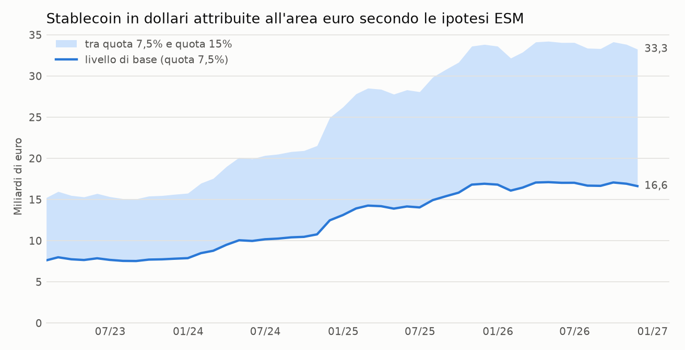

# 06 - Module 1: the level, from external sources

Module 1 of [SPEC.md](../SPEC.md) asks for a number: the value of dollar stablecoins
attributable to the euro area under the external assumptions, updated to current
circulation, alongside the prevalence among consumers.

Sections 1 and 2 were committed **before** the circulation data were read. The two
shares applied (7.5% and 15%) were not chosen here: they come from ESM Working Paper
79, checked against the original in [report 02](02_benchmarks_and_module3_data.md).

## 1. What kind of number it is

It is not an estimate. It is the mechanical application of an external assumption to an
observed figure:

    level = world circulation of dollar stablecoins × share assumed by the ESM

Circulation is measured; the share is a calibration assumption made by the ESM authors,
with no confidence interval. The result inherits all the uncertainty of the share.

## 2. Method, set before the numbers

### 2.1 Circulation

- **Main source**: the DefiLlama public API (`stablecoins.llama.fi`), no key required.
  Three quantities: all dollar-pegged stablecoins, USDT, USDC.
- **Control source**: CoinGecko (`circulating_supply` of USDT and USDC). If the two
  sources differ by more than 2% for either token, the report flags it.
- **Validation against the ESM**: the ESM gives USD 248 billion in circulation in the
  third quarter of 2025. This is compared with the DefiLlama figure for 30 September
  2025. If they match, the base to which the share is applied is the same one the ESM
  authors used.

### 2.2 Level

| Quantity | Definition |
|---|---|
| **Base level** | 7.5% of the circulation of all dollar stablecoins (the base used by the ESM) |
| **High level** | 15% of the same circulation (ESM sensitivity scenario D) |
| Of which USDT and USDC | The same shares applied to the circulation of USDT and USDC alone, which are the subject of the project |

In dollars and in euros, at the ECB reference rate for the latest available day.

### 2.3 Time series

The same calculation at each month-end since January 2023, and the ratio of the base
level to the sight deposits of euro area households and firms (from module 3) in the
months for which the bank data exist.

### 2.4 Prevalence among consumers

Reported without processing: 5% of consumers report that their household holds
stablecoins (ECB, CES survey, August 2025, 11 countries). It cannot be updated: it
depends on the ECB's next survey round.

### 2.5 Consistency check between the two sources

The two external sources do not measure the same thing, but they can be compared with a
declared calculation. The ECB box says that about 10% of holders have at least EUR
10,000 in stablecoins (November 2025). This gives a **floor**:

    floor = euro area households × 5% × 10% × EUR 10,000

with the number of households from Eurostat. It is a minimum, because it ignores 90% of
holders and counts exactly EUR 10,000 for the others. It is compared with the base level
at the end of November 2025. It is this project's own calculation on ECB figures, not
an ECB estimate, and it assumes that the results for the 11 survey countries hold for
all 21.

### 2.6 Link with module 4

The base level and the high level are saved in `data/processed/m1_level.json`. Module 4
reads them and adds them to the ESM scenarios as an updated starting level.

## 3. Results

Calculated on 2026-11-24.

### 3.1 The number

Circulation on 24 November 2026 (DefiLlama): USDT USD 174.9 billion, USDC 69.4,
together 244.2. ECB reference rate on the same day: 1.0963 dollars per euro.

| | Share applied | In dollars | In euros |
|---|---|---|---|
| **Base level** | 7.5% | **18.3 billion** | **16.7 billion** |
| **High level** | 15% | **36.6 billion** | **33.4 billion** |

Relative to the sight deposits of euro area households and firms (EUR 8,180 billion in
September 2026), the base level is **0.21%** and the high level 0.42%.

Prevalence among consumers, to be read alongside: **5%** report that their household
holds stablecoins (ECB, August 2025, 11 countries).

This is not an estimate of how much euro area residents hold. It is what results from
applying to today's circulation the share that the ESM authors assumed. If the true
share were different, the number would change in proportion.

### 3.2 Departure from the pre-registered method

Section 2.2 defined the base level on the circulation of **all** dollar stablecoins,
describing it as "the base used by the ESM". The validation planned in section 2.1
showed that this premise was wrong:

| At 30 September 2025 | USD billion | Difference from the ESM's 248 |
|---|---|---|
| USDT + USDC (DefiLlama) | 247.8 | -0.1% |
| All dollar stablecoins (DefiLlama) | 292.9 | +18.1% |

I rechecked the text: in section 4.4.1 (p. 39) the authors consider only USDT and USDC,
174 and 74 billion, and assume that they represent the entire universe of dollar
stablecoins. The base to which the 7.5% refers is therefore USDT plus USDC.

The level in section 3.1 is calculated on that base, which is also the scope of the
project. The pre-registered definition remains as a variant: with all dollar
stablecoins (USD 283.7 billion) the base level would be USD 21.3 billion, i.e. EUR 19.4
billion, and the high level 42.6 and 38.8. The difference is 16%.

### 3.3 Source checks

| Check | Outcome |
|---|---|
| DefiLlama against CoinGecko, USDT | 174.86 against 174.84 billion: +0.01% |
| DefiLlama against CoinGecko, USDC | 69.37 against 69.12 billion: +0.36% |
| Flag threshold | 2%: not exceeded |
| ESM base at 30 September 2025 | 247.8 against 248: -0.1% |
| ESM level recalculated | 18.6 against the USD 19 billion given in the paper |

USDT and USDC together are 86% of all dollar stablecoins in circulation.

### 3.4 The number over time



| Month-end | USDT + USDC (USD bn) | Base level (USD bn) | Base level (EUR bn) | High level (EUR bn) | Base level over the area's sight deposits |
|---|---|---|---|---|---|
| January 2023 | 110.0 | 8.2 | 7.6 | 15.2 | 0.09% |
| January 2024 | 122.7 | 9.2 | 8.5 | 17.0 | 0.11% |
| January 2025 | 192.8 | 14.5 | 13.9 | 27.8 | 0.18% |
| September 2025 | 247.8 | 18.6 | 15.8 | 31.7 | 0.20% |
| January 2026 | 255.6 | 19.2 | 16.1 | 32.2 | 0.20% |
| May 2026 | 264.4 | 19.8 | 17.0 | 34.1 | 0.21% |
| September 2026 | 258.4 | 19.4 | 17.1 | 34.1 | 0.21% |
| 24 November 2026 | 244.2 | 18.3 | 16.7 | 33.4 | n.a. |

- **The level has more than doubled in four years and has stalled over the past year.**
  In euros it rose from 7.6 to 16.7 billion; the peak in dollars was in April 2026
  (USD 20.0 billion) and circulation has fallen since then.
- **Compared with the figure on which the ESM built its scenarios, circulation is now
  1.5% lower.** The starting point of the scenarios has not become outdated.
- **Relative to deposits it has been stable at around 0.2% since mid-2025.**

Since the share is constant, the series replicates the path of world circulation and,
for the values in euros, of the exchange rate: it contains no information on the euro
area itself.

### 3.5 Are the two external sources compatible?

The ECB box says that 5% of consumers own stablecoins and that about 10% of holders have
at least EUR 10,000 in them. With 163.5 million households in the 21 countries
(Eurostat, 2025):

| Step | Value |
|---|---|
| Households with stablecoins (5%) | 8.2 million |
| Of which with at least EUR 10,000 (10%) | 0.8 million |
| **Floor** (these only, at exactly EUR 10,000) | **EUR 8.2 billion** |
| Base level at end-November 2025 | EUR 16.9 billion |
| High level at end-November 2025 | EUR 33.8 billion |
| Average amount per holding household implied by the base level | about EUR 2,100 |

The two sources do not contradict each other. The floor derived from the ECB survey is
about half the ESM base level, and the base level implies an average amount of about
EUR 2,100 per holding household, consistent with a distribution in which most have
little and one tenth have more than EUR 10,000.

Nothing more can be said: the calculation does not confirm the 7.5%, it only shows that
it is not contradicted by the ECB data. It is this project's own calculation, it assumes
that the 11 survey countries represent all 21, and it treats as households the
consumers interviewed, who were asked the question with reference to their household.

### 3.6 Link with module 4

The level is written to `data/processed/m1_level.json` and module 4 adds it to the
scenarios. With the September 2026 balance sheets:

| Scenario | Stablecoins held (USD bn) | Deposits to be replaced (EUR bn) | Sight deposits lost | Increase in wholesale funding |
|---|---|---|---|---|
| Today, base level | 18.3 | 16.1 | 0.20% | 0.13% |
| Today, high level | 36.6 | 32.3 | 0.39% | 0.26% |

By country, at the base level: the funding to be replaced ranges from 0.01% of
liabilities in Luxembourg to 0.12% in Slovenia; in billions, 5.1 in Germany, 2.6 in
Italy, 2.5 in Spain. The detail is in `data/processed/m4_scenarios_by_country.csv`,
scenarios `M1_oggi_base` and `M1_oggi_alto`.

The euro amounts here are slightly lower than those in section 3.1 because module 4
converts at the exchange rate on the balance-sheet date (1.1355) and not at today's
rate.

### 3.7 SPEC completion criteria

| Criterion | Status |
|---|---|
| (a) Table of references checked against the originals | Done in report 02, part A |
| (b) Script that downloads the circulation of USDT and USDC from a verified free source and produces the level in the two scenarios, with the date | Done: DefiLlama, checked against CoinGecko and against the ESM base |
| (c) Result labelled as the application of an external assumption | Done: sections 1 and 3.1, and the `avvertenza` field in the output file |

## 4. Limitations

- **The share is an assumption.** The 7.5% and the 15% are calibration choices by the
  ESM authors, who apply a judgemental discount to the estimates of Reuter (2025). They
  have no confidence interval. All the uncertainty of the number lies there, and it
  cannot be quantified.
- **The number moves only with world circulation and with the exchange rate.** If euro
  area residents doubled their holdings with circulation unchanged, this indicator would
  not notice.
- **It refers to households**, as in the ESM. Holdings of firms and intermediaries are
  not included.
- **The 5% prevalence dates from August 2025** and covers 11 countries.
- **Circulation comes from an aggregator**, not from the issuers. The two cross-checks
  match within 0.4%.

## 5. What could not be done

- **Provide a measured level.** This is the result of tests 00 and 01: with free data
  the euro area share cannot be estimated. This module applies a declared assumption.
- **Update the prevalence among consumers**: it depends on the ECB's next survey round.
- **Read circulation directly from the issuers' transparency pages**: they have no
  stable public API; the comparison between two independent aggregators is the check
  adopted.

## 6. How to use it

```bash
.venv/bin/python src/module1_level.py       # updates the level to today's circulation
.venv/bin/python src/module4_scenarios.py   # recalculates the scenarios with the new level
```

| File | Contents |
|---|---|
| `data/processed/m1_level.json` | Base and high level, circulation, exchange rate, checks |
| `data/processed/m1_monthly_series.csv` | Month-end series since 2023 |
| `data/raw/m1_circulation_daily.csv` | Daily circulation of USDT, USDC and all dollar stablecoins |

---

**What this adds to the final programme**: the starting point for everything else. A
level that can be updated with one command (EUR 16.7 billion in the base scenario, 33.4
in the high one, 0.2% - 0.4% of the area's sight deposits), anchored to the same base as
the ESM and fed directly into the module 4 scenarios; and the check that the two
external sources, the ECB survey and the ESM assumption, are compatible with each other.
