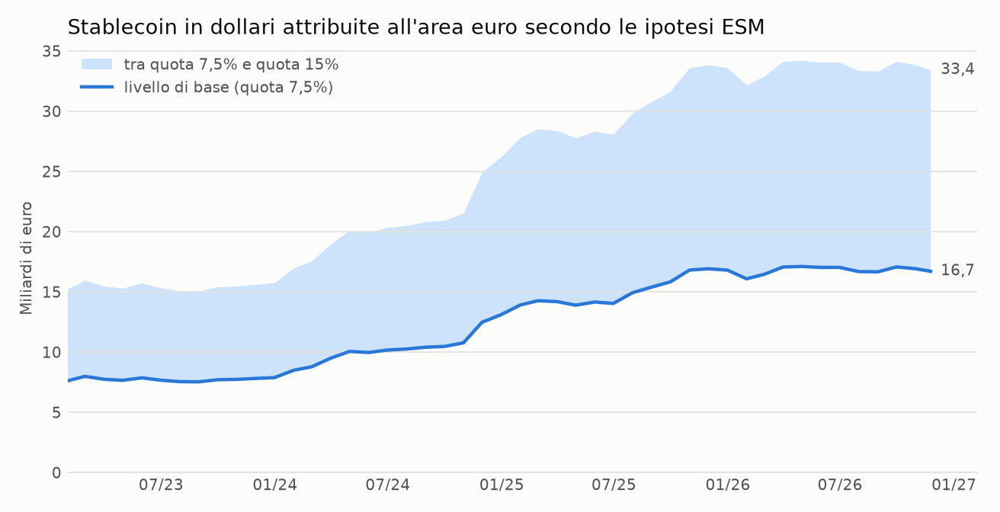

# 06 - Modulo 1: il livello, da fonti esterne

Il modulo 1 di [SPEC.md](../SPEC.md) chiede un numero: il valore delle stablecoin in
dollari attribuibile all'area euro secondo le ipotesi esterne, aggiornato alla
circolazione corrente, affiancato dalla diffusione tra i consumatori.

Le sezioni 1 e 2 sono state committate **prima** di leggere i dati di circolazione. Le
due quote applicate (7,5% e 15%) non sono scelte nostre: vengono dall'ESM Working Paper
79, verificato sull'originale nel [report 02](02_benchmark_e_modulo3.md).

## 1. Che tipo di numero è

Non è una stima. È l'applicazione meccanica di un'ipotesi esterna a un dato osservato:

    livello = circolazione mondiale di stablecoin in dollari × quota assunta dall'ESM

La circolazione è misurata; la quota è un'ipotesi di calibrazione degli autori dell'ESM,
senza intervallo di confidenza. Il risultato eredita tutta l'incertezza della quota.

## 2. Metodo, fissato prima dei numeri

### 2.1 Circolazione

- **Fonte principale**: API pubblica di DefiLlama (`stablecoins.llama.fi`), senza chiave.
  Tre grandezze: tutte le stablecoin ancorate al dollaro, USDT, USDC.
- **Fonte di controllo**: CoinGecko (`circulating_supply` di USDT e USDC). Se le due
  fonti differiscono di più del 2% per uno dei due token, il report lo segnala.
- **Convalida sull'ESM**: l'ESM indica 248 miliardi di dollari in circolazione al terzo
  trimestre 2025. Si confronta con il dato DefiLlama del 30 settembre 2025. Se tornano,
  la base a cui applicare la quota è la stessa usata dagli autori.

### 2.2 Livello

| Grandezza | Definizione |
|---|---|
| **Livello di base** | 7,5% della circolazione di tutte le stablecoin in dollari (la base usata dall'ESM) |
| **Livello alto** | 15% della stessa circolazione (scenario di sensibilità D dell'ESM) |
| Di cui USDT e USDC | Le stesse quote applicate alla sola circolazione di USDT e USDC, che sono l'oggetto del progetto |

In dollari e in euro, al tasso di riferimento BCE dell'ultimo giorno disponibile.

### 2.3 Serie storica

Lo stesso calcolo a ogni fine mese dal gennaio 2023, e il rapporto tra il livello di
base e i depositi a vista di famiglie e imprese dell'area euro (dal modulo 3) nei mesi
in cui il dato bancario esiste.

### 2.4 Diffusione tra i consumatori

Riportata senza elaborazioni: 5% dei consumatori dichiara che in famiglia si possiedono
stablecoin (BCE, indagine CES, agosto 2025, 11 paesi). Non è aggiornabile: dipende dalla
prossima rilevazione della BCE.

### 2.5 Controllo di coerenza tra le due fonti

Le due fonti esterne non misurano la stessa cosa, ma si possono confrontare con un
calcolo dichiarato. Il riquadro BCE dice che circa il 10% dei detentori ha almeno 10.000
euro in stablecoin (novembre 2025). Ne segue un **pavimento**:

    pavimento = famiglie dell'area euro × 5% × 10% × 10.000 euro

con il numero di famiglie da Eurostat. È un minimo, perché ignora il 90% dei detentori
e conta 10.000 euro esatti per gli altri. Si confronta con il livello di base alla fine
di novembre 2025. È un nostro calcolo su cifre BCE, non una stima della BCE, e assume
che i risultati degli 11 paesi dell'indagine valgano per tutti i 21.

### 2.6 Collegamento con il modulo 4

Il livello di base e quello alto vengono salvati in `data/processed/m1_level.json`. Il
modulo 4 li legge e li aggiunge agli scenari ESM come livello di partenza aggiornato.

## 3. Risultati

Calcolato il 2026-11-24.

### 3.1 Il numero

Circolazione del 24 novembre 2026 (DefiLlama): USDT 174,9 miliardi di dollari, USDC 69,4,
insieme 244,2. Cambio di riferimento BCE dello stesso giorno: 1,0963 dollari per euro.

| | Quota applicata | In dollari | In euro |
|---|---|---|---|
| **Livello di base** | 7,5% | **18,3 miliardi** | **16,7 miliardi** |
| **Livello alto** | 15% | **36,6 miliardi** | **33,4 miliardi** |

Rispetto ai depositi a vista di famiglie e imprese dell'area euro (8.180 miliardi di
euro a settembre 2026) il livello di base vale lo **0,21%** e quello alto lo 0,42%.

Diffusione tra i consumatori, da leggere accanto: **5%** dichiara che in famiglia si
possiedono stablecoin (BCE, agosto 2025, 11 paesi).

Questo non è una stima di quanto detengono i residenti dell'area euro. È ciò che
risulta applicando alla circolazione di oggi la quota che gli autori dell'ESM hanno
assunto. Se la quota vera fosse diversa, il numero cambierebbe in proporzione.

### 3.2 Scostamento dal metodo pre-registrato

La sezione 2.2 definiva il livello di base sulla circolazione di **tutte** le stablecoin
in dollari, indicandola come "la base usata dall'ESM". La convalida prevista dalla
sezione 2.1 ha mostrato che quella premessa era sbagliata:

| Al 30 settembre 2025 | Miliardi di dollari | Differenza dai 248 dell'ESM |
|---|---|---|
| USDT + USDC (DefiLlama) | 247,8 | -0,1% |
| Tutte le stablecoin in dollari (DefiLlama) | 292,9 | +18,1% |

Ho ricontrollato il testo: nella sezione 4.4.1 (p. 39) gli autori considerano solo USDT
e USDC, 174 e 74 miliardi, e assumono che rappresentino l'intero universo delle
stablecoin in dollari. La base a cui si riferisce il 7,5% è quindi USDT più USDC.

Il livello della sezione 3.1 è calcolato su quella base, che è anche il perimetro del
progetto. La definizione pre-registrata resta come variante: con tutte le stablecoin in
dollari (283,7 miliardi) il livello di base sarebbe 21,3 miliardi di dollari, cioè 19,4
miliardi di euro, e quello alto 42,6 e 38,8. La differenza è del 16%.

### 3.3 Controlli sulle fonti

| Controllo | Esito |
|---|---|
| DefiLlama contro CoinGecko, USDT | 174,86 contro 174,84 miliardi: +0,01% |
| DefiLlama contro CoinGecko, USDC | 69,37 contro 69,12 miliardi: +0,36% |
| Soglia di segnalazione | 2%: non superata |
| Base ESM al 30 settembre 2025 | 247,8 contro 248: -0,1% |
| Livello ESM ricalcolato | 18,6 contro i 19 miliardi di dollari indicati dal paper |

USDT e USDC insieme sono l'86% di tutte le stablecoin in dollari in circolazione.

### 3.4 Il numero nel tempo



| Fine mese | USDT + USDC (mld $) | Livello di base (mld $) | Livello di base (mld €) | Livello alto (mld €) | Base sui depositi a vista dell'area |
|---|---|---|---|---|---|
| Gennaio 2023 | 110,0 | 8,2 | 7,6 | 15,2 | 0,09% |
| Gennaio 2024 | 122,7 | 9,2 | 8,5 | 17,0 | 0,11% |
| Gennaio 2025 | 192,8 | 14,5 | 13,9 | 27,8 | 0,18% |
| Settembre 2025 | 247,8 | 18,6 | 15,8 | 31,7 | 0,20% |
| Gennaio 2026 | 255,6 | 19,2 | 16,1 | 32,2 | 0,20% |
| Maggio 2026 | 264,4 | 19,8 | 17,0 | 34,1 | 0,21% |
| Settembre 2026 | 258,4 | 19,4 | 17,1 | 34,1 | 0,21% |
| 24 novembre 2026 | 244,2 | 18,3 | 16,7 | 33,4 | n.d. |

- **Il livello è più che raddoppiato in quattro anni e si è fermato da uno.** In euro è
  passato da 7,6 a 16,7 miliardi; il massimo in dollari è di aprile 2026 (20,0 miliardi)
  e da allora la circolazione è scesa.
- **Rispetto al dato su cui l'ESM ha costruito i suoi scenari la circolazione è oggi
  più bassa dell'1,5%.** Il punto di partenza degli scenari non è invecchiato.
- **In rapporto ai depositi è stabile intorno allo 0,2% da metà 2025.**

Poiché la quota è costante, la serie replica l'andamento della circolazione mondiale e,
per la parte in euro, del cambio: non contiene alcuna informazione sull'area euro in sé.

### 3.5 Le due fonti esterne sono compatibili?

Il riquadro BCE dice che il 5% dei consumatori possiede stablecoin e che circa il 10%
dei detentori ne ha almeno 10.000 euro. Con 163,5 milioni di famiglie nei 21 paesi
(Eurostat, 2025):

| Passaggio | Valore |
|---|---|
| Famiglie con stablecoin (5%) | 8,2 milioni |
| Di cui con almeno 10.000 euro (10%) | 0,8 milioni |
| **Pavimento** (solo queste, a 10.000 euro esatti) | **8,2 miliardi di euro** |
| Livello di base a fine novembre 2025 | 16,9 miliardi di euro |
| Livello alto a fine novembre 2025 | 33,8 miliardi di euro |
| Importo medio per famiglia detentrice implicito nel livello di base | circa 2.100 euro |

Le due fonti non si contraddicono. Il pavimento ricavato dall'indagine BCE è circa la
metà del livello di base ESM, e il livello di base implica un importo medio di circa
2.100 euro per famiglia detentrice, compatibile con una distribuzione in cui la maggior
parte ha poco e un decimo ha più di 10.000 euro.

Non si può dire di più: il calcolo non conferma il 7,5%, mostra soltanto che non è
smentito dai dati della BCE. È un nostro calcolo, assume che gli 11 paesi dell'indagine
rappresentino tutti i 21, e tratta come famiglie i consumatori intervistati, a cui la
domanda è stata posta con riferimento alla famiglia.

### 3.6 Collegamento con il modulo 4

Il livello viene scritto in `data/processed/m1_level.json` e il modulo 4 lo aggiunge
agli scenari. Con i bilanci di settembre 2026:

| Scenario | Stablecoin detenute (mld $) | Depositi da sostituire (mld €) | Depositi a vista persi | Aumento della raccolta all'ingrosso |
|---|---|---|---|---|
| Oggi, livello di base | 18,3 | 16,1 | 0,20% | 0,13% |
| Oggi, livello alto | 36,6 | 32,3 | 0,39% | 0,26% |

Per paese, al livello di base: la raccolta da sostituire va dallo 0,01% del passivo in
Lussemburgo allo 0,12% in Slovenia; in miliardi, 5,1 in Germania, 2,6 in Italia, 2,5 in
Spagna. Il dettaglio è in `data/processed/m4_scenarios_by_country.csv`, scenari
`M1_oggi_base` e `M1_oggi_alto`.

Gli importi in euro qui sono leggermente più bassi di quelli della sezione 3.1 perché
il modulo 4 converte al cambio della data dei bilanci (1,1355) e non a quello di oggi.

### 3.7 Criteri di completamento di SPEC

| Criterio | Stato |
|---|---|
| (a) Tabella dei riferimenti verificata sugli originali | Fatto nel report 02, parte A |
| (b) Script che scarica la circolazione di USDT e USDC da una fonte gratuita verificata e produce il livello nei due scenari, con data | Fatto: DefiLlama, verificata con CoinGecko e con la base dell'ESM |
| (c) Risultato etichettato come applicazione di un'ipotesi esterna | Fatto: sezioni 1 e 3.1, e campo `avvertenza` nel file di output |

## 4. Limiti

- **La quota è un'ipotesi.** Il 7,5% e il 15% sono scelte di calibrazione degli autori
  dell'ESM, che scontano a giudizio le stime di Reuter (2025). Non hanno intervallo di
  confidenza. Tutta l'incertezza del numero sta lì, e non è quantificabile.
- **Il numero si muove solo con la circolazione mondiale e con il cambio.** Se i
  residenti dell'area euro raddoppiassero le loro detenzioni a circolazione invariata,
  questo indicatore non se ne accorgerebbe.
- **Si riferisce alle famiglie**, come nell'ESM. Le detenzioni di imprese e intermediari
  non sono comprese.
- **La diffusione al 5% è ferma ad agosto 2025** e copre 11 paesi.
- **La circolazione viene da un aggregatore**, non dagli emittenti. I due controlli
  incrociati tornano entro lo 0,4%.

## 5. Cosa non è stato possibile fare

- **Dare un livello misurato.** È il risultato dei test 00 e 01: con dati gratuiti la
  quota dell'area euro non è stimabile. Questo modulo applica un'ipotesi dichiarata.
- **Aggiornare la diffusione tra i consumatori**: dipende dalla prossima rilevazione
  della BCE.
- **Leggere la circolazione direttamente dalle pagine di trasparenza degli emittenti**:
  non hanno un'API pubblica stabile; il confronto tra due aggregatori indipendenti è il
  controllo adottato.

## 6. Come si usa

```bash
.venv/bin/python src/module1_level.py       # aggiorna il livello alla circolazione di oggi
.venv/bin/python src/module4_scenarios.py   # ricalcola gli scenari con il nuovo livello
```

| File | Contenuto |
|---|---|
| `data/processed/m1_level.json` | Livello di base e alto, circolazione, cambio, controlli |
| `data/processed/m1_monthly_series.csv` | Serie di fine mese dal 2023 |
| `data/raw/m1_circulation_daily.csv` | Circolazione giornaliera di USDT, USDC e di tutte le stablecoin in dollari |

---

**Cosa aggiunge questo al programma finale**: il punto di partenza di tutto il resto.
Un livello aggiornabile con un comando (16,7 miliardi di euro nello scenario di base,
33,4 in quello alto, lo 0,2% - 0,4% dei depositi a vista dell'area), ancorato alla
stessa base dell'ESM e alimentato direttamente negli scenari del modulo 4; e la verifica
che le due fonti esterne, indagine BCE e ipotesi ESM, sono tra loro compatibili.
