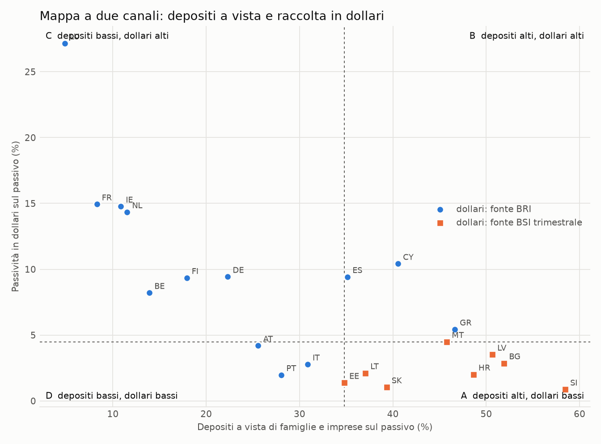

# 07 - Module 5: effect on credit and on transmission

Module 5 of [SPEC.md](../SPEC.md) takes the module 4 scenarios from deposits to credit,
applying the coefficients of ECB Working Paper 3199, and places the countries on a
two-channel map.

Sections 1 and 2 were committed **before** the results were calculated. The
coefficients in section 1 are inputs, transcribed from the paper.

**Caveat that applies to the whole document**: these are coefficients estimated on
individual banks, applied here to national aggregates. They give orders of magnitude,
not forecasts.

## 1. Coefficients from ECB Working Paper 3199, checked against the original

Altavilla, Boucinha, Burlon, Adalid, Fortes, Maruhn, "Stablecoins and monetary policy
transmission", ECB Working Paper 3199, March 2026
([PDF](https://www.ecb.europa.eu/pub/pdf/scpwps/ecb.wp3199~ad552b59ec.en.pdf)). Read
in full; tables 1 and 3 were also checked against the page image. Page numbers are the
printed ones.

| No. | Coefficient | Value | What exactly it measures | Source |
|---|---|---|---|---|
| 1 | Deposits → loans rule | EUR 100 bn less in retail deposits → about EUR 50 bn less in loans | Elasticity implicit in the estimate on all banks, which the paper's authors state is in line with the literature | Section 3.2, p. 18 |
| 1a | Estimate it derives from | A fall of one standard deviation in sight deposits over total assets (0.8 points) reduces annual loan growth by about 1 point, i.e. 0.4 points of total assets | Estimate on all banks together, "not shown" in a table | Section 3.2, p. 18 |
| 2a | Fall in sight deposits, **low** retail share banks | -0.441 (std. error 0.306), not significant; with demand control -0.342 (0.293) | Cumulative growth of loans to the non-financial private sector between t-1 and t+24, in points, for a fall of one standard deviation in household sight deposits over total assets | Table 1, columns 3 and 4, p. 17 |
| 2b | Fall in sight deposits, **high** retail share banks | -3.089** (0.197); with demand control -4.173* (0.163) | As above. High retail share = above the 75th percentile of the ratio of household deposits to deposits of households plus non-bank intermediaries | Table 1, columns 3 and 4, p. 17 |
| 2c | Stablecoin shock | -2.633** (1.055); with demand control -2.230** (1.102) | Cumulative loan growth at 24 months for a one standard deviation shock to stablecoin exposure | Table 1, columns 1 and 2, p. 17 |
| 3a | Loan response to +25 bp, **low** dollar funding | -1.590** (0.617); with demand control -1.330** (0.596) | Annual loan growth 24 months later, in points, for banks with a lot of wholesale funding and a dollar share below the 75th percentile | Table 3, columns 1 and 3, p. 28 |
| 3b | Loan response to +25 bp, **high** dollar funding | -0.064 (0.578); with demand control +0.293 (0.540): not significant | As above, dollar share above the 75th percentile | Table 3, columns 2 and 4, p. 28 |
| 3c | Difference between 3a and 3b | F = 3.36* and 4.20** | Test of equality of the two coefficients | Table 3, p. 28 |
| 4a | Pass-through to lending rates, all banks | about 70% after one year, about 100% after two | Points of the rate on loans to firms per point of the policy rate | Section 4.2 and figure 9, pp. 22-23 |
| 4b | Pass-through to lending rates, wholesale-dependent banks | about 80% after 12 months, about 120% after two years | As above, banks in the lowest quartile of the ratio of retail deposits to total deposits | Section 4.2 and figure 9, pp. 22-23 |
| 4c | Pass-through to deposit rates | about 10% (all); over 30% after 18-24 months (wholesale-dependent) | Points of the rate on retail sight deposits per point of the policy rate | Section 4.2 and figure 9, p. 23 |
| 4d | Loan response to +25 bp | about -0.3 points (all); almost -0.7 points (wholesale-dependent), with an interval reaching -1.5 | Peak of annual growth of loans to firms, about 12 months later | Section 4.2 and figure 9, p. 23 |

Two notes on the transcription:

- In table 1 the standard errors of the "high retail share" coefficients (0.197 and
  0.163) are reported as printed. With those values the coefficients would be
  significant at 1%, while the asterisks indicate 5% and 10%: one of the two
  indications in the paper is probably a typo. The point estimates are used here.
- Values 4a-4d are read from the text, which describes figure 9 with "about": they do
  not appear in any table.

## 2. Method, set before the results

### 2.1 Additional data

From the ECB BSI dataset, for the 21 countries, monthly: loans to households
(`A20`, sector 2250) and to non-financial corporations (sector 2240); deposits of
non-bank intermediaries (sectors 2210 and 2220), for the retail share.

### 2.2 From the outflow to loans

For each country and scenario, module 4 gives a deposit outflow. Three variants.

| Variant | Rule |
|---|---|
| **Uniform** | Loan reduction = 0.5 × outflow (coefficient 1), the same for all countries |
| **Range** | For each country the effect is calculated with the low coefficient (2a) and with the high one (2b) |
| **Threshold** | High coefficient for the countries above the retail share threshold, low coefficient for the others |

Application of coefficients 2a and 2b to a country:

    fall in loans (%) = coefficient × (outflow / total liabilities, in points) / 0.8
    loan reduction (EUR bn) = fall (%) × loans to households and firms

The 0.8 is the standard deviation given by the paper for the estimate on all banks; it
is assumed to apply also to table 1, which uses the same variable. The column 3
estimates are used (-0.441 and -3.089); column 4 is reported as a sensitivity. The
effect is cumulated over 24 months.

### 2.3 Retail share threshold

The paper classifies as "high retail share" the banks above the 75th percentile of the
ratio of household deposits to deposits of households plus non-bank intermediaries. The
threshold for countries is defined in the same way:

    retail share = household deposits / (household deposits + deposits of
                   other financial intermediaries, insurance corporations and pension funds)

**Threshold: the 75th percentile of this share across the 21 countries, in the latest
month.** The countries above it receive the high coefficient. It is a transposition: the
paper's percentile is calculated across banks and its value is not published.

### 2.4 Two-channel map

- **Axis 1**: sight deposits of households and firms over total liabilities (C1 of module 3).
- **Axis 2**: dollar liabilities over total liabilities. Source: BIS statistics for
  the 13 reporting countries. For the other eight, the following are tried, in order:
  the ECB consolidated banking data and the quarterly currency breakdown of the BSI
  dataset (dollar deposits plus debt securities issued in dollars). Where both sources
  exist they are compared, to see whether they are comparable; the countries with the
  alternative source are marked.
- **Quadrant thresholds**: the median of the 21 countries on each axis.
- **Quadrants**: A = high deposits and low dollars; B = high deposits and high dollars;
  C = low deposits and high dollars; D = low deposits and low dollars.
- For each quadrant, the report sets out what coefficients 3 and 4 imply for
  transmission.

### 2.5 What is not done

No own coefficients are estimated, coefficient 2c is not applied (it requires the
attention shock defined by the paper's authors) and no country-level effects on rates
are calculated: coefficients 3 and 4 serve only to qualify the quadrants.

## 3. Results

Calculated on 2026-11-25 on the September 2026 balance sheets. Loans to households and
non-financial corporations in the 21 countries: EUR 12,502 billion, 28% of liabilities.

### 3.1 Retail share threshold

The 75th percentile of the retail share across the 21 countries is **92.4%**. Above the
threshold, and therefore with the high coefficient in the threshold variant: **Bulgaria,
Lithuania, Slovenia, Slovakia, Croatia**. The share ranges from 21% in Luxembourg to 96%
in Bulgaria; for the area as a whole it is 77%. Table in `data/processed/m5_retail_share.csv`.

### 3.2 Credit reduction, euro area

Allocation rule R1, effect cumulated over 24 months.

| Scenario | Stablecoins held (USD bn) | Outflow (EUR bn) | Uniform (EUR bn) | Range low - high (EUR bn) | Threshold (EUR bn) | Threshold, % of loans | Uniform, % of loans |
|---|---|---|---|---|---|---|---|
| Today, 7.5% share | 18.3 | 16.1 | 8.1 | 2.8 - 19.3 | 3.6 | 0.03% | 0.06% |
| Today, 15% share | 36.6 | 32.3 | 16.1 | 5.5 - 38.6 | 7.1 | 0.06% | 0.13% |
| ESM base 2030 | 143 | 125.9 | 63.0 | 21.5 - 150.8 | 27.7 | 0.22% | 0.50% |
| ESM high 2030 | 300 | 264.2 | 132.1 | 45.2 - 316.3 | 58.2 | 0.47% | 1.06% |
| ESM high 2030, 15% share | 600 | 528.4 | 264.2 | 90.3 - 632.5 | 116.4 | 0.93% | 2.11% |

How to read the three columns:

- **Uniform** is the paper's rule: 50 cents of loans per euro of deposits.
- **The range** applies to all countries first the coefficient of low retail share
  banks, then that of high retail share banks. Its upper end is seven times its lower
  end: per euro of outflow, the loan reduction goes from 17 cents to EUR 1.20. The upper
  end exceeds the outflow itself, because in the paper high retail share banks react
  more than proportionally.
- **Threshold** is worth 22 cents per euro, less than the uniform rule: the high
  coefficient applies only to five small countries, which together have 2% of loans.

With the estimates in column 4 of table 1 (control for credit demand), the threshold
variant in the ESM high scenario goes from 58.2 to 53.9 billion and the range becomes
35.0 - 427.3.

### 3.3 Top five countries

Threshold variant, allocation rule R1.

| Scenario | Top five in EUR billion | Top five as a share of loans |
|---|---|---|
| ESM base 2030 | Germany 6.4; Spain 3.8; Italy 3.5; France 2.2; Slovakia 2.1 | Slovenia 3.5%; Bulgaria 3.1%; Croatia 2.9%; Slovakia 2.3%; Lithuania 2.2% |
| ESM high 2030 | Germany 13.4; Spain 7.9; Italy 7.3; France 4.6; Slovakia 4.3 | Slovenia 7.4%; Bulgaria 6.4%; Croatia 6.1%; Slovakia 4.9%; Lithuania 4.7% |
| ESM high 2030, 15% share | Germany 26.9; Spain 15.8; Italy 14.6; France 9.2; Slovakia 8.7 | Slovenia 14.7%; Bulgaria 12.8%; Croatia 12.1%; Slovakia 9.8%; Lithuania 9.3% |

The calculation is linear, so the order does not change across scenarios. With the per
capita allocation rule (R2) in the ESM high scenario, the threshold variant gives EUR
72.3 billion for the area (0.58% of loans), and the top countries by share of loans are
Bulgaria 14.4%, Slovakia 11.0%, Croatia 11.0%, Slovenia 10.0% and Lithuania 7.5%.

### 3.4 All countries, ESM high 2030 scenario

Allocation rule R1. (R) = above the retail share threshold.

| Country | Outflow (EUR bn) | Loans (EUR bn) | Uniform (EUR bn) | Range low - high (EUR bn) | Threshold (EUR bn) | Threshold, % of loans |
|---|---|---|---|---|---|---|
| Slovenia (R) | 1.2 | 28 | 0.6 | 0.3 - 2.1 | 2.1 | 7.36% |
| Bulgaria (R) | 2.1 | 63 | 1.1 | 0.6 - 4.1 | 4.1 | 6.42% |
| Croatia (R) | 1.6 | 48 | 0.8 | 0.4 - 2.9 | 2.9 | 6.06% |
| Slovakia (R) | 1.8 | 88 | 0.9 | 0.6 - 4.3 | 4.3 | 4.92% |
| Lithuania (R) | 1.3 | 39 | 0.7 | 0.3 - 1.8 | 1.8 | 4.67% |
| Latvia | 0.5 | 15 | 0.3 | 0.1 - 1.0 | 0.1 | 0.90% |
| Greece | 5.6 | 123 | 2.8 | 1.0 - 7.3 | 1.0 | 0.85% |
| Malta | 0.7 | 18 | 0.4 | 0.1 - 1.0 | 0.1 | 0.81% |
| Cyprus | 1.0 | 22 | 0.5 | 0.2 - 1.1 | 0.2 | 0.72% |
| Spain | 40.5 | 1,224 | 20.3 | 7.9 - 55.2 | 7.9 | 0.64% |
| Estonia | 0.6 | 29 | 0.3 | 0.2 - 1.3 | 0.2 | 0.63% |
| Italy | 41.9 | 1,338 | 20.9 | 7.3 - 51.3 | 7.3 | 0.55% |
| Portugal | 4.5 | 238 | 2.2 | 1.2 - 8.4 | 1.2 | 0.50% |
| Austria | 8.9 | 448 | 4.4 | 2.0 - 14.2 | 2.0 | 0.45% |
| Germany | 82.9 | 3,519 | 41.4 | 13.4 - 94.1 | 13.4 | 0.38% |
| Finland | 3.9 | 258 | 2.0 | 0.8 - 5.8 | 0.8 | 0.32% |
| Belgium | 6.8 | 484 | 3.4 | 1.2 - 8.5 | 1.2 | 0.25% |
| Netherlands | 11.8 | 1,146 | 5.9 | 2.3 - 16.3 | 2.3 | 0.20% |
| Ireland | 7.5 | 178 | 3.7 | 0.3 - 2.4 | 0.3 | 0.20% |
| France | 36.4 | 3,059 | 18.2 | 4.6 - 32.3 | 4.6 | 0.15% |
| Luxembourg | 2.8 | 135 | 1.4 | 0.1 - 0.8 | 0.1 | 0.09% |

The threshold creates a jump: between Lithuania (4.7%) and Latvia (0.9%) the retail
share differs by less than four points, but the coefficient applied is seven times
lower. It is an effect of the paper's two-group rule, not a property of the countries:
Greece coincides with the threshold (92.4%) and Latvia is just below it (91.7%): they
should be read as borderline cases.

### 3.5 Two-channel map



Medians of the 21 countries: sight deposits 35.4% of liabilities; dollar liabilities
4.9%. The two values are shown in brackets; the asterisk indicates the quarterly BSI
source instead of the BIS.

| Quadrant | Countries | What it implies for transmission |
|---|---|---|
| **A** - high deposits, low dollars | Slovenia (59%; 0.9%*), Bulgaria (51%; 2.9%*), Latvia (50%; 3.8%*), Croatia (49%; 2.0%*), Malta (46%; 4.9%*), Slovakia (39%; 1.1%*), Lithuania (37%; 2.1%*) | The channel is deposit substitution. These are the systems in which an outflow reduces credit the most (coefficient 2b) and in which funding would be expected to shift most towards wholesale. After the shift, pass-through to lending rates would become stronger and faster (from about 70% to 80% after one year, from 100% to 120% after two) and pass-through to deposit rates would rise from about 10% to over 30%; the loan response to 25 basis points would go from about -0.3 to almost -0.7 points, with much more uncertainty |
| **B** - both high | Greece (48%; 5.4%), Cyprus (41%; 10.4%), Spain (36%; 9.4%) | Exposed on both channels: to deposit substitution, like group A, and to dollar funding that is already significant, like group C |
| **C** - low deposits, high dollars | Germany (21%; 9.4%), Finland (18%; 9.3%), Belgium (14%; 8.2%), Netherlands (11%; 14.3%), Ireland (11%; 14.8%), France (8%; 14.9%), Luxembourg (5%; 27.2%) | The channel is foreign-currency funding. Little exposed to the loss of sight deposits, but already funded wholesale and in dollars: for banks of this type the paper finds that an increase in the policy rate does not reduce loans significantly (+0.29 against -1.33 for banks with little dollar funding) and that the reaction to US monetary policy is stronger. Here the risk is that domestic monetary policy loses its grip |
| **D** - both low | Estonia (35%; 1.4%*), Italy (31%; 2.8%), Portugal (28%; 2.0%), Austria (25%; 4.2%) | The least exposed on both channels. Estonia is exactly on the sight deposit median |

The two axes are negatively correlated (rank correlation -0.67): countries exposed on
one channel tend not to be exposed on the other. Quadrant B is the least populated.

### 3.6 The eight countries without BIS data

- **ECB consolidated banking data (CBD2)**: tried, not usable. The dataset has a
  currency dimension, but contains only the total: no currency breakdown of
  liabilities.
- **Quarterly BSI by currency**: works. It gives the dollar deposits of euro area
  residents for all 21 countries, and those of non-residents and the debt securities
  issued in dollars for most of them. For the eight countries it is the source of axis 2.

The two sources are only partly comparable. In the six countries that have both the BIS
data and all the BSI components, the BSI measure is, at the median, 79% of the BIS
measure, and the rank correlation is 0.77. The values for the eight countries are
therefore probably somewhat underestimated. When they are rescaled to the BIS scale with
that ratio, two countries change quadrant: Malta moves from A to B and Greece from B to
A. The other 19 stay where they are.

### 3.7 SPEC completion criteria

| Criterion | Status |
|---|---|
| (a) Coefficients in a table with their source, checked against the PDF | Done: section 1 |
| (b) Thresholds and rules written before the results | Done: section 2, committed first |
| (c) Loan reduction with a range, a threshold variant and a uniform variant | Done: sections 3.2-3.4 and `m5_credit_by_country.csv` |
| (d) Two-channel map for the 21 countries | Done: 13 with BIS data, 8 with quarterly BSI data, marked |

## 4. Limitations

- **Bank coefficients applied to countries.** The paper estimates the response of
  individual banks, classified relative to the other banks. Here each country is
  treated as a single bank. Within each country, banks of both types coexist.
- **The threshold is a transposition.** The 75th percentile across countries is not the
  75th percentile across banks, whose value is not published. Five countries out of 21
  receive the high coefficient by construction.
- **The low coefficient is not statistically different from zero** in the paper. The
  lower end of the range could be zero.
- **The high coefficient implies more than one euro of loans per euro of deposits.** It
  is what the estimate gives for high retail share banks, but applying it to an entire
  country is the strongest extrapolation in this document.
- **The standard deviation of 0.8 points** is given by the paper for the estimate on all
  banks; it is assumed to apply to table 1.
- **No dynamics.** The effect is cumulated at 24 months and does not take account of
  monetary policy reactions, credit demand or the rebalancing of assets.
- **The dollar axis has two sources** that are not perfectly comparable (section 3.6).
- **Coefficients 3 and 4 qualify the quadrants; they do not give figures by country.**

## 5. What could not be done

- **Use the paper's true threshold**: the value of the 75th percentile across banks is not published.
- **Apply the stablecoin shock coefficient (2c)**: it requires the attention series
  constructed by the paper's authors on confidential data.
- **Obtain for the eight countries a measure of dollar liabilities identical to the BIS one.**
- **Estimate the effect on rates by country**: values 4a-4d are described in the text,
  not tabulated, and refer to groups of banks.

## 6. How to use it

```bash
.venv/bin/python src/module5_credit.py            # downloads the additional series and recalculates
.venv/bin/python src/module5_credit.py --offline
```

| File | Contents |
|---|---|
| `data/processed/m5_credit_by_country.csv` | Credit reduction by scenario, allocation rule and country |
| `data/processed/m5_credit_euro_area.csv` | Euro area totals |
| `data/processed/m5_two_channel_map.csv` | Coordinates, source and quadrant of each country |
| `data/processed/m5_retail_share.csv` | Retail share and loans by country |

---

**What this adds to the final programme**: the step from deposits to credit. For each
scenario and country, the programme now states the loan reduction, with a declared
range (in the ESM high scenario: EUR 132 billion with the uniform rule, 58 with the
threshold, between 45 and 316 at the extremes); and a map that separates the countries
exposed to the loss of deposits from those in which the risk is that monetary policy
loses its grip.
