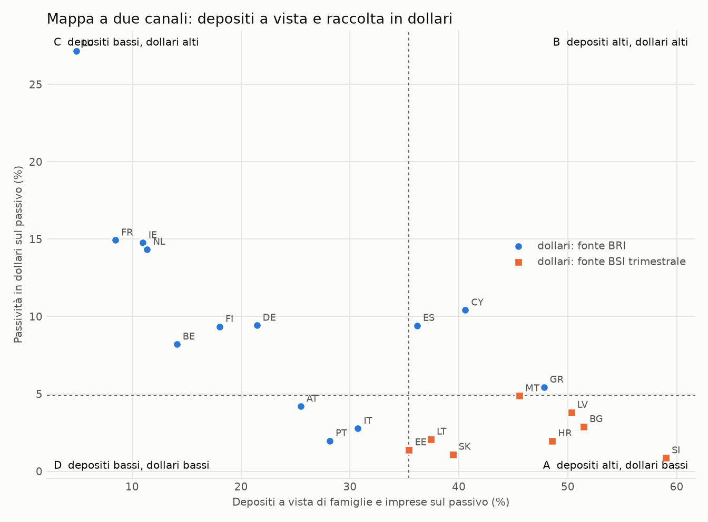

# 07 - Modulo 5: effetto sul credito e sulla trasmissione

Il modulo 5 di [SPEC.md](../SPEC.md) porta gli scenari del modulo 4 dai depositi al
credito, applicando i coefficienti del Working Paper BCE 3199, e colloca i paesi su una
mappa a due canali.

Le sezioni 1 e 2 sono state committate **prima** di calcolare i risultati. I
coefficienti della sezione 1 sono dati di ingresso, trascritti dal paper.

**Avvertenza che vale per tutto il documento**: sono coefficienti stimati su singole
banche, applicati qui ad aggregati nazionali. Danno ordini di grandezza, non previsioni.

## 1. Coefficienti del Working Paper BCE 3199, verificati sull'originale

Altavilla, Boucinha, Burlon, Adalid, Fortes, Maruhn, "Stablecoins and monetary policy
transmission", ECB Working Paper 3199, marzo 2026
([PDF](https://www.ecb.europa.eu/pub/pdf/scpwps/ecb.wp3199~ad552b59ec.en.pdf)). Letto
per intero; le tabelle 1 e 3 sono state controllate anche sull'immagine della pagina.
I numeri di pagina sono quelli stampati.

| N. | Coefficiente | Valore | Cosa misura esattamente | Origine |
|---|---|---|---|---|
| 1 | Regola depositi → prestiti | 100 mld € di depositi retail in meno → circa 50 mld € di prestiti in meno | Elasticità implicita nella stima su tutte le banche, che gli autori dichiarano in linea con la letteratura | Sezione 3.2, p. 18 |
| 1a | Stima da cui deriva | Un calo di una deviazione standard dei depositi a vista sul totale attivo (0,8 punti) riduce la crescita annua dei prestiti di circa 1 punto, cioè 0,4 punti del totale attivo | Stima su tutte le banche insieme, "non mostrata" in tabella | Sezione 3.2, p. 18 |
| 2a | Calo dei depositi a vista, banche a **bassa** quota retail | -0,441 (errore std. 0,306), non significativo; con controllo della domanda -0,342 (0,293) | Crescita cumulata dei prestiti al settore privato non finanziario tra t-1 e t+24, in punti, per un calo di una deviazione standard dei depositi a vista delle famiglie sul totale attivo | Tabella 1, colonne 3 e 4, p. 17 |
| 2b | Calo dei depositi a vista, banche ad **alta** quota retail | -3,089** (0,197); con controllo della domanda -4,173* (0,163) | Come sopra. Alta quota retail = sopra il 75° percentile del rapporto tra depositi delle famiglie e depositi di famiglie più intermediari non bancari | Tabella 1, colonne 3 e 4, p. 17 |
| 2c | Shock alle stablecoin | -2,633** (1,055); con controllo della domanda -2,230** (1,102) | Crescita cumulata dei prestiti a 24 mesi per uno shock di una deviazione standard all'esposizione alle stablecoin | Tabella 1, colonne 1 e 2, p. 17 |
| 3a | Risposta dei prestiti a +25 pb, **bassa** raccolta in dollari | -1,590** (0,617); con controllo della domanda -1,330** (0,596) | Crescita annua dei prestiti 24 mesi dopo, in punti, per banche con molta raccolta all'ingrosso e quota in dollari sotto il 75° percentile | Tabella 3, colonne 1 e 3, p. 28 |
| 3b | Risposta dei prestiti a +25 pb, **alta** raccolta in dollari | -0,064 (0,578); con controllo della domanda +0,293 (0,540): non significativi | Come sopra, quota in dollari sopra il 75° percentile | Tabella 3, colonne 2 e 4, p. 28 |
| 3c | Differenza tra 3a e 3b | F = 3,36* e 4,20** | Test di uguaglianza dei due coefficienti | Tabella 3, p. 28 |
| 4a | Trasmissione ai tassi sui prestiti, tutte le banche | circa 70% dopo un anno, circa 100% dopo due | Punti di tasso sui prestiti alle imprese per punto di tasso di policy | Sezione 4.2 e figura 9, pp. 22-23 |
| 4b | Trasmissione ai tassi sui prestiti, banche dipendenti dall'ingrosso | circa 80% dopo 12 mesi, circa 120% dopo due anni | Come sopra, banche nel quartile più basso del rapporto depositi retail su depositi totali | Sezione 4.2 e figura 9, pp. 22-23 |
| 4c | Trasmissione ai tassi sui depositi | circa 10% (tutte); oltre 30% dopo 18-24 mesi (dipendenti dall'ingrosso) | Punti di tasso sui depositi a vista retail per punto di tasso di policy | Sezione 4.2 e figura 9, p. 23 |
| 4d | Risposta dei prestiti a +25 pb | circa -0,3 punti (tutte); quasi -0,7 punti (dipendenti dall'ingrosso), con intervallo fino a -1,5 | Picco della crescita annua dei prestiti alle imprese, circa 12 mesi dopo | Sezione 4.2 e figura 9, p. 23 |

Due annotazioni sulla trascrizione:

- Nella tabella 1 gli errori standard dei coefficienti "alta quota retail" (0,197 e
  0,163) sono riportati come stampati. Con quei valori i coefficienti sarebbero
  significativi all'1%, mentre gli asterischi indicano 5% e 10%: una delle due
  indicazioni nel paper è probabilmente un refuso. Qui si usano le stime puntuali.
- I valori 4a-4d sono letti dal testo, che descrive la figura 9 con "circa": non
  esistono in tabella.

## 2. Metodo, fissato prima dei risultati

### 2.1 Dati aggiuntivi

Dal dataset BSI della BCE, per i 21 paesi, mensili: prestiti alle famiglie
(`A20`, settore 2250) e alle imprese non finanziarie (settore 2240); depositi degli
intermediari non bancari (settori 2210 e 2220), per la quota retail.

### 2.2 Dal deflusso ai prestiti

Per ogni paese e scenario il modulo 4 dà un deflusso di depositi. Tre varianti.

| Variante | Regola |
|---|---|
| **Uniforme** | Prestiti in meno = 0,5 × deflusso (coefficiente 1), uguale per tutti i paesi |
| **Intervallo** | Per ogni paese si calcola l'effetto con il coefficiente basso (2a) e con quello alto (2b) |
| **A soglia** | Coefficiente alto ai paesi sopra la soglia di quota retail, coefficiente basso agli altri |

Applicazione dei coefficienti 2a e 2b a un paese:

    calo dei prestiti (%) = coefficiente × (deflusso / totale del passivo, in punti) / 0,8
    prestiti in meno (mld €) = calo (%) × prestiti a famiglie e imprese

Lo 0,8 è la deviazione standard indicata dal paper per la stima su tutte le banche; si
assume che valga anche per la tabella 1, che usa la stessa variabile. Si usano le stime
della colonna 3 (-0,441 e -3,089); la colonna 4 è riportata come sensibilità.
L'effetto è cumulato su 24 mesi.

### 2.3 Soglia di quota retail

Il paper classifica "ad alta quota retail" le banche sopra il 75° percentile del
rapporto tra depositi delle famiglie e depositi di famiglie più intermediari non
bancari. La soglia per i paesi è definita allo stesso modo:

    quota retail = depositi delle famiglie / (depositi delle famiglie + depositi di
                   altri intermediari finanziari, assicurazioni e fondi pensione)

**Soglia: il 75° percentile di questa quota tra i 21 paesi, nell'ultimo mese.** I paesi
sopra ricevono il coefficiente alto. È una trasposizione: il percentile del paper è
calcolato tra banche e il suo valore non è pubblicato.

### 2.4 Mappa a due canali

- **Asse 1**: depositi a vista di famiglie e imprese sul totale del passivo (C1 del modulo 3).
- **Asse 2**: passività in dollari sul totale del passivo. Fonte: statistiche BRI per
  i 13 paesi che dichiarano. Per gli altri otto si provano, nell'ordine, i dati bancari
  consolidati della BCE e la scomposizione trimestrale per valuta del dataset BSI
  (depositi in dollari più titoli emessi in dollari). Dove esistono entrambe le fonti si
  confrontano, per capire se sono paragonabili; i paesi con la fonte alternativa sono
  marcati.
- **Soglie dei quadranti**: la mediana dei 21 paesi su ciascun asse.
- **Quadranti**: A = depositi alti e dollari bassi; B = depositi alti e dollari alti;
  C = depositi bassi e dollari alti; D = depositi bassi e dollari bassi.
- Per ogni quadrante si scrive cosa implicano i coefficienti 3 e 4 per la trasmissione.

### 2.5 Cosa non si fa

Non si stimano coefficienti propri, non si applica il coefficiente 2c (richiede lo
shock di attenzione definito dagli autori) e non si calcolano effetti sui tassi per
paese: i coefficienti 3 e 4 servono solo a qualificare i quadranti.

## 3. Risultati

Calcolato il 2026-11-25 sui bilanci di settembre 2026. Prestiti a famiglie e imprese
non finanziarie nei 21 paesi: 12.502 miliardi di euro, il 28% del passivo.

### 3.1 Soglia di quota retail

Il 75° percentile della quota retail tra i 21 paesi è **92,4%**. Sopra la soglia, e
quindi con il coefficiente alto nella variante a soglia: **Bulgaria, Lituania, Slovenia,
Slovacchia, Croazia**. La quota va dal 21% del Lussemburgo al 96% della Bulgaria; per
l'area nel suo insieme è 77%. Tabella in `data/processed/m5_retail_share.csv`.

### 3.2 Credito in meno, area euro

Ripartizione R1, effetto cumulato su 24 mesi.

| Scenario | Stablecoin detenute (mld $) | Deflusso (mld €) | Uniforme (mld €) | Intervallo basso - alto (mld €) | A soglia (mld €) | A soglia, % dei prestiti | Uniforme, % dei prestiti |
|---|---|---|---|---|---|---|---|
| Oggi, quota 7,5% | 18,3 | 16,1 | 8,1 | 2,8 - 19,3 | 3,6 | 0,03% | 0,06% |
| Oggi, quota 15% | 36,6 | 32,3 | 16,1 | 5,5 - 38,6 | 7,1 | 0,06% | 0,13% |
| ESM base 2030 | 143 | 125,9 | 63,0 | 21,5 - 150,8 | 27,7 | 0,22% | 0,50% |
| ESM alto 2030 | 300 | 264,2 | 132,1 | 45,2 - 316,3 | 58,2 | 0,47% | 1,06% |
| ESM alto 2030, quota 15% | 600 | 528,4 | 264,2 | 90,3 - 632,5 | 116,4 | 0,93% | 2,11% |

Come leggere le tre colonne:

- **Uniforme** è la regola del paper: 50 centesimi di prestiti per euro di depositi.
- **L'intervallo** applica a tutti i paesi prima il coefficiente delle banche a bassa
  quota retail, poi quello delle banche ad alta quota retail. È largo sette volte: per
  euro di deflusso si va da 17 centesimi a 1,20 euro di prestiti in meno. L'estremo alto
  supera il deflusso stesso, perché nel paper le banche ad alta quota retail reagiscono
  più che in proporzione.
- **A soglia** vale 22 centesimi per euro, meno della regola uniforme: il coefficiente
  alto si applica solo a cinque paesi piccoli, che insieme hanno il 2% dei prestiti.

Con le stime della colonna 4 della tabella 1 (controllo della domanda di credito) la
variante a soglia nello scenario ESM alto passa da 58,2 a 53,9 miliardi e l'intervallo
diventa 35,0 - 427,3.

### 3.3 Primi cinque paesi

Variante a soglia, ripartizione R1.

| Scenario | Primi cinque per miliardi di euro | Primi cinque per quota dei prestiti |
|---|---|---|
| ESM base 2030 | Germania 6,4; Spagna 3,8; Italia 3,5; Francia 2,2; Slovacchia 2,1 | Slovenia 3,5%; Bulgaria 3,1%; Croazia 2,9%; Slovacchia 2,3%; Lituania 2,2% |
| ESM alto 2030 | Germania 13,4; Spagna 7,9; Italia 7,3; Francia 4,6; Slovacchia 4,3 | Slovenia 7,4%; Bulgaria 6,4%; Croazia 6,1%; Slovacchia 4,9%; Lituania 4,7% |
| ESM alto 2030, quota 15% | Germania 26,9; Spagna 15,8; Italia 14,6; Francia 9,2; Slovacchia 8,7 | Slovenia 14,7%; Bulgaria 12,8%; Croazia 12,1%; Slovacchia 9,8%; Lituania 9,3% |

Il calcolo è lineare, quindi l'ordine non cambia tra scenari. Con la ripartizione pro
capite (R2) nello scenario ESM alto la variante a soglia dà 72,3 miliardi per l'area
(0,58% dei prestiti) e in testa per quota dei prestiti ci sono Bulgaria 14,4%,
Slovacchia 11,0%, Croazia 11,0%, Slovenia 10,0% e Lituania 7,5%.

### 3.4 Tutti i paesi, scenario ESM alto 2030

Ripartizione R1. (R) = sopra la soglia di quota retail.

| Paese | Deflusso (mld €) | Prestiti (mld €) | Uniforme (mld €) | Intervallo basso - alto (mld €) | A soglia (mld €) | A soglia, % dei prestiti |
|---|---|---|---|---|---|---|
| Slovenia (R) | 1,2 | 28 | 0,6 | 0,3 - 2,1 | 2,1 | 7,36% |
| Bulgaria (R) | 2,1 | 63 | 1,1 | 0,6 - 4,1 | 4,1 | 6,42% |
| Croazia (R) | 1,6 | 48 | 0,8 | 0,4 - 2,9 | 2,9 | 6,06% |
| Slovacchia (R) | 1,8 | 88 | 0,9 | 0,6 - 4,3 | 4,3 | 4,92% |
| Lituania (R) | 1,3 | 39 | 0,7 | 0,3 - 1,8 | 1,8 | 4,67% |
| Lettonia | 0,5 | 15 | 0,3 | 0,1 - 1,0 | 0,1 | 0,90% |
| Grecia | 5,6 | 123 | 2,8 | 1,0 - 7,3 | 1,0 | 0,85% |
| Malta | 0,7 | 18 | 0,4 | 0,1 - 1,0 | 0,1 | 0,81% |
| Cipro | 1,0 | 22 | 0,5 | 0,2 - 1,1 | 0,2 | 0,72% |
| Spagna | 40,5 | 1.224 | 20,3 | 7,9 - 55,2 | 7,9 | 0,64% |
| Estonia | 0,6 | 29 | 0,3 | 0,2 - 1,3 | 0,2 | 0,63% |
| Italia | 41,9 | 1.338 | 20,9 | 7,3 - 51,3 | 7,3 | 0,55% |
| Portogallo | 4,5 | 238 | 2,2 | 1,2 - 8,4 | 1,2 | 0,50% |
| Austria | 8,9 | 448 | 4,4 | 2,0 - 14,2 | 2,0 | 0,45% |
| Germania | 82,9 | 3.519 | 41,4 | 13,4 - 94,1 | 13,4 | 0,38% |
| Finlandia | 3,9 | 258 | 2,0 | 0,8 - 5,8 | 0,8 | 0,32% |
| Belgio | 6,8 | 484 | 3,4 | 1,2 - 8,5 | 1,2 | 0,25% |
| Paesi Bassi | 11,8 | 1.146 | 5,9 | 2,3 - 16,3 | 2,3 | 0,20% |
| Irlanda | 7,5 | 178 | 3,7 | 0,3 - 2,4 | 0,3 | 0,20% |
| Francia | 36,4 | 3.059 | 18,2 | 4,6 - 32,3 | 4,6 | 0,15% |
| Lussemburgo | 2,8 | 135 | 1,4 | 0,1 - 0,8 | 0,1 | 0,09% |

La soglia crea un salto: tra la Lituania (4,7%) e la Lettonia (0,9%) la quota retail
differisce di meno di quattro punti, ma il coefficiente applicato è sette volte più
basso. È un effetto della regola a due gruppi del paper, non una proprietà dei paesi:
la Grecia coincide con la soglia (92,4%) e la Lettonia è appena sotto (91,7%): vanno
lette come casi di confine.

### 3.5 Mappa a due canali



Mediane dei 21 paesi: depositi a vista 35,4% del passivo; passività in dollari 4,9%.
Tra parentesi i due valori; l'asterisco indica la fonte BSI trimestrale al posto della BRI.

| Quadrante | Paesi | Cosa implica per la trasmissione |
|---|---|---|
| **A** - depositi alti, dollari bassi | Slovenia (59%; 0,9%*), Bulgaria (51%; 2,9%*), Lettonia (50%; 3,8%*), Croazia (49%; 2,0%*), Malta (46%; 4,9%*), Slovacchia (39%; 1,1%*), Lituania (37%; 2,1%*) | Il canale è la sostituzione dei depositi. Sono i sistemi in cui un deflusso riduce di più il credito (coefficiente 2b) e in cui la raccolta dovrebbe spostarsi di più verso l'ingrosso. Dopo lo spostamento la trasmissione ai tassi sui prestiti diventerebbe più forte e più rapida (da circa 70% a 80% dopo un anno, da 100% a 120% dopo due) e quella ai tassi sui depositi salirebbe da circa 10% a oltre 30%; la risposta dei prestiti a 25 punti base passerebbe da circa -0,3 a quasi -0,7 punti, con molta più incertezza |
| **B** - entrambi alti | Grecia (48%; 5,4%), Cipro (41%; 10,4%), Spagna (36%; 9,4%) | Esposti su entrambi i canali: alla sostituzione dei depositi come il gruppo A, e a una raccolta in dollari già rilevante come il gruppo C |
| **C** - depositi bassi, dollari alti | Germania (21%; 9,4%), Finlandia (18%; 9,3%), Belgio (14%; 8,2%), Paesi Bassi (11%; 14,3%), Irlanda (11%; 14,8%), Francia (8%; 14,9%), Lussemburgo (5%; 27,2%) | Il canale è la raccolta in valuta. Poco esposti alla perdita di depositi a vista, ma già finanziati all'ingrosso e in dollari: per banche di questo tipo il paper trova che un aumento del tasso di policy non riduce i prestiti in modo significativo (+0,29 contro -1,33 delle banche con poca raccolta in dollari) e che la reazione alla politica monetaria statunitense è più forte. Qui il rischio è la perdita di presa della politica monetaria interna |
| **D** - entrambi bassi | Estonia (35%; 1,4%*), Italia (31%; 2,8%), Portogallo (28%; 2,0%), Austria (25%; 4,2%) | I meno esposti su entrambi i canali. L'Estonia è esattamente sulla mediana dei depositi a vista |

I due assi sono correlati negativamente (correlazione di rango -0,67): chi è esposto su
un canale tende a non esserlo sull'altro. Il quadrante B è il meno popolato.

### 3.6 Gli otto paesi senza dati BRI

- **Dati bancari consolidati della BCE (CBD2)**: provati, non servono. Il dataset ha una
  dimensione di valuta, ma contiene solo il totale: nessuna scomposizione per valuta
  delle passività.
- **BSI trimestrale per valuta**: funziona. Dà i depositi in dollari di residenti
  dell'area euro per tutti i 21 paesi, e quelli di non residenti e i titoli emessi in
  dollari per la maggior parte. Per gli otto paesi è la fonte dell'asse 2.

Le due fonti sono paragonabili solo in parte. Nei sei paesi che hanno sia la BRI sia
tutte le componenti BSI, la misura BSI è in mediana il 79% di quella BRI e la
correlazione di rango è 0,77. I valori degli otto paesi sono quindi probabilmente un po'
sottostimati. Riportandoli alla scala BRI con quel rapporto, due paesi cambiano
quadrante: Malta passa da A a B e la Grecia da B ad A. Gli altri 19 restano dove sono.

### 3.7 Criteri di completamento di SPEC

| Criterio | Stato |
|---|---|
| (a) Coefficienti in tabella con origine, verificati sul PDF | Fatto: sezione 1 |
| (b) Soglie e regole scritte prima dei risultati | Fatto: sezione 2, committata prima |
| (c) Prestiti in meno con intervallo, variante a soglia e variante uniforme | Fatto: sezioni 3.2-3.4 e `m5_credit_by_country.csv` |
| (d) Mappa a due canali per i 21 paesi | Fatto: 13 con dati BRI, 8 con dati BSI trimestrali, marcati |

## 4. Limiti

- **Coefficienti di banca applicati a paesi.** Il paper stima la risposta di singole
  banche, classificate rispetto alle altre banche. Qui ogni paese è trattato come una
  banca sola. Dentro ogni paese convivono banche dei due tipi.
- **La soglia è una trasposizione.** Il 75° percentile tra paesi non è il 75° percentile
  tra banche, il cui valore non è pubblicato. Cinque paesi su 21 ricevono il
  coefficiente alto per costruzione.
- **Il coefficiente basso non è statisticamente diverso da zero** nel paper. L'estremo
  inferiore dell'intervallo potrebbe essere zero.
- **Il coefficiente alto implica più di un euro di prestiti per euro di depositi.** È
  ciò che la stima dà per le banche ad alta quota retail, ma applicarlo a un intero
  paese è l'estrapolazione più forte di questo documento.
- **La deviazione standard di 0,8 punti** è indicata dal paper per la stima su tutte le
  banche; si assume che valga per la tabella 1.
- **Nessuna dinamica.** L'effetto è cumulato a 24 mesi e non tiene conto di reazioni di
  politica monetaria, di domanda di credito o di ricomposizione dell'attivo.
- **Asse dei dollari con due fonti** non perfettamente paragonabili (sezione 3.6).
- **I coefficienti 3 e 4 qualificano i quadranti, non danno numeri per paese.**

## 5. Cosa non è stato possibile fare

- **Usare la soglia vera del paper**: il valore del 75° percentile tra banche non è pubblicato.
- **Applicare il coefficiente dello shock alle stablecoin (2c)**: richiede la serie di
  attenzione costruita dagli autori su dati riservati.
- **Avere per gli otto paesi una misura delle passività in dollari identica a quella BRI.**
- **Stimare l'effetto sui tassi per paese**: i valori 4a-4d sono descritti nel testo, non
  tabulati, e riguardano gruppi di banche.

## 6. Come si usa

```bash
.venv/bin/python src/module5_credit.py            # scarica le serie aggiuntive e ricalcola
.venv/bin/python src/module5_credit.py --offline
```

| File | Contenuto |
|---|---|
| `data/processed/m5_credit_by_country.csv` | Credito in meno per scenario, regola di ripartizione e paese |
| `data/processed/m5_credit_euro_area.csv` | Totali dell'area euro |
| `data/processed/m5_two_channel_map.csv` | Coordinate, fonte e quadrante di ogni paese |
| `data/processed/m5_retail_share.csv` | Quota retail e prestiti per paese |

---

**Cosa aggiunge questo al programma finale**: il passaggio dai depositi al credito. Per
ogni scenario e paese il programma dice ora quanti prestiti in meno, con un intervallo
dichiarato (nello scenario ESM alto: 132 miliardi con la regola uniforme, 58 con la
soglia, tra 45 e 316 agli estremi); e una mappa che separa i paesi esposti alla perdita
di depositi da quelli in cui il rischio è la perdita di presa della politica monetaria.
